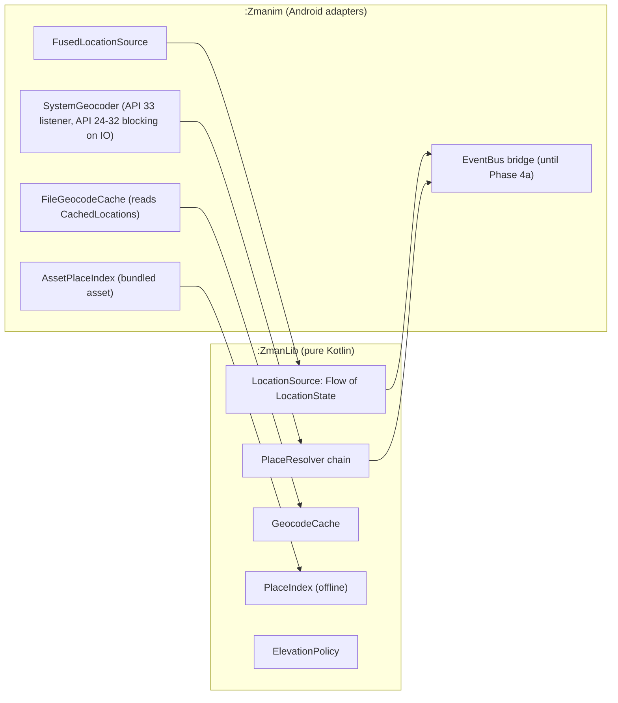

# Phase 2: Modern Location Architecture & Offline Resilience

**Date:** 2026-10-28
**Status:** Decisions D1 to D6 answered by the maintainer on 2026-10-28 (Section 8); awaiting final approval of the document. No Phase 2 code has been written. Where the text says "proposed", it is the author's call with the reason given.
**Scope:** `:ZmanLib` (new `location` domain code), `:Zmanim` (adapters and the replacement of the current acquirer/resolver classes). `:ZehutYosef` does not use location and is untouched.
**Depends on:** Phase 1 (complete on `main`; the human-only signing steps do not block this phase).
**Estimated effort:** 2 to 3 weeks (the roadmap's figure; the plan in `phase-2-implementation.md` is sized to match).

---

## 1. Intent

Zmanim is only useful if the app knows where the user is, and every number it shows depends on three inputs: latitude, longitude and, optionally, elevation. Today those inputs are obtained by code that predates coroutines, runs blocking network calls, and gives up (leaving an unnamed, sea-level location) whenever the device cannot reach a geocoding service.

This phase makes location resolution work in the conditions where a zmanim app is most needed: on a phone with a weak or absent connection, for a place the user types in, in a city the system geocoder does not know. It also moves the logic into small Kotlin interfaces so that Phase 4a (Compose, `StateFlow`), Phase 5 (Wear OS, which needs location caching while disconnected from the phone) and Phase 6 (iOS) can reuse it without another rewrite.

## 2. Current state (verified against `main` on 2026-10-28)

| Piece | What exists | Consequence |
|---|---|---|
| Device location | `DynamicLocationAcquirer` already uses `FusedLocationProviderClient` (last-known if under 30 minutes old, else a one-shot high-accuracy request delivered by `PendingIntent` to `ZmanimLocationAcquiredService`). It requires `ACCESS_FINE_LOCATION`; a coarse-only grant reports `NO_PERMISSIONS`. | Phase 2.1 is a change of shape (callbacks and events to a `Flow`), not a new capability. Android 12+ lets users grant approximate location only; the app treats that as a refusal. |
| Name and place lookup | `LocationToAddressConverter` (a `JobIntentService`) runs a chain: `CachedLocationResolver`, then `AndroidResolver` (the system `Geocoder`, blocking `getFromLocation` / `getFromLocationName`), then `PassthroughResolver`. | No network fallback, no offline fallback. A failed lookup ends in `PassthroughResolver`, which returns the bare coordinates with an "unknown location" name. |
| Cache | `CachedLocations`, a file written with `DataOutputStream` by `ZmanimLocation.save/load` and held in an LRU. A resolved entry matches a request when the user's typed name equals the stored original name, or when the coordinates are within 1 km and 5 m of elevation. | Any new cache must still read this file on upgrade (the same constraint the Phase 1 upgrade tests protect for other saved state). |
| Elevation | `ZmanimLocation.elevation` is filled from the GPS fix's altitude and is 0 for a place the user typed. The `USE_ELEVATION` preference makes `ZmanimFactory` apply it. | A user who turns on elevation and picks a place by name gets sea-level times. GPS altitude is also not guaranteed to be sea-level altitude (see 5.5). |
| Dead code | `JsonQueryingResolver` was an abstract class with no subclasses; removed in its own PR (#42). | Nothing to carry forward. |
| Wiring | The pieces talk through the legacy `EventBus` (`RequestLocationUpdateEvent`, `LocationAcquiredEvent`, `LocationError`). | Phase 4a deletes the event bus. Phase 2 must not deepen the dependency on it. |
| Manifest | `ACCESS_COARSE_LOCATION`, `ACCESS_FINE_LOCATION`, `ACCESS_BACKGROUND_LOCATION`, `INTERNET`. | Background location is required (the periodic alarm check runs in the background and needs the location, D6); Task 7 records each use for the Play declaration. |

## 3. Goals

1. **A named, correct location from every input, offline or online.** From GPS, from coordinates, and from a typed name, with a fallback order that always ends in the best answer available rather than an unnamed one.
2. **Location as a `Flow`.** A cold `Flow` of location states, so callers can collect it from a coroutine and Phase 4a can turn it into `StateFlow` without adapters.
3. **No blocking calls on the main thread or in a `JobIntentService`.** Geocoding is `suspend` and cancellable.
4. **An elevation the user can trust.** Documented source and datum, available for typed places, applied only when the user enabled elevation.
5. **Saved data keeps working.** `CachedLocations`, the saved current location and the location preferences load unchanged after the upgrade.
6. **Testable without a phone.** The domain logic runs in JVM tests with fakes; offline behavior is also proven once on an emulator with the network off.

## 4. Non-goals and anti-goals

**Non-goals:** any UI change except one warning message for an approximate-only location grant (D3). The screens are replaced in Phase 4a, so Phase 2 changes no layout and no existing golden screenshot (the warning state gets a new golden of its own); dependency injection (4a); telemetry (4a); a map or place-picker UI; background tracking or continuous location; a Kotlin Multiplatform extraction of the location code (Phase 6 decides that, once the calculation engine question is settled); converting existing Java files that this phase does not need to replace.

**Anti-goals (failures even if the tests pass):**
- Sending the user's coordinates to any service the app does not already use (D4: no new third party is added in this phase).
- Making the network a point of failure: online lookups go through the system geocoder only, always behind a timeout, and the offline index answers when it fails.
- Labeling Israeli cities with a country other than Israel in the bundled data (D2).
- Making zmanim for a known place less accurate than today, for example by replacing a precise GPS fix with a nearby city's coordinates. The offline city dataset is used to *name* a fix and to *resolve a typed name*, never to move one.
- An upgrade that wipes the user's saved location or cache.

## 5. Proposed design

### 5.1 Layering

New pure-Kotlin code in `:ZmanLib` under `com.gindin.zmanlib.location` (JVM and Android only, as `:ZmanLib` is today; it already holds `ZmanimLocation`). It defines interfaces and the decision logic and depends on `kotlinx-coroutines-core` only. Android implementations live in `:Zmanim` as new Kotlin files. The existing Java classes keep their public behavior while being thinned out, and are deleted only when Phase 4a rewrites their callers.

### 5.2 Resolution order

For a **typed name**: cache, then system geocoder, then the offline index (match on name), then fail with a specific error (not an unnamed location).
For **coordinates** (GPS or typed lat/long): cache, then system geocoder, then the offline index (nearest place by great-circle distance, used only for the name and time zone, never to change the coordinates), then the bare coordinates with a "near &lt;nearest city&gt;" or coordinate-based name.

The order puts the free, private, fast sources first and the system geocoder (the app's only online lookup) after them, so it is called only for places not already known.

### 5.3 Location as a Flow

`LocationSource.locations(request): Flow<LocationState>`, where `LocationState` is a sealed type: `Resolving(coordinates)`, `Resolved(ZmanimLocation)`, `Unavailable(reason, lastKnown)`. Reasons replace the current `LocationError.Code` set: no permission, approximate-only permission, location services off (carrying the resolvable settings exception the UI needs), no Play Services, timeout. The Fused adapter uses `callbackFlow` over `requestLocationUpdates`, cancels on collector cancellation, and emits the cached location first when it is recent. Approximate-only permission is accepted (D3), and a non-blocking warning tells the user the times may be a few seconds off; it is raised through the app's existing message-display mechanism (`messageDisplay`; Task 6 confirms the right hook) and only in that case. A bridge class keeps the current event-bus contract so no screen changes until Phase 4a.

### 5.4 Online lookup: the system geocoder only

The app's online lookup is the system `Geocoder`, which on Play devices is backed by Google, and the maintainer confirmed (D4) that its use is already disclosed. This phase therefore adds **no** second online service: a public geocoder such as Nominatim would be a new third party receiving coordinates, with usage limits (about one request per second for the whole app) and no service guarantee, in exchange for covering only devices where the system geocoder is missing while Play services (required for location anyway) are present, which is rare. The offline index covers the failure case that matters (no connectivity). If a real gap shows up later, the `PlaceResolver` interface lets a provider be added without touching callers.

Work in this phase: make the system geocoder call asynchronous and cancellable (API 33 `GeocodeListener`; blocking overload on an IO dispatcher for API 24 to 32), with a timeout.

### 5.5 Elevation

`ElevationPolicy` decides the elevation stored on a `ZmanimLocation`, in this order (the datum is height above mean sea level, D5): (1) the device's altitude **above mean sea level** when the fix provides it (`Location.getMslAltitudeMeters()` on API 34+); (2) on older devices, the fix's ellipsoid altitude corrected by a coarse geoid model if the spike in Task 5 shows that is accurate enough, otherwise omitted; (3) the bundled dataset's elevation for the matched place (for typed places): GeoNames carries an `elevation` column (meters, frequently empty) and a `dem` column (the elevation of the roughly 90 m SRTM terrain cell at the place, generally filled in; to be confirmed against the actual file in Task 3), so the policy prefers `elevation` and falls back to `dem`; this is a point value for the city, not for the user's street; (4) 0, meaning unknown, as today. No online elevation service in this phase.

Why this matters: `Location.getAltitude()` is documented as height above the WGS 84 ellipsoid, which differs from height above sea level by tens of meters in many places. The zmanim engine expects elevation above sea level. This is to be confirmed against the current Android documentation in Task 5 before it is relied on.

### 5.6 Offline place index

A compact read-only asset generated at build time from public data, loaded into memory on first use (about 25,000 places is a few megabytes at most, and a linear nearest-neighbor scan over that many points takes milliseconds, so no database or spatial index is needed). Each record carries name, country, latitude, longitude, elevation, time zone id and a flag for Jewish-community entries. Source (D2 accepted): GeoNames `cities15000` (about 25,000 places with population over 15,000 and all capitals; license CC BY 4.0, so the About screen needs an attribution line; the license version and the elevation/DEM columns to be confirmed against the current download). Jewish-community coverage beyond large cities needs a list the maintainer curates.

**Israeli places are shown as being in Israel.** GeoNames assigns some places to the Palestinian Territory (`PS`). The generator therefore does not trust the source's country field for display: it takes the country from the source for everywhere else, applies a maintainer-owned override file (`place-overrides.tsv`, GeoNames id and country code) for places that must be shown as Israel, and fails the build if any record in the override file would still display "Palestine" or "Palestinian Territory". The generator also prints the list of source records tagged `PS` so the maintainer can review which belong in the override file; the author does not decide that list. A test asserts a set of well-known Israeli cities (for example Jerusalem, Tel Aviv, Haifa, Be'er Sheva, Eilat) are "Israel" in the generated asset. Names produced by the system geocoder come from the OS or Google and are outside this project's control; the rule applies to the bundled data.

### 5.7 Cache

A small file-backed cache with an explicit version header. The first read of an upgraded install uses the legacy `CachedLocations` reader (kept, with a fixture-based test generated by running the shipped code, as in Phase 1); later writes use the new format. A database is not proposed: the cache holds tens of entries.

## 6. Approaches considered

| | A. Roadmap-literal | B. Lean interfaces, no database (**chosen**) | C. Defer to Phase 4a |
|---|---|---|---|
| What | SQLDelight (or Room) for cache and a bundled city database; Flow; HTTP fallback; elevation API | The same behavior, behind small interfaces; file cache with versioned format; in-memory index from a bundled asset | Do nothing now; build it inside the Compose rewrite |
| Cost | Highest: database dependency, schema migrations, R8 and KMP-driver decisions, pre-built database generation | Moderate: no new persistence technology; one build-time data generator | Lowest now |
| Risk | More moving parts for a cache of tens of entries and a read-only lookup table | Hand-written cache and nearest search need good tests (they are small) | Offline failures persist through the 6 to 8 weeks of Phase 4a; 4a mixes UI and location work |
| Why not | Complexity does not buy anything at this data size | | Phase 4a "depends on Phase 2 only", and bundling both removes the safety of landing location changes under unchanged screens |

B is the chosen approach (D1: the flat file has worked well, and the database is deferred). If the maintainer wants a database anyway (for example to share it with the Wear app in Phase 5), the interfaces in 5.1 mean it can be added behind `GeocodeCache` and `PlaceIndex` without touching callers.

## 7. Constraints

- Saved-state compatibility is a hard requirement (Goal 5); upgrade tests are written before the code that must preserve them.
- `:ZmanLib` and `:ZmanUtils` Java-visible API must not change without fixing Java callers; new Kotlin APIs are designed for Kotlin callers first.
- R8: every class reached by name (serialization, reflection) is added to `r8-kept-names.txt` with its rule; the `checkR8KeptNames` task and the minified emulator job must stay green.
- Quality gates: `ktfmtCheck`, `detekt` (no baseline), `verifyRoborazziDebug` with no golden change (a golden change means a UI change, which is out of scope).
- Single purpose per commit and per PR (see `AGENTS.md`): data generation, interfaces, adapters and wiring are separate PRs.
- minSdk 24: the API 33 `GeocodeListener` path needs an API 24 to 32 branch.

## 8. Decisions (answered by the maintainer, 2026-10-28)

| | Decision | Effect on the design |
|---|---|---|
| D1 | Approach B. Defer the database; a flat file has worked well. | Sections 5.7, 6. |
| D2 | GeoNames `cities15000` is acceptable. Israeli cities must be shown as being in **Israel**, not "Palestine". | Section 5.6: override file, build-time check, test. The list of places that need the override is the maintainer's to approve. |
| D3 | Accept an approximate-only grant, and **warn** the user. | Section 5.3, Task 6. One new warning state; no existing golden changes. |
| D4 | The app already does an online lookup through the system geocoder (disclosed); do not add Nominatim. | Section 5.4: no second online service, no privacy-policy or Data Safety change for this phase. |
| D5 | Elevation is height above sea level. Question asked: does the GeoNames data have elevation? Answer in 5.5: yes, an `elevation` column (often empty) and a `dem` column (terrain-cell elevation), to be confirmed on the real file. | Section 5.5, Task 3 and Task 5. |
| D6 | Background location is required: the periodic alarm check runs in the background and needs the location. | `ACCESS_BACKGROUND_LOCATION` stays. Task 7 documents the use for the Play declaration and verifies the background path under an approximate-only grant. |

## 9. Success criteria

- With the network off, a typed city from the bundled set resolves to a named location with a time zone and elevation; coordinates get a "near X" name; neither produces an unnamed location. Proven by JVM tests and once on an emulator in airplane mode.
- An upgrade from the released builds keeps the saved location and cache (fixture tests pass on the minified `releaseCheck` build).
- Location arrives as a `Flow`; no `Geocoder` call runs on the main thread.
- No golden screenshot changes; `./gradlew ktfmtCheck detekt test verifyRoborazziDebug assembleDebug checkR8KeptNames` is green; both emulator CI jobs pass.
- Release APK size grows by no more than the dataset's budget (proposed: 3 MB).
- No new data sharing is introduced (no new third party), so no privacy-policy or Data Safety change is needed.
- Well-known Israeli cities in the bundled data are "Israel"; the generator fails if an override-listed place would display "Palestine" or "Palestinian Territory".
- An approximate-only grant shows the warning, and the alarm check still works in the background under that grant.

## 10. Risks

| Risk | Mitigation |
|---|---|
| System geocoder unavailable or slow | Timeout, then the offline index; results are cached |
| Country shown wrongly for disputed places in the bundled data | Maintainer-owned override file, build-time check, test (Section 5.6) |
| Dataset license or attribution mistake | Attribution on the About screen; license text bundled; checked in Task 3 |
| Elevation datum wrong | Datum documented, tested against known points (for example, cities with well-known elevations), uncertain cases fall back to dataset elevation |
| Regressions in the one-shot location flow | Characterization tests first (Task 1), event-bus bridge keeps the contract, emulator tests with injected mock locations |
| Scope creep into UI or DI | Non-goals above; Roborazzi goldens unchanged is a hard gate |
