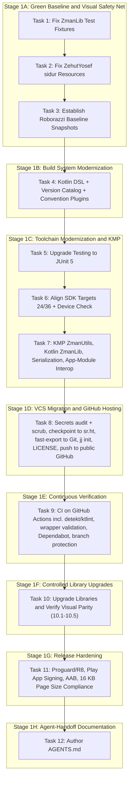

# Phase 1: Foundation Modernization, VCS Migration to Jujutsu (jj) + GitHub, and Visual Safety Net Implementation Plan

> **For agentic workers:** REQUIRED SUB-SKILL: Use superpowers:subagent-driven-development to implement this plan task-by-task. Steps use checkbox (`- [ ]`) syntax for tracking. **Do not skip ahead**: each task's final verification step is a hard gate — if it fails, stop and fix before starting the next task. Where a step's exact command-line syntax depends on the installed version of a tool (`jj`, `hg-fast-export`), a `--help` confirmation sub-step is included before the step that uses it; run that confirmation and adjust the literal command if this machine's version differs from what's shown.

**Revision history:**
- **2026-09-14 (first pass):** real tool paths substituted for placeholders (Task 7→8), a hosting move to GitHub added with a new CI task immediately after it, library modernization split into five sub-tasks, a real-device check added to the SDK-alignment task, the `EventBus` port explicitly framed as a stepping stone, `UT_TalitTimes.java` added to Task 1's file manifest, Task 3's stated goal corrected.
- **2026-09-14 (second pass):** SDK target corrected to **API 36** (Google Play's compliance requirement effective August 31, 2026 — the previous API 35 target was already out of date). New Task 4 inserted: convert all build scripts to Kotlin DSL and adopt a Gradle version catalog, before any further build-file edits. KMP task expanded: `:ZmanLib` converts to Kotlin alongside `:ZmanUtils` (staying JVM/Android-only — see the master roadmap's Phase 6.1 for the multiplatform follow-up), `explicitApiMode` applied to both, `kotlinx.serialization`/`kotlinx-datetime` replace remaining `org.json`/JVM-date usage. CI task gains `detekt`/`ktlint`. R8/AAB task gains a 16 KB page size compliance check. GitHub destination confirmed as `github.com/jgindin/zmanim`. Phase 1 is now 11 tasks (was 9, then 10).
- **2026-09-15 (third pass):** repo visibility confirmed **public** — Task 8 gains a mandatory secrets audit and history-scrub gate before the first push (a real signing keystore and API key files were found sitting in `common/`, dated 2012–2015; their Mercurial history hasn't been checked yet and must be before anything is pushed publicly), and a top-level `LICENSE` (Apache-2.0). Task 8's `gh repo create` corrected from `--private` to `--public` to match. Task 9 gains Gradle Wrapper Validation, a `dependabot.yml` for the version catalog, and branch protection tied to CI. Task 11 gains a step migrating release signing to Google Play App Signing so the keystore no longer needs to live in the repo at all. New **Task 12** authors a repo-root `AGENTS.md` so later phases can actually be handed to agents the way Task 4's history preservation below and everything else in this phase assumes. Task 4's Step 6 corrected to use `hg move --after` instead of `hg rm` + `hg add`, so the Groovy→Kotlin DSL conversion preserves file history instead of making every build script look newly created. Phase 1 is now 12 tasks.
- **2026-09-15 (fourth pass):** Task 8's Step 4 corrected — its original commands were all `git log`/`git filter-repo`, which only work once Step 2's `hg-fast-export` has created a local git conversion; as written it couldn't actually be run as a standalone pre-check the way the surrounding text implied. Step 4 now leads with an `hg`-native audit (`hg log` templates across all revisions, `hg log --follow`/`hg cat` on the specific candidate paths) that only needs Mercurial and can be run today, before Task 8 otherwise begins; the `git`-based sweep is kept as a secondary cross-check that naturally runs after Step 2 within Task 8's own sequence.
- **2026-09-15 (fifth pass):** the `hg`-native audit from the fourth pass has actually been run against the real repository, and Step 4 is rewritten from an open-ended "go find out" into the confirmed findings plus a bounded fix. Result: `common/jay-gindin-android-apps.keystore`, `common/ProjectApiKey.txt`, and `common/MapQuest.properties.orig` were **never** committed to Mercurial under any path, across the full 1356+-revision history — nothing to scrub, and the original "treat as compromised, hard blocker" framing for these three no longer applies. Two different files **were** found in history: `common/AcraApiKey.properties` (2016, self-hosted tool, long unused) and `thirdparty/flurry/ProjectApiKey.txt` (Flurry Analytics, shut down March 2024) — both low current risk since neither service is live, but both get folded into the same `git-filter-repo` pass since it costs nothing extra. Step 4 now ends with an explicit re-sweep (Step 4b) immediately before the push, since this plan's findings are a snapshot and the working tree could change before Task 8 actually executes.
- **2026-09-16 (sixth pass) — adversarial review, 7 blocking + 6 non-blocking fixes applied:** an independent adversarial pass against the live repository found real defects, not style issues. **Task 2's Steps 2/3** were rewritten from "Create [file]: [3-line snippet]" to explicit "insert into the existing file" instructions — the real `strings.xml` has 33 in-use entries and the real `styles.xml` defines the module's base `AppTheme`; executed literally as written, both steps would have deleted them. **Task 1's file list** was corrected after grepping the actual test sources: 4 of the original 8 files (`UT_TalitTimes.java`, all three `UT_WakeupScheduler_*.java`) contain zero occurrences of the `GR'A Kol Eliyahu` string the task is built around removing — they're now called out explicitly as unconfirmed, with Step 1 rewritten to diagnose actual failures rather than blindly apply Step 3's fix everywhere. **Task 8's Step 7 push command had invalid git syntax** (`git push <remote> <branch> --all`, which git rejects outright) on the single most irreversible step in the plan — fixed. **Task 8** also gained an unresolved branch/bookmark identity problem (the Mercurial named branch is `default`, not `zmanim-v4`; `zmanim-v4` is one of seven bookmarks; nothing verified `hg-fast-export`'s output branch actually corresponds to the right commit) and a licensing conflict (the repo already has `LICENSE.md` declaring LGPL-2.1; the plan's Apache-2.0 `LICENSE` addition was decided without knowing this and now needs Jay's explicit confirmation, not a mechanical file-add) — both are now flagged as requiring a human decision before Task 8 proceeds. **`master-roadmap.md` was stale** (still said "11 tasks," no mention of Task 12 or the third-pass additions) and has been updated to match. Non-blocking fixes: Task 4 was missing two real Groovy build files (`common/gindin-android.gradle`, `common/gindin-versioning.gradle`, the latter containing a non-mechanical APK-renaming closure); Task 5's scope was ambiguous about which modules' test files actually migrate to Jupiter (now explicit: `:ZmanUtils`/`:ZmanLib` only, `:Android`/`:ZehutYosef` stay on JUnit4 via the vintage engine); Task 3's reference-photo set doesn't 1:1 match its planned snapshots (now noted as expected, not a gap to close); three Play Console-dependent steps (Task 6 Steps 1–2, Task 11 Step 2) are now explicitly flagged as requiring human hand-off, which an autonomous agent cannot do itself; Task 9's `gh api` branch-protection call switched from a `--field`-based encoding with documented reliability problems to an explicit JSON `--input` payload; Task 8's secrets-scrub step now clarifies it rewrites history only, not the current working-tree `AcraApiKey.properties` symlink.

**Goal:** Establish an immediate Roborazzi screen snapshot safety net from the untouched app baseline, stabilize tests and compilation in Mercurial, convert all build scripts to Kotlin DSL with a version catalog (preserving file history via `hg move`), upgrade the testing framework to JUnit 5, align Android SDK targets to 24/36 (with real-device verification and current Play compliance), migrate `:ZmanUtils` and `:ZmanLib` to idiomatic Kotlin (dropping custom `Pair`, adopting `kotlinx.serialization`/`kotlinx-datetime`), enable Kotlin interop in the app modules, audit and scrub secrets before migrating version control from Mercurial to Jujutsu (`jj`) and hosting to a **public** GitHub repo, stand up CI with static analysis and dependency-update automation, comprehensively modernize Android libraries as independently-verified sub-tasks, fully enable Proguard / R8 minification with a 16 KB page size compliance check and a move to Play App Signing, and close the phase by documenting the result in an `AGENTS.md` so subsequent phases can be executed by agents with the context this one required a live conversation to establish.

**Architecture:** Eight disciplined stages. First, fix test fixtures in `:ZmanLib` and missing resources in `:ZehutYosef:sidur`, immediately followed by establishing Roborazzi screen snapshot testing so the **original untouched visual baseline** is captured to protect all subsequent work. Second, convert every build script to Kotlin DSL with a version catalog, preserving each file's Mercurial history via `hg move --after` rather than a delete-and-recreate — done once, early, so every later build-file edit in this phase is already in the target format. Third, upgrade tests to JUnit 5, align SDK baselines to 24/36 (verified on both Roborazzi and a real device/emulator), and convert `:ZmanUtils` and `:ZmanLib` to idiomatic Kotlin while enabling Kotlin interop in the app modules. Fourth, audit the full history for secrets before it becomes public, convert repository history to Git, initialize colocated Jujutsu (`jj`), and move canonical hosting to a public GitHub repo with a top-level `LICENSE`. Fifth, stand up CI on GitHub Actions — tests, static analysis, wrapper validation, dependency-update automation, and visual/behavioral verification, with branch protection requiring it to pass — so every subsequent change is automatically checked. Sixth, upgrade Material Components, ConstraintLayout, and AndroidX Preference, and replace obsolete MikePenz libraries with standard Android components, as five separately-committed, separately-verified sub-tasks. Seventh, enable R8 minification, migrate release signing to Play App Signing, and verify release-readiness including 16 KB page size compliance. Eighth, author `AGENTS.md` documenting the now-modernized structure so later phases can be handed off cleanly.

**Architecture Diagram:**



**Tech Stack:**
- Android Gradle Plugin (AGP) 9.4.0 / Gradle 9.6.0
- Java 21 / 25 Toolchains
- Kotlin 2.1.0 / Kotlin Multiplatform (KMP), all build scripts as Kotlin DSL with a `gradle/libs.versions.toml` version catalog and a `build-logic` convention-plugin build
- Jujutsu (`jj`) — installed at `~/.local/bin/jj`; confirm exact version with `jj --version` before Task 8
- Mercurial (`hg`) — installed at `/usr/bin/hg`
- `hg-fast-export` — checked out at `~/src/fast-export`; confirm invocation with `~/src/fast-export/hg-fast-export.sh --help` before Task 8
- GitHub — canonical hosting at **github.com/jgindin/zmanim** (**public**), effective Task 8
- `git-filter-repo` — for scrubbing any secrets found in the pre-push history audit (Task 8); confirm it's installed or install it before that task, it isn't part of the currently-confirmed toolchain
- JUnit 5 (Jupiter 5.11+), `kotlin-test` in KMP `commonTest`
- `detekt` + `ktlint` for static analysis (Task 9, CI-enforced)
- `gradle/actions/wrapper-validation@v6`, `.github/dependabot.yml` for the version catalog, and branch protection requiring CI to pass before merge (Task 9)
- Roborazzi 1.40+ / Robolectric Native Graphics (host-JVM layer), plus a targeted real-device/emulator smoke layer (Task 6, Task 9's CI matrix)
- AndroidX AppCompat 1.7.0, Material Components 1.12.0, ConstraintLayout 2.2.0, Preference 1.2.1, Play Services Location 21.3.0
- `com.kosherjava:zmanim:2.5.0` (JVM-only; see Task 7's scope note and the master roadmap's Phase 6.1 for the multiplatform follow-up)
- `kotlinx.serialization`, `kotlinx-datetime` for shared KMP code
- Google Play App Signing for release signing (Task 11) — replaces the keystore file previously checked into `common/`
- Apache License 2.0 as the repository's top-level `LICENSE` (Task 8) — a normal dependency relationship with the LGPL-2.1 `kosherjava`/KosherKotlin library (not vendoring or embedding its source) is standard practice under both licenses, but this isn't legal advice; confirm with counsel before Phase 6 if `KosherKotlin` ends up vendored rather than pulled as a binary dependency

**Spec:** [`docs/plans/specs/2026-09-07-phase-1-foundation-modernization-design.md`](file:///home/jgindin/src/gindin/zmanim/zmanim/docs/plans/specs/2026-09-07-phase-1-foundation-modernization-design.md)

## Global Constraints
- Target SDK / Compile SDK: **36** (Android 16) — corrected from an earlier API 35 target to match Google Play's compliance requirement effective August 31, 2026
- Min SDK: 24 for all Android modules (`Android`, `ZehutYosef`) — confirm against current Play Console install-base distribution before changing (Task 6, Step 1)
- Java Version: 21 for Android modules, 21/25 for JVM/KMP modules
- All build scripts are Kotlin DSL (`.gradle.kts`); all dependency versions live in `gradle/libs.versions.toml`
- No custom `Pair` class: use standard `kotlin.Pair` everywhere
- All new/migrated code must be idiomatic Kotlin; `:ZmanUtils` and `:ZmanLib` apply `explicitApiMode`
- `:Android` and `:ZehutYosef` remain Java modules through the end of Phase 1 except for the interop plugin added in Task 7 — do not mass-convert their existing `.java` files in this phase; that happens screen-by-screen in Phase 4a/4b alongside each Compose rewrite
- `:ZmanLib` converts to Kotlin in this phase but stays JVM/Android-only — do not attempt to add an iOS target to it in Phase 1; that depends on the KosherKotlin spike scoped for the start of Phase 6
- The Kotlin port of `EventBus`/MVP in Task 7 is a deliberately mechanical stepping stone — Phase 4a deletes this pattern outright when DI lands. Do not invest effort improving its design.
- No Android emulator required for Tasks 1–5 and 7–11: screenshot tests run on host JVM via Roborazzi + Robolectric Native Graphics. Task 6 is the one exception — it requires one manual real-device/emulator check in addition to Roborazzi. Task 9 automates this going forward via CI.
- Play Console access is required and cannot be substituted by an autonomous agent: Task 6's Steps 1 and 2 (install-base distribution, current API-36 compliance status) and Task 11's Step 2 (Play App Signing enrollment) all need an authenticated human session against Jay's Play Console account. An agent executing this plan should stop at each of these specific steps and hand off, not guess a plausible-sounding answer to keep moving.
- Zero visual regression against the recorded Roborazzi baseline; zero `detekt`/`ktlint` violations once CI (Task 9) establishes the baseline
- sr.ht is the pre-migration source of truth; Bitbucket is stale/non-functional and is not used as a migration target; GitHub (`github.com/jgindin/zmanim`) is the canonical host going forward, created **public**
- The repository will be public: Task 8's secrets audit and any resulting `git-filter-repo` scrub is a hard gate before the first push to GitHub, not an optional cleanup step. Do not proceed to Task 8's push step if the audit is incomplete or its findings are unresolved.
- Build-script file renames in Task 4 (`.gradle` → `.gradle.kts`) are committed via `hg move --after`, never `hg rm` + `hg add` — the latter looks identical in the working tree but discards file history that Task 8's `fast-export` would otherwise carry into Git
- The release signing keystore does not live in the repository once Task 11 completes; release signing goes through Google Play App Signing
- Task 12's `AGENTS.md` is the reference document for every later phase's agent execution — keep it current if Phase 1's structure changes after this plan is written

---

### Task 1: Stabilize `ZmanLib` Test Suite

**Files — confirmed by direct grep against the live repository (2026-09-16) to contain the `GR'A Kol Eliyahu` fixture string this task removes:**
- Modify: `ZmanLib/src/test/java/com/gindin/zmanlib/UT_ShemaTimes.java` (8 occurrences)
- Modify: `ZmanLib/src/test/java/com/gindin/zmanlib/UT_Zmanim.java` (12 occurrences)
- Modify: `ZmanLib/src/test/java/com/gindin/zmanlib/UT_ZmanimWithElevation.java` (12 occurrences)
- Modify: `ZmanLib/src/test/java/com/gindin/zmanlib/calendar/holiday/UT_YomTovCandleLighting.java` (6 occurrences)

**Files listed in earlier drafts of this task, but confirmed to contain *zero* occurrences of `GR'A Kol Eliyahu` — do not assume they need this same fix:**
- `ZmanLib/src/test/java/com/gindin/zmanlib/UT_TalitTimes.java`
- `ZmanLib/src/test/java/com/gindin/zmanlib/UT_WakeupScheduler_ConfiguredAlerts.java`
- `ZmanLib/src/test/java/com/gindin/zmanlib/UT_WakeupScheduler_DefaultAlerts.java`
- `ZmanLib/src/test/java/com/gindin/zmanlib/UT_WakeupScheduler_NoShabbat.java`

These four were carried forward from an earlier pass without re-verifying against the actual file contents. Either they don't need any change for this task (in which case leave them alone and remove them from the commit in Step 5), or Step 1's baseline test run will show them failing for some *other*, currently undocumented reason — Step 3 below tells you how to tell which.

**Interfaces:**
- Consumes: `SofZmanShema.java`, which no longer contains `GR'A Kol Eliyahu` in the live repository (confirmed by grep) — the exact prior commit that removed it was not independently re-verified for this pass
- Produces: 100% passing tests in `:ZmanLib:test`

- [ ] **Step 1: Run failing tests and record the actual baseline — do not assume the counts below are current**

Run: `./gradlew :ZmanLib:test`
The "52 failures" / "191 tests" figures from earlier drafts of this plan were never independently confirmed by actually running the suite — treat them as a rough prior, not ground truth. Record the real failure count and, critically, **which test classes/methods are actually failing and why** (open the HTML/XML test report, not just the console summary). Cross-check that list against the two file groups above:
- If a failure is in one of the four confirmed files and the failure message shows an expected-vs-actual mismatch involving `GR'A Kol Eliyahu`, it's this task's bug — proceed to Step 2/3.
- If a failure is in one of the four zero-occurrence files, or shows a *different* mismatch, **stop and diagnose it as its own issue** (per `systematic-debugging`) rather than applying Step 3's find-and-remove instructions to a file where there's nothing matching to find. Note what you find in the commit message either way.

- [ ] **Step 2: Update `UT_ShemaTimes.java` header and column fixtures**

Remove the `GR'A Kol Eliyahu` header column (`| GR'A Kol Eliyahu |`) and its corresponding data value column from:
`shemaTimesForSeattle1` through `shemaTimesForSeattle6`, `ahavatShalomLondon`, `ahavatShalomKotel`.

- [ ] **Step 3: Update remaining confirmed test classes**

Realign formatted table columns in `UT_Zmanim.java`, `UT_ZmanimWithElevation.java`, and `UT_YomTovCandleLighting.java` (the three other files confirmed in Step 1/the file list above to actually contain the string). Every literal occurrence of `GR'A Kol Eliyahu` and its adjacent time value must be removed from expected-output fixtures — search each file for that exact string to find every occurrence rather than relying on line numbers, since expected-output blocks repeat per test case. Do **not** apply this same edit to `UT_TalitTimes.java` or the `UT_WakeupScheduler_*` files unless Step 1's actual test run showed them failing for this reason — grep them yourself if in doubt; as of this plan's writing, none of them contain the string.

- [ ] **Step 4: Verify all tests in `:ZmanLib` pass**

Run: `./gradlew :ZmanLib:test`
Expected: BUILD SUCCESSFUL, 0 failed. If the four zero-occurrence files were genuinely failing for an unrelated reason (per Step 1), they need their own fix before this gate passes — don't consider this task done with them still red.

- [ ] **Step 5: Commit changes in Mercurial**

```bash
hg add ZmanLib/src/test/java
hg commit -m "Fix ZmanLib test fixtures following removal of deprecated GR'A Kol Eliyahu"
```

---

### Task 2: Fix `ZehutYosef:sidur` Compilation and Resource Architecture

**Files:**
- **Modify (not create — see Step 2):** `ZehutYosef/src/main/res/values/strings.xml`
- Modify: `ZehutYosef/src/main/res/values/styles.xml`
- Create: `ZehutYosef/src/main/res/drawable/header.xml`
- Verify: `ZehutYosef/src/barMitzvah/res/values/purple_gray_style.xml`

**Read this before Step 2 or 3:** both `strings.xml` and `styles.xml` already exist and are not empty. `strings.xml` currently has 33 real, in-use string entries (`birkat_amazon`, `mincha`, `action_about`, font names, preference titles, and more — referenced from `BirkatAmmazon.java`, `Mincha.java`, `ZehutYosefActivity.java`, and others). `styles.xml` defines the module's base `AppTheme`. The snippets in Steps 2 and 3 below show only the *new* element each one adds — they are not complete replacement files. Writing either snippet as the file's entire new content deletes everything else already in it, which will break compilation far more severely than the 3 unresolved symbols this task is fixing. Open each file, find its `<resources>` block, and insert the shown element alongside what's already there.

**Interfaces:**
- Consumes: `About.java:37` (`R.string.about_description_text`), `About.java:46` (`R.style.EliPurple`), `ZehutYosefActivity.java:229` (`R.drawable.header`)
- Produces: Clean compilation for both `sidur` and `barMitzvah` product flavors

- [ ] **Step 1: Verify current compilation failure in `sidur` flavor**

Run: `./gradlew :ZehutYosef:compileSidurDebugJavaWithJavac`
Expected: FAIL with 3 unresolved symbol errors (`about_description_text`, `EliPurple`, `header`)

- [ ] **Step 2: Add default fallback string into the existing `src/main/res/values/strings.xml`**

**This is an insertion into the existing file, not a replacement.** Open `ZehutYosef/src/main/res/values/strings.xml` (33 existing `<string>` entries), and add one new element inside its existing `<resources>` block, leaving every other entry untouched:
```xml
<string name="about_description_text">Zehut Yosef Siddur</string>
```
Verify after saving that the file still has all 33 original entries plus this new one (`grep -c '<string ' ZehutYosef/src/main/res/values/strings.xml` should now report 34, not 1).

- [ ] **Step 3: Add EliPurple fallback into the existing `src/main/res/values/styles.xml`**

**This is an insertion into the existing file, not a replacement.** Open `ZehutYosef/src/main/res/values/styles.xml` (already defines the module's base `AppTheme`), and add one new `<style>` element inside its existing `<resources>` block, leaving `AppTheme` and everything else untouched:
```xml
<style name="EliPurple" parent="Theme.AppCompat.Light.DarkActionBar">
  <!-- Default theme properties for Zehut Yosef; overridden in barMitzvah flavor -->
</style>
```
Verify after saving that `AppTheme` (or whatever styles already existed) is still present alongside the new `EliPurple` entry.

- [ ] **Step 4: Add default neutral header drawable in `src/main/res/drawable/header.xml`**

```xml
<?xml version="1.0" encoding="utf-8"?>
<shape xmlns:android="http://schemas.android.com/apk/res/android"
    android:shape="rectangle">
  <solid android:color="@color/material_drawer_primary" />
</shape>
```

- [ ] **Step 5: Verify both `sidur` and `barMitzvah` compile and assemble**

Run: `./gradlew :ZehutYosef:compileSidurDebugJavaWithJavac :ZehutYosef:compileBarMitzvahDebugJavaWithJavac :ZehutYosef:assembleDebug`
Expected: BUILD SUCCESSFUL

- [ ] **Step 6: Commit changes in Mercurial**

```bash
hg add ZehutYosef/src/main/res
hg commit -m "Provide default resources in main so sidur flavor compiles alongside barMitzvah"
```

---

### Task 3: Establish Roborazzi Screen Snapshot Safety Net (Untouched Baseline)

**Files:**
- Modify: `build.gradle`
- Modify: `gradle.properties`
- Modify: `Android/build.gradle`
- Modify: `ZehutYosef/build.gradle`
- Create: `Android/src/test/java/com/gindin/zmanim/android/snapshot/ZmanimSnapshotTest.java`
- Create: `ZehutYosef/src/test/java/com/gindin/zehutyosef/snapshot/SiddurSnapshotTest.java`
- Output: `screenshots/` directory containing recorded golden images

**Interfaces:**
- Consumes: Roborazzi 1.40+, Robolectric 4.14+ Native Graphics
- Produces: Deterministic JVM-rendered PNG screenshots serving as the self-referential golden baseline for every later Roborazzi comparison in this phase

**Important framing:** the goal of this task is a baseline that later runs are diffed *against*, not a literal pixel match to the reference photos in `docs/plans/specs/screenshots/`. Robolectric Native Graphics' font rendering, anti-aliasing, and DPI handling do not reproduce a real device photo pixel-for-pixel — don't iterate trying to close that gap. Use the reference photos once, as a human sanity check that the recorded baseline is roughly right, then treat the recorded PNGs in `screenshots/` as the only thing `verifyRoborazziDebug` ever compares against from here on.

**The reference-photo set and this task's planned snapshots don't line up 1:1 — don't try to force a match that isn't there.** `docs/plans/specs/screenshots/` currently contains `zmanim.png`, `location.png`, `preferences.png`, and `barmitzvah.png`. Step 3 below plans a `captureSiddurReader()` snapshot (the `sidur` flavor) with no corresponding reference photo — that's expected; just eyeball it against the app's actual current UI or skip the sanity-check for that one snapshot and note as much in the commit message. `location.png` has no planned Roborazzi snapshot at all in this task — that's also fine; it isn't in scope here (a location-picker screenshot may be added in a later phase), don't add a snapshot test just to make the reference-photo count match.

**Note:** this task is written against `build.gradle` (Groovy) since it runs before Task 4's Kotlin DSL conversion. If Task 4 is reordered ahead of this task for any reason, translate the snippets below to Kotlin DSL syntax accordingly.

- [ ] **Step 1: Configure Roborazzi and Robolectric Native Graphics**

In `gradle.properties`:
```properties
robolectric.graphicsMode=NATIVE
```
In `build.gradle` and module build scripts, apply `io.github.takahirom.roborazzi` plugin and add test dependencies (`robolectric`, `roborazzi`, `roborazzi-junit-rule`).

- [ ] **Step 2: Write `ZmanimSnapshotTest.java` in `:Android`**

Implement tests using Robolectric `ActivityScenario`:
- `captureMainScreen()`: Launches `ZmanimActivity` with fixed test location (Yonkers, New York) and date (September 7, 2026), capturing the full daily list and header.
- `capturePreferencesScreen()`: Launches `PersonalPreferencesActivity`, capturing notification sliders and category headers.

- [ ] **Step 3: Write `SiddurSnapshotTest.java` in `:ZehutYosef`**

Implement tests:
- `captureBarMitzvahReader()`: Launches `barMitzvah` flavor layout with `EliPurple` action bar and drawer header.
- `captureSiddurReader()`: Launches `sidur` flavor layout.

- [ ] **Step 4: Record golden baseline images**

Run: `./gradlew recordRoborazziDebug`
Expected: Golden PNG files generated in `screenshots/` directory. Open each one and eyeball it against the corresponding reference photo purely to confirm the right screen/content was captured — do not expect or chase pixel identity.

- [ ] **Step 5: Verify that verify task passes on the baseline**

Run: `./gradlew verifyRoborazziDebug`
Expected: BUILD SUCCESSFUL (0 diffs detected against the just-recorded baseline)

- [ ] **Step 6: Commit golden snapshots to Mercurial**

```bash
hg add screenshots
hg commit -m "Establish Roborazzi screen snapshot safety net with golden baseline images"
```

---

### Task 4: Convert Build Scripts to Kotlin DSL, Adopt a Version Catalog and Convention Plugins

**Files:**
- Convert: `build.gradle` → `build.gradle.kts`, `settings.gradle` → `settings.gradle.kts`
- Convert: `ZmanUtils/build.gradle` → `ZmanUtils/build.gradle.kts`
- Convert: `ZmanLib/build.gradle` → `ZmanLib/build.gradle.kts`
- Convert: `Android/build.gradle` → `Android/build.gradle.kts`
- Convert: `ZehutYosef/build.gradle` → `ZehutYosef/build.gradle.kts`
- **Convert: `common/gindin-android.gradle` → `common/gindin-android.gradle.kts`** (applied from `Android/build.gradle` via `apply from:`; wires the `:ZmanLib` dependency and the `com.android.application` plugin — easy to miss since it isn't one of the five main module build files, but it's a real Groovy script in active use)
- **Convert: `common/gindin-versioning.gradle` → `common/gindin-versioning.gradle.kts`** (applies `org.moallemi.advanced-build-version` and renames output APKs via `android.applicationVariants.all { variant -> variant.outputs.all { outputFileName = ... } }`) — **flagged as non-mechanical, see Step 3a below**
- Create: `gradle/libs.versions.toml`
- Create: `build-logic/settings.gradle.kts`, `build-logic/build.gradle.kts`, and at least one convention plugin (e.g. `build-logic/src/main/kotlin/zmanim.java-library-conventions.gradle.kts`)

**Interfaces:**
- Consumes: the current Groovy build scripts (verified working as of Task 3's checkpoint), including the two `common/*.gradle` scripts applied via `apply from:` and the two optionally-applied per-module scripts described in Step 3a
- Produces: Kotlin DSL build scripts, a populated version catalog, and a `build-logic` included build, with **zero behavior change** — this task is a mechanical translation for everything except the APK-renaming closure called out in Step 3a

**Scope note:** this task deliberately does nothing but change *how* the build is expressed, not what it does. Resist the temptation to also fix or upgrade anything while in these files — Tasks 5, 6, 7, and 10 do that, each with their own verification gate. Mixing a translation with a behavior change here makes it much harder to tell which caused a regression. The Global Constraint "all build scripts are Kotlin DSL" isn't actually true until `common/gindin-android.gradle` and `common/gindin-versioning.gradle` are converted too — don't consider this task complete with only the five main module files done.

- [ ] **Step 1: Create the version catalog**

Create `gradle/libs.versions.toml` and populate it with every dependency coordinate and plugin version currently hardcoded across `build.gradle`, `Android/build.gradle`, `ZehutYosef/build.gradle`, `ZmanLib/build.gradle`, and `ZmanUtils/build.gradle` — AGP, `org.moallemi.gradle.advanced-build-version`, `foojay-resolver-convention`, `com.kosherjava:zmanim`, `org.jetbrains:annotations`, `org.json:json`, `junit:junit`, `androidx.appcompat:appcompat`, the MikePenz libraries, etc. Group under `[versions]`, `[libraries]`, and `[plugins]` per standard TOML version catalog format.

- [ ] **Step 2: Convert the root `build.gradle` and `settings.gradle`**

Translate to `build.gradle.kts` and `settings.gradle.kts`, referencing the version catalog via `libs.plugins.*` where applicable. Verify the catalog is visible to `settings.gradle.kts` (`dependencyResolutionManagement { versionCatalogs { ... } }` if not using the default `gradle/libs.versions.toml` auto-detection).

- [ ] **Step 3: Convert each module's `build.gradle` to `build.gradle.kts`**

For `ZmanUtils`, `ZmanLib`, `Android`, and `ZehutYosef`: translate Groovy syntax to Kotlin DSL (`apply plugin: 'x'` → `plugins { id("x") }`, `dependencies { implementation 'g:a:v' }` → `dependencies { implementation(libs.g.a) }`, etc.), replacing every inline coordinate with its version-catalog reference from Step 1.

- [ ] **Step 3a: Convert the two `common/*.gradle` scripts, including the non-mechanical one**

`common/gindin-android.gradle` is a straightforward translation — convert it the same way as Step 3. `common/gindin-versioning.gradle` is not: its APK-renaming logic uses the Groovy-closure idiom `android.applicationVariants.all { variant -> variant.outputs.all { outputFileName = ... } }`, which doesn't translate 1:1 into Kotlin DSL's more strictly-typed `ApplicationVariant`/variant-output APIs (the exact typed replacement depends on the AGP version already in use — check current AGP documentation for the supported Kotlin DSL equivalent rather than guessing at a Groovy-to-Kotlin transliteration). Verify after conversion that a release build still produces identically-named output APKs/AABs to before — this is exactly the kind of change that can compile fine and only surface as a problem when someone goes looking for a specific version-named artifact.

Separately, `Android/zmanim.gradle` and `ZehutYosef/zehut-yosef.gradle` exist in the working tree today but are deliberately gitignored and never committed — the Groovy build wraps their application in a try/catch specifically to tolerate their absence on a fresh checkout. Confirm whether an equivalent optional-apply pattern exists and is used for these in Kotlin DSL (`File(...).exists()` guard around `apply(from = ...)`, or drop the pattern entirely if these scripts turn out to be dead weight) — don't let them silently stop being applied because the try/catch that used to swallow their absence doesn't exist anymore.

- [ ] **Step 4: Scaffold `build-logic` with one convention plugin**

Create a `build-logic` included build (referenced from the root `settings.gradle.kts` via `pluginManagement { includeBuild("build-logic") }`) with a single convention plugin capturing the Java 21 toolchain configuration currently duplicated in `ZmanUtils/build.gradle.kts` and `ZmanLib/build.gradle.kts`. Apply it to both modules, replacing their duplicated `java { toolchain { ... } }` blocks. Do not attempt a convention plugin for the Android modules yet — Task 7's KMP work and Task 10's library changes will touch those build scripts again shortly, and consolidating Android-specific conventions makes more sense once that settles.

- [ ] **Step 5: Verify zero behavior change**

Run: `./gradlew test assembleDebug verifyRoborazziDebug`
Expected: BUILD SUCCESSFUL, identical results to the Task 3 checkpoint — 0 test failures, 0 visual regressions, same artifacts produced. Any difference here means the conversion introduced a behavior change and needs to be found before proceeding, not carried forward into Task 5.

- [ ] **Step 6: Commit changes in Mercurial, preserving file history via `hg move`**

Steps 2–3 already left each Groovy file replaced on disk by its Kotlin DSL translation (old path gone, new path present with different content) — exactly the situation `hg move --after` is for: it tells Mercurial to record the pair as a rename now, using its own similarity heuristics rather than requiring identical bytes, instead of falling back to a plain delete-and-add that would make `hg log --follow` (and, after Task 8's `fast-export`, `git log --follow`/blame) treat every build script as brand new with no history before this commit.

```bash
hg move --after build.gradle build.gradle.kts
hg move --after settings.gradle settings.gradle.kts
hg move --after ZmanUtils/build.gradle ZmanUtils/build.gradle.kts
hg move --after ZmanLib/build.gradle ZmanLib/build.gradle.kts
hg move --after Android/build.gradle Android/build.gradle.kts
hg move --after ZehutYosef/build.gradle ZehutYosef/build.gradle.kts
hg move --after common/gindin-android.gradle common/gindin-android.gradle.kts
hg move --after common/gindin-versioning.gradle common/gindin-versioning.gradle.kts
hg add gradle/libs.versions.toml build-logic
hg commit -m "Convert build scripts to Kotlin DSL, adopt a version catalog and build-logic convention plugins (history preserved via hg move --after)"
```
Expected: `hg log --follow build.gradle.kts` (run before Task 8) shows the pre-conversion Groovy commits, not just this one. If any of the eight `hg move --after` calls reports it can't find a matching removed source (e.g. because a file was moved by hand rather than translated in place), fall back to `hg add`/`hg rm` for that file only rather than blocking the whole commit — but note it in the commit message so the history gap is visible later, not silently lost.

---

### Task 5: Upgrade Testing Framework to JUnit 5 (Jupiter)

**Files:**
- Modify: `build.gradle.kts`
- Modify: `ZmanUtils/build.gradle.kts`
- Modify: `ZmanLib/build.gradle.kts`
- Modify: `Android/build.gradle.kts`
- Modify: `ZehutYosef/build.gradle.kts`
- **Modify test files in `:ZmanUtils` and `:ZmanLib` only** to use `org.junit.jupiter.api.*` (see scope note below — this was ambiguous in earlier drafts)

**Scope, stated explicitly because an earlier draft of this task left it ambiguous:** only `:ZmanUtils` and `:ZmanLib` test annotations are migrated to Jupiter in this task (Step 2). `:Android` and `:ZehutYosef` test files — including the `ZmanimSnapshotTest.java`/`SiddurSnapshotTest.java` Task 3 just wrote, necessarily against JUnit4/Robolectric idioms since Task 3 runs before this task — are **not** migrated here and are not expected to be migrated in this phase at all. They keep running as JUnit4 tests via the `junit-vintage-engine` compatibility layer configured in Step 1 below, which is applied to all four modules' Gradle configuration (so `useJUnitPlatform()` works everywhere) even though only two modules' test *files* actually change. Don't take the build-script change in all four modules as a signal that all four modules' test files need migrating too.

**Interfaces:**
- Consumes: JUnit 5 (Jupiter 5.11.4), the version catalog from Task 4
- Produces: Modern test execution via Gradle `useJUnitPlatform()` across all four modules; Jupiter-native tests in `:ZmanUtils`/`:ZmanLib`, JUnit4 tests in `:Android`/`:ZehutYosef` running under the vintage engine

- [ ] **Step 1: Add JUnit 5 catalog entries and configure Gradle in all four modules**

Add `junit-jupiter` and `junit-vintage-engine` (version 5.11.4) to `gradle/libs.versions.toml`. In each of the four modules' `build.gradle.kts` — including `Android` and `ZehutYosef`, even though their test files aren't being rewritten this task — add:
```kotlin
dependencies {
  testImplementation(libs.junit.jupiter)
  testRuntimeOnly(libs.junit.vintage.engine)
}

tasks.withType<Test> {
  useJUnitPlatform()
}
```
The vintage engine is what lets `Android`'s and `ZehutYosef`'s existing (and Task 3's newly-added) JUnit4-style tests keep running unmodified under the same `useJUnitPlatform()` configuration.

- [ ] **Step 2: Migrate test annotations in `:ZmanUtils` and `:ZmanLib`**

Replace `org.junit.Test` with `org.junit.jupiter.api.Test`, `org.junit.Assert.*` with `org.junit.jupiter.api.Assertions.*`, `@Before` with `@BeforeEach`.

- [ ] **Step 3: Verify all tests execute and pass under JUnit 5**

Run: `./gradlew test`
Expected: BUILD SUCCESSFUL across all modules under JUnit Platform runner

- [ ] **Step 4: Commit changes in Mercurial**

```bash
hg commit -m "Upgrade test suite across all modules to JUnit 5 (Jupiter 5.11+)"
```

---

### Task 6: Align SDK Baseline Targets Across Android Modules

**Files:**
- Modify: `Android/build.gradle.kts`
- Modify: `ZehutYosef/build.gradle.kts`

**Interfaces:**
- Consumes: AGP 9.4.0
- Produces: `minSdkVersion 24` and `compileSdk`/`targetSdk` **36** across both Android apps, verified on both Roborazzi and one real device/emulator at each SDK boundary

- [ ] **Step 1 — REQUIRES A HUMAN: Pull current Android-version install-base distribution**

An autonomous agent cannot complete this step on its own — it requires an authenticated human session in Play Console, which agents executing this plan will not have credentials for. **Stop here and hand this specific step to Jay (or whoever holds Play Console access), then resume at Step 2 once the answer is in hand.** What's needed: the Android version/API level distribution for both `com.gindin.zmanim.android` and the `ZehutYosef` flavors, to confirm that raising `minSdkVersion` to 24 does not silently drop a meaningful share of the existing install base. Record the observed distribution in the commit message for this task once available. Do not guess a distribution or skip this check to keep the task moving — this is exactly the kind of thing a plan says "cheap to check now, expensive to discover after a release."

- [ ] **Step 2: Update `Android/build.gradle.kts`**

Change:
```kotlin
compileSdk = 33
minSdk = 14
targetSdk = 35
```
to:
```kotlin
compileSdk = 36
minSdk = 24
targetSdk = 36
```
**36, not 35** — Google Play requires apps to target API 36 (Android 16) for updates; the primary deadline was August 31, 2026, which has already passed as of this plan's writing (2026-09-15/16), so any update to either app on Google Play right now is already relying on the grace extension to November 1, 2026. **This is also a human-required check**, same as Step 1 — confirm current status in Play Console (whether either app is already past-due, currently in the grace window, or already compliant) before assuming there's slack left; don't treat "grace extension available" as meaning there's no urgency.

- [ ] **Step 3: Update `ZehutYosef/build.gradle.kts`**

Same change: `compileSdk = 36`, `minSdk = 24`, `targetSdk = 36`.

- [ ] **Step 4: Verify build and visual regression tests pass**

Run: `./gradlew test assembleDebug verifyRoborazziDebug`
Expected: BUILD SUCCESSFUL with 0 visual regressions

- [ ] **Step 5 — REQUIRES A HUMAN OR A DEVICE THE AGENT DOESN'T HAVE: Real-device/emulator smoke check (does not run on host JVM)**

Targeting API 36 turns on edge-to-edge-by-default enforcement (introduced at API 35, still in force) and other targetSdk-gated behavior changes. Robolectric's simulated window insets are not reliable for this category of regression. Install a debug build on one real device or emulator image at API 24 and one at API 36, and manually confirm: no content is drawn under the status bar or navigation bar, no interactive control (buttons, sliders in `PersonalPreferencesActivity`) is obscured by system bars, and the app launches and navigates normally on both. Note the device/emulator images used in the commit message. (Task 9 automates an equivalent check in CI going forward.)

- [ ] **Step 6: Commit changes in Mercurial**

```bash
hg commit -m "Raise minSdkVersion to 24 and compileSdk/targetSdk to 36 across Android and ZehutYosef; verified against Play Console install base, current Play target-API requirement, and real-device edge-to-edge behavior"
```

---

### Task 7: Configure Kotlin Multiplatform (KMP), Convert `:ZmanUtils` and `:ZmanLib` to Kotlin, Drop Custom `Pair`, Adopt `kotlinx.serialization`/`kotlinx-datetime`, and Enable Kotlin Interop in App Modules

**Files:**
- Delete: `ZmanUtils/src/main/java/com/gindin/util/Pair.java`
- Modify call sites:
  - `ZmanLib/src/main/java/com/gindin/zmanlib/location/LatitudeLongitudeParser.java` (converts to `.kt` in Step 3 below)
  - `ZmanLib/src/main/java/com/gindin/zmanlib/ZmanCallback.java` (converts to `.kt`)
  - `ZmanLib/src/main/java/com/gindin/zmanlib/zman/ZmanimFactory.java` (converts to `.kt`)
  - `Android/src/main/java/com/gindin/zmanim/android/AppUpgrader.java`
  - `Android/src/main/java/com/gindin/zmanim/android/location/resolvers/JsonQueryingResolver.java`
  - `Android/src/main/java/com/gindin/zmanim/android/service/ZmanimService.java`
  - `Android/src/main/java/com/gindin/zmanim/android/service/DisplayNotificationService.java`
  - `Android/src/main/java/com/gindin/zmanim/android/display/daily/main/ZmanimPresenterImpl.java`
- Re-configure `ZmanUtils/build.gradle.kts` with `kotlin("multiplatform")` (JVM + Android targets, Java 21/25 toolchain), `explicitApiMode`
- Re-configure `ZmanLib/build.gradle.kts` as a Kotlin JVM/Android library (not multiplatform yet — see scope note), `explicitApiMode`
- Create Kotlin files in `ZmanUtils/src/commonMain/kotlin/`:
  - `com/gindin/eventBus/Event.kt`, `EventCacheControl.kt`, `EventHandler.kt`, `EventBus.kt`
  - `com/gindin/mvp/View.kt`, `Presenter.kt`, `AbstractPresenter.kt`, `MvpModule.kt`
  - `com/gindin/telemetry/TelemetryTracker.kt`
- Create Kotlin test in `ZmanUtils/src/commonTest/kotlin/com/gindin/eventBus/UT_EventBus.kt`
- Convert all of `ZmanLib/src/main/java/**/*.java` to `ZmanLib/src/main/kotlin/**/*.kt` (entire module — see Step 5)
- Delete old Java files in `ZmanUtils/src/main/java/`, `ZmanUtils/src/test/java/`, and all of `ZmanLib/src/main/java/` once converted
- Modify: `Android/build.gradle.kts` (apply `kotlin-android` plugin, interop only)
- Modify: `ZehutYosef/build.gradle.kts` (apply `kotlin-android` plugin, interop only)
- Modify: the 3 current `org.json` call sites (locate via `grep -rl "org.json" --include=*.java ZmanLib Android ZehutYosef`) to use `kotlinx.serialization` instead

**Interfaces:**
- Consumes: standard library `kotlin.Pair`, Kotlin 2.1.0 (Multiplatform for `:ZmanUtils`; JVM/Android-only for `:ZmanLib`), `kotlinx.serialization`, `kotlinx-datetime`
- Produces: Idiomatic Kotlin `:ZmanUtils` (KMP) and `:ZmanLib` (JVM/Android), `EventBus`, MVP interfaces, `TelemetryTracker` API, unit tests, and Kotlin-interop-ready `:Android`/`:ZehutYosef` modules

**Scope note:** the `EventBus`/MVP port below is a deliberately mechanical stepping stone — Phase 4a's DI work deletes this entire pattern in favor of `StateFlow`/UDF. Don't spend time improving its design beyond what's needed to compile cleanly and pass its tests. `:ZmanLib`'s conversion to Kotlin is a **separate, lower-risk decision** from making it multiplatform: this task converts its *language* (Java → Kotlin, safety-netted by 191 existing tests) but explicitly does **not** attempt to add an iOS/Native target, because `:ZmanLib` depends on `com.kosherjava:zmanim`, a JVM-only Java library with no first-party multiplatform build. True multiplatform support for `:ZmanLib` is scoped as a dedicated spike at the start of Phase 6 (see the master roadmap's Phase 6.1), evaluating the community **KosherKotlin** port (`github.com/Sternbach-Software/KosherKotlin`) against this module's own golden-fixture tests before committing to a migration. Do not pull `KosherKotlin` into this task.

- [ ] **Step 1: Replace `com.gindin.util.Pair` with `kotlin.Pair` at all call sites and remove `Pair.java`**

Update imports and constructor calls. Remove `Pair.java`. Do this before the language conversion in Step 5 so the Java call sites are already updated when they convert.

- [ ] **Step 2: Configure `:ZmanUtils` for Kotlin Multiplatform**

In `ZmanUtils/build.gradle.kts`:
```kotlin
plugins {
  alias(libs.plugins.kotlin.multiplatform)
}

kotlin {
  explicitApi()

  jvm {
    jvmToolchain(25)
  }
  androidTarget()
  sourceSets {
    commonMain.dependencies {
      // standard library
    }
    commonTest.dependencies {
      // kotlin-test only — NOT a direct JUnit 5 Jupiter dependency here.
      // Jupiter does not run on non-JVM Kotlin/Native targets, and Phase 6
      // adds an iOS target to this module. kotlin-test maps to JUnit 5
      // automatically on the JVM/Android targets without pulling in a
      // JVM-only dependency that would break commonTest once iOS is added.
      implementation(libs.kotlin.test)
    }
  }
}
```
If any JUnit5-Jupiter-specific API (not covered by `kotlin-test`) turns out to be needed, add `org.junit.jupiter:junit-jupiter` only to the `jvmTest` or `androidUnitTest` source set dependencies — never to `commonTest`.

- [ ] **Step 3: Convert `Event.kt`, `EventCacheControl.kt`, and `EventHandler.kt` to idiomatic Kotlin**

```kotlin
package com.gindin.eventBus

public interface Event

public enum class EventCacheControl {
    NO_CACHE,
    CACHE_LATEST
}

public fun interface EventHandler<in T : Event> {
    public fun onEvent(event: T)
}
```
(Explicit `public` modifiers shown because `explicitApiMode` is enabled — Kotlin normally infers `public`, but explicit API mode requires it to be written.)

- [ ] **Step 4: Convert `EventBus.kt` and MVP contracts to idiomatic Kotlin, and define `TelemetryTracker.kt`**

Implement thread-safe event dispatch with `ConcurrentHashMap`, Kotlin null-safety, and Java-interop annotations (`@JvmStatic`, `@JvmOverloads`).

Define `TelemetryTracker.kt` in `ZmanUtils/src/commonMain/kotlin/com/gindin/telemetry/`:
```kotlin
package com.gindin.telemetry

public interface TelemetryTracker {
    public fun trackScreen(screenName: String)
    public fun trackEvent(name: String, parameters: Map<String, Any?> = emptyMap())
    public fun setUserProperty(key: String, value: String)
    public fun recordNonFatal(throwable: Throwable)
}
```
Note for callers: the default value on `parameters` is visible to Kotlin call sites but not to Java call sites — existing Java code in `:Android`/`:ZehutYosef` calling `trackEvent` must pass `emptyMap()` explicitly rather than omitting the argument. This is expected, not a bug to fix.

- [ ] **Step 5: Convert `:ZmanLib` from Java to Kotlin**

Re-configure `ZmanLib/build.gradle.kts` to apply the Kotlin JVM plugin (`org.jetbrains.kotlin.jvm`) alongside its existing `java-library` setup, with `explicitApi()` enabled. Convert every file under `ZmanLib/src/main/java/` to an equivalent `.kt` file under `ZmanLib/src/main/kotlin/`, preserving package structure and public API shape (the test suite from Task 1 depends on exact output strings, not on internal implementation details, so this should be a safe mechanical conversion — but run the full `:ZmanLib:test` suite after converting each logical group of files, not only at the end, so a mistranslation is caught close to its source). This module stays JVM/Android-only — do not add `androidTarget()`/multiplatform configuration here (see the scope note above).

- [ ] **Step 6: Replace `org.json` usage with `kotlinx.serialization`**

Locate the 3 current `org.json` call sites and replace them with `kotlinx.serialization` equivalents (`@Serializable` data classes plus `Json.encodeToString`/`decodeFromString`), removing the `org.json:json` dependency once nothing references it. Replace any shared `java.util.Date`/`Calendar`-based code encountered during the `:ZmanLib` conversion in Step 5 with `kotlinx-datetime` types (`Instant`, `LocalDate`, etc.) where that code is meant to be shared logic rather than pure JVM-facing formatting.

- [ ] **Step 7: Write `UT_EventBus.kt` using `kotlin-test` assertions**

Rewrite the test cases in idiomatic Kotlin using `kotlin.test.Test`, `kotlin.test.assertEquals`, etc.

- [ ] **Step 8: Enable Kotlin interop in `:Android` and `:ZehutYosef` (no file conversion)**

Apply the `kotlin-android` plugin in `Android/build.gradle.kts` and `ZehutYosef/build.gradle.kts`. Do **not** convert any existing `.java` file to Kotlin in this step. Full conversion of these modules' Java sources to Kotlin is deferred to Phase 4a/4b, screen-by-screen alongside each Compose rewrite.

- [ ] **Step 9: Run full verification across all modules**

Run: `./gradlew test assembleDebug verifyRoborazziDebug`
Expected: BUILD SUCCESSFUL with 0 failures and 0 visual regressions

- [ ] **Step 10: Commit Stage 1C milestone in Mercurial**

```bash
hg add ZmanUtils ZmanLib Android/build.gradle.kts ZehutYosef/build.gradle.kts
hg commit -m "Migrate ZmanUtils to Kotlin Multiplatform and ZmanLib to idiomatic Kotlin (JVM/Android only); drop custom Pair; adopt kotlinx.serialization/kotlinx-datetime; enable Kotlin interop in app modules; complete Stage 1C"
```

---

### Task 8: Migrate Version Control from `hg` to `jj`, and Move Hosting to GitHub

**Files:**
- Create: `.gitignore`
- Create: `LICENSE` (Apache License 2.0) — **and see the relicensing note below; this is not a green-field choice**
- **Remove or reconcile: `LICENSE.md`** (already exists in the repo, already declares LGPL-2.1 — see below)
- Remove/Archive: `.hg/` ➔ `.hg.backup/`
- Create (new remote, not a repo file): `github.com/jgindin/zmanim` (**public**)

**Interfaces:**
- Consumes: Full Mercurial changeset history (1356+ revisions), tooling at `/usr/bin/hg`, `~/.local/bin/jj`, `~/src/fast-export`, `git-filter-repo` (install before this task if not already present)
- Produces: Colocated Jujutsu repository (`.jj` + `.git`) tracking the correct branch (see the branch/bookmark note below), its history audited and scrubbed of secrets, pushed to `github.com/jgindin/zmanim` as canonical `origin`, public, with a single, unambiguous top-level `LICENSE`

**REQUIRES A HUMAN DECISION — relicensing, not a mechanical file-creation step:** the repository already has a `LICENSE.md` on disk, and it already declares the project licensed under **LGPL-2.1** (`"Zmanim for Android is licensed under the LGPL 2.1"`, pointing at the FSF's LGPL-2.1 text). This plan's earlier passes decided on Apache-2.0 for the new top-level `LICENSE` file without knowing `LICENSE.md` existed — the decision was made as if this were a green-field project with no prior license, which it isn't. Relicensing an already-publicly-LGPL-2.1-declared codebase to Apache-2.0 is Jay's call to make (he's presumably the sole copyright holder, but that assumption itself hasn't been confirmed — e.g. no other contributors ever landed code under the LGPL-2.1 declaration), not something an agent should decide or silently carry out. **Before Task 8 runs:** confirm with Jay whether Apache-2.0 is still the intended choice now that the existing LGPL-2.1 declaration is known, and if so, remove or update `LICENSE.md` in the same commit that adds the new `LICENSE` — don't leave both files present with contradictory terms, which is exactly the kind of thing that confuses GitHub's own license-detection badge (which Step 8 below asks you to check).

**REQUIRES VERIFICATION — which branch/bookmark actually gets migrated:** the Mercurial repository has a single named branch, `default` — not `zmanim-v4`. `zmanim-v4` is one of **seven** bookmarks currently in the repo (`zmanim-v4`, `zmanim-v5`, `zmanim-prev-v5`, `shachrit`, `user-holidays`, `z-35-save-favorites`, `Z-93-new-plag-hanmincha`); `.hg/bookmarks.current` does confirm `zmanim-v4` is the one currently checked out, so it's the right target, but Step 2's `git checkout zmanim-v4 || git checkout -b zmanim-v4` has no verification that the branch `hg-fast-export` actually produces (very likely named `default`, not `zmanim-v4`, depending on the installed version) lands on the correct commit — it will silently fall into the `git checkout -b` branch and create a new pointer at whatever HEAD happens to be, with nothing catching a mismatch. Step 3's revision-count parity check only compares total commit counts across all branches, not that any specific branch tip is correct. See Step 2's revised verification below. Separately, nothing in this plan says what happens to the other six bookmarks — newer abandoned work, older experiments, or something worth keeping? **This needs a decision from Jay** (push all of them to GitHub as branches too, or leave them Mercurial-only) before Step 7's push; don't assume they're safe to drop.

**Why the audit matters, and what it found (2026-09-15):** `common/jay-gindin-android-apps.keystore` and `common/ProjectApiKey.txt` looked like the obvious risk when this task was first drafted, sitting untracked in the working tree today. The audit (Step 4 below) has since actually been run against the real repository: neither of those two files, nor `common/MapQuest.properties.orig`, was ever committed to Mercurial under any path — confirmed via a full 1356+-revision sweep, not just a check of the current tip. What the same sweep did find were two older, already-lower-risk items: `common/AcraApiKey.properties` (committed once in 2016, self-hosted tool, long unused) and `thirdparty/flurry/ProjectApiKey.txt` (Flurry Analytics, the service itself shut down in March 2024). Step 4 below has the specifics and the scrub command for those two.

**Before starting:** confirm `~/.local/bin` is on `PATH` in the shell that will run this task. Run `jj --version` and `~/src/fast-export/hg-fast-export.sh --help` and compare against the syntax below — both tools' CLI surfaces can drift between versions.

- [ ] **Step 1: Push current Mercurial history to sr.ht as a pre-conversion checkpoint**

```bash
hg push ssh://hg@hg.sr.ht/~jgindin/zmanim
```
Expected: push succeeds with no new heads / no errors. The Bitbucket remote is stale and no longer functional — not used as a target here.

- [ ] **Step 2: Run `hg-fast-export` to convert Mercurial history into Git, then verify the branch it produces is actually the right one**

```bash
cd /home/jgindin/src/gindin/zmanim/zmanim
git init
~/src/fast-export/hg-fast-export.sh -r . --force
git branch -a
```
Adjust flags to match whatever `hg-fast-export.sh --help` reports for the checked-out version. `git branch -a` will most likely show a branch named `default` (the Mercurial named branch), not `zmanim-v4` — `zmanim-v4` is a Mercurial *bookmark*, not the named branch, and `hg-fast-export` may or may not translate bookmarks into git branches depending on the flags used above; check its `--help` output for a bookmark-import option before assuming it did.

**Do not just `git checkout zmanim-v4 || git checkout -b zmanim-v4` and move on** — if the checkout falls into the `-b` branch (creating a brand-new pointer), that new branch's HEAD is only correct by coincidence, not by verification. Instead, confirm which commit is the real target and check that out explicitly:
```bash
hg log -r zmanim-v4 --template '{node|short}\n'    # the changeset the zmanim-v4 bookmark actually points to
git log --all --oneline | grep <that-changeset-short-hash-or-nearby-commit-message>
git checkout -b zmanim-v4 <the-matching-git-commit>
```
`hg-fast-export` doesn't preserve Mercurial hashes as git hashes, so matching by hash won't work directly — match by commit message/author/date from the `hg log -r zmanim-v4` output against `git log`, and confirm you've found the right commit before branching from it. If `hg-fast-export` did import bookmarks as branches and one is already named `zmanim-v4` pointing at the right place, this step is just a confirmation, not extra work — but confirm it, don't assume it.

**Separately, decide what happens to the other six bookmarks** (`zmanim-v5`, `zmanim-prev-v5`, `shachrit`, `user-holidays`, `z-35-save-favorites`, `Z-93-new-plag-hanmincha`) before Step 7's push — this plan doesn't have an answer, and it needs one from Jay, not an assumption that they're safe to leave behind or safe to publish.

- [ ] **Step 3: Verify revision-count parity between Mercurial and Git**

```bash
hg log --template '{rev}\n' | wc -l
git log --all --oneline | wc -l
```
Expected: the two counts should reconcile. Investigate and resolve any unexplained gap before proceeding.

- [ ] **Step 4: Scrub the two confirmed secrets in history before anything goes public**

The `hg`-native audit for this step has already been run (2026-09-15) against the real repository, so this step is now "apply the known fix," not "go discover what's there." Recorded here so whoever executes Task 8 doesn't have to redo the discovery:

**Findings:**
- `common/ProjectApiKey.txt`, `common/jay-gindin-android-apps.keystore`, and `common/MapQuest.properties.orig` — **confirmed never committed to Mercurial, under these or any other path.** `hg log --follow` returned "no such file" for all three at the current tip, and a full-history sweep (`hg log -r "all()" --template "{file_adds}\n"`, across all 1356+ revisions) found no `.keystore`/`.jks`/`.p12` file under any path, ever. Nothing to scrub for these three — they're stray local files, already covered by Task 8's `.gitignore` (Step 6) so they never get added going forward.
- `common/AcraApiKey.properties` — **was** committed, once, in changeset 883 (2016, "Incorporate ACRA reporting tool"); it's a symlink on disk today, meaning someone already stopped the ongoing exposure, but the 2016 real value is still sitting in Mercurial history. Assessed as low current risk (self-hosted tool, long unused) — not urgent, but cheap to scrub alongside the next finding.
- `thirdparty/flurry/ProjectApiKey.txt` — **was** committed (caught by the same full-history sweep). Almost certainly a Flurry Analytics SDK key; Flurry was fully shut down by Verizon on March 15, 2024, so there's no live service left for this credential to grant access to — low current risk for the same reason as ACRA. Confirm with `hg log --follow -- thirdparty/flurry/ProjectApiKey.txt` and `hg cat -r <rev> thirdparty/flurry/ProjectApiKey.txt` if you want the specific revision/content, but it doesn't change the recommendation below.

This is still a gate before Step 5 (jj init) and Step 7 (push) — scrubbing after `jj git init --colocated` has taken a dependency on the git history is messier than scrubbing before — but it's now a known, bounded action rather than an open-ended search.

- [ ] **Step 4a: Scrub both confirmed history hits**

Once Step 2 has produced the local git conversion:
```bash
git filter-repo --path common/AcraApiKey.properties --path thirdparty/flurry/ProjectApiKey.txt --invert-paths
```
Then re-run Step 3's parity check, since `filter-repo` rewrites commit hashes. Neither finding requires panicked rotation before proceeding — both are attached to dead or unused services — but there's no reason to leave secret-shaped filenames sitting in a public repo's history once the fix is a single extra `--path` argument on a command you're already running.

**Note what this does and doesn't touch:** `--invert-paths` rewrites *history* only — it removes `common/AcraApiKey.properties` and `thirdparty/flurry/ProjectApiKey.txt` from every past commit, but has no effect on the current working tree. `common/AcraApiKey.properties` on disk today is a symlink (not the real 2016 file), and `Android/build.gradle` reads it via a try/catch-wrapped `FileInputStream` — this scrub doesn't delete that symlink or otherwise change how ACRA config loading currently works. Don't assume this step also cleans up the live file; if that symlink needs to go too, that's a separate, deliberate decision, not a side effect of the history scrub.

- [ ] **Step 4b: Re-run the full-history sweep as a final check**

Before Step 7's push, repeat the same sweep from the findings above (`hg log -r "all()" --template "{file_adds}\n" | ...` pre-migration, or the `git log --all --diff-filter=A --name-only` equivalent post-`fast-export`) once more against whatever the actual repository state is at execution time — this plan was written against a snapshot from 2026-09-15, and if new files were added to `common/`, `thirdparty/`, or elsewhere between then and when Task 8 actually runs, they won't be covered by the findings above.

- [ ] **Step 5: Initialize colocated Jujutsu repository**

```bash
jj git init --colocated
jj log -r '::@' | head -20
```
Expected: `jj log` shows the imported history ending at the current commit.

- [ ] **Step 6: Create `.gitignore`, add a `LICENSE`, and archive `.hg`**

```gitignore
build/
.gradle/
*.iml
.idea/
local.properties
*.keystore
*.jks
*.p12
keystore.properties
common/ProjectApiKey.txt
Android/zmanim.gradle
ZehutYosef/zehut-yosef.gradle
.hg/
.hgignore
.hgtags
*.orig
```
**Do not run this step until the relicensing question above is actually resolved with Jay.** Once it is: add a top-level `LICENSE` file containing the Apache License 2.0 text and a one-line `## License` section in the README pointing to it, and remove (or rewrite) the existing `LICENSE.md`'s LGPL-2.1 declaration so the repo doesn't end up with two files stating different licenses. Archive `.hg/` to `.hg.backup/` (kept locally in addition to the sr.ht push in Step 1).

- [ ] **Step 7: Point at the confirmed GitHub destination and push, public**

The destination repository is confirmed: **https://github.com/jgindin/zmanim**, **public**. Check whether it already exists before trying to create it:

```bash
gh repo view jgindin/zmanim
```
If that succeeds, confirm its visibility matches (`gh repo view jgindin/zmanim --json visibility`; if it was created private earlier, switch it with `gh repo edit jgindin/zmanim --visibility public`), then add the remote and push:
```bash
git remote add github git@github.com:jgindin/zmanim.git
git push github zmanim-v4
git push github --tags
```
(`git push <remote> <branch> --all` is invalid — `--all` pushes every branch under `refs/heads/` and git rejects combining it with an explicit branch name. Push just `zmanim-v4` unless Step 2's decision about the other six bookmarks was to publish them too, in which case push each by name explicitly, or use `--all` on its own with no branch argument once you've confirmed every local branch is one you actually want public.)
If it reports not found, create it first, then push:
```bash
gh repo create jgindin/zmanim --public --source=. --remote=github
git push github zmanim-v4
git push github --tags
```
If `gh` isn't available or authenticated, do the equivalent manually on github.com (confirm or create `jgindin/zmanim` as **Public**), then run the `git remote add` / `git push` commands above. Do not run this step until Step 4's secrets audit is complete and clean (or scrubbed) — there is no undo once a public push has been fetched by anyone or any crawler.

- [ ] **Step 8: Verify repository state, history, and build against the GitHub-hosted repo**

```bash
jj status
jj log -r '::@'
./gradlew test assembleDebug verifyRoborazziDebug
```
Expected: Clean working copy, full history visible, and 0 visual regressions. Also spot-check on github.com that the `LICENSE` file is recognized (GitHub shows a license badge on the repo page) and that no obviously sensitive file appears under `common/` in the file browser.

- [ ] **Step 9: Commit migration milestone in Jujutsu**

```bash
jj commit -m "Migrate repository version control from Mercurial to Jujutsu (jj); move canonical hosting to public github.com/jgindin/zmanim with Apache-2.0 LICENSE (sr.ht kept as secondary mirror, Bitbucket retired)"
```

---

### Task 9: Establish CI on GitHub Actions

**Files:**
- Create: `.github/workflows/ci.yml`
- Create: `.github/dependabot.yml`

**Interfaces:**
- Consumes: the GitHub-hosted repository from Task 8
- Produces: automated test + static analysis + wrapper-integrity + Roborazzi + emulator-smoke verification on every push and pull request, automated dependency-update PRs, and branch protection gating merges on all of the above

- [ ] **Step 1: Add the primary verification workflow, including Gradle Wrapper validation**

Create `.github/workflows/ci.yml`:
```yaml
name: CI

on:
  push:
    branches: [zmanim-v4]
  pull_request:

jobs:
  verify:
    runs-on: ubuntu-latest
    steps:
      - uses: actions/checkout@v4
      - uses: gradle/actions/wrapper-validation@v6
      - uses: actions/setup-java@v4
        with:
          distribution: 'temurin'
          java-version: '21'
      - name: Run static analysis
        run: ./gradlew detekt ktlintCheck
      - name: Run unit tests and Roborazzi verification
        run: ./gradlew test verifyRoborazziDebug
      - name: Upload Roborazzi diff report on failure
        if: failure()
        uses: actions/upload-artifact@v4
        with:
          name: roborazzi-diffs
          path: '**/build/outputs/roborazzi/**'
```
The `wrapper-validation` step checks `gradle-wrapper.jar`'s checksum against Gradle's published list before anything else runs, so a tampered wrapper (a real supply-chain vector for public repos) fails the build immediately instead of silently executing. Cheap to add since this workflow is being written from scratch anyway. (Note: `gradle/actions/setup-gradle@v4+` performs this same validation automatically as part of its own setup, and additionally provides build caching between CI runs — if a future revision of this workflow adopts `setup-gradle` for the caching benefit, the standalone `wrapper-validation` step becomes redundant and can be dropped. Not worth blocking this task on switching now; just don't add both and assume you need both.)

- [ ] **Step 2: Add `detekt` and `ktlint` Gradle configuration**

Add the `detekt` and `ktlint` (e.g. `org.jlleitschuh.gradle.ktlint`) Gradle plugins via the version catalog and `build-logic` convention plugin from Task 4, applied to every Kotlin-bearing module (`:ZmanUtils`, `:ZmanLib` as of Task 7, and `:Android`/`:ZehutYosef` once they gain Kotlin files in Phase 4a/4b). Establish the baseline: run `./gradlew detekt ktlintCheck` locally, fix or explicitly and narrowly suppress any findings so the baseline starts clean, and commit a `detekt.yml` config capturing the agreed rule set.

- [ ] **Step 3: Add an instrumented emulator smoke matrix**

```yaml
  emulator-smoke:
    runs-on: ubuntu-latest
    strategy:
      matrix:
        api-level: [24, 36]
    steps:
      - uses: actions/checkout@v4
      - uses: gradle/actions/wrapper-validation@v6
      - uses: actions/setup-java@v4
        with:
          distribution: 'temurin'
          java-version: '21'
      - name: Run instrumented smoke test on emulator
        uses: reactivecircus/android-emulator-runner@v2
        with:
          api-level: ${{ matrix.api-level }}
          script: ./gradlew connectedDebugAndroidTest
```
This runs fully unattended on GitHub-hosted runners, triggered automatically by the same push/PR events as the `verify` job — no one launches an emulator or clicks anything once this workflow exists. It's the automated, ongoing equivalent of the manual real-device check Task 6 performed once — assert (at minimum) that the main content of `ZmanimActivity` and `PersonalPreferencesActivity` isn't obscured by system bars on both the API-24 floor and the API-36 ceiling. Write the underlying instrumented test(s) this job runs (e.g. Espresso assertions on view bounds vs. window insets) before wiring the matrix job, if they don't already exist.

- [ ] **Step 4: Add Dependabot for the Gradle version catalog**

Create `.github/dependabot.yml`:
```yaml
version: 2
updates:
  - package-ecosystem: "gradle"
    directory: "/"
    schedule:
      interval: "weekly"
  - package-ecosystem: "github-actions"
    directory: "/"
    schedule:
      interval: "weekly"
```
This is the automated counterpart to the "state of the art" goal — without it, the AGP/Kotlin/AndroidX versions this phase just pinned in `gradle/libs.versions.toml` will drift stale again the same way they did before this phase started. Dependabot is the pragmatic default here: zero-config, native to GitHub, and its Gradle support reads version catalogs directly as of recent versions. If it turns out not to pick up `gradle/libs.versions.toml` entries correctly once this is live, Renovate is the documented fallback (it can import this same `dependabot.yml`) — don't pre-emptively set up both.

- [ ] **Step 5: Require CI to pass before merge**

**The `--field` nested-array encoding below is known to be fragile against this exact endpoint** — GitHub's branch-protection API has documented cases of rejecting `--field required_status_checks[contexts][]=...`-style calls with a 422 ("No subschema in `anyOf` matched") due to JSON-schema ambiguity between array and object encodings, and the API has also been shifting from the legacy `contexts: [...]` array toward `checks: [{context, app_id}]`. Use `--input` with an explicit JSON payload instead of `--field`, and confirm the current field names against `gh api --help` / GitHub's REST API docs at execution time rather than trusting this verbatim, since this is exactly the kind of CLI/API surface that drifts between when a plan is written and when it's run:

```bash
gh api repos/jgindin/zmanim/branches/zmanim-v4/protection \
  --method PUT \
  --input - <<'EOF'
{
  "required_status_checks": {
    "strict": true,
    "contexts": ["verify"]
  },
  "enforce_admins": true,
  "required_pull_request_reviews": null,
  "restrictions": null
}
EOF
```
If this still 422s, check whether the installed `gh`/API version wants `checks: [{"context": "verify"}]` in place of `contexts: ["verify"]` and adjust accordingly — don't spend more than one retry guessing before checking the docs.

This makes the `verify` job (tests, static analysis, wrapper validation, Roborazzi) a hard requirement before anything merges to `zmanim-v4`, rather than a check that's easy to ignore. `enforce_admins: true` means this applies even to you/agents pushing directly — if that turns out too strict for a solo-maintained repo where you sometimes want to push straight to the branch, drop it, but keep the status-check requirement itself; it's the actual safety net Task 9 exists to build. Adjust `contexts`/`checks` if the `emulator-smoke` matrix job should also gate merges once it's stable — it's left out initially since a flaky emulator matrix blocking every merge is worse than not gating on it yet.

- [ ] **Step 6: Verify the workflow runs green on the current `zmanim-v4` branch**

Push a trivial commit (or open a draft PR) and confirm all jobs complete successfully on GitHub Actions.
Expected: green checks on `verify` and `emulator-smoke`, and the branch protection rule visible in the repo's Settings → Branches.

- [ ] **Step 7: Commit in Jujutsu**

```bash
jj commit -m "Establish CI on GitHub Actions: wrapper validation, detekt/ktlint, unit tests, Roborazzi verification, API 24/36 emulator smoke matrix, Dependabot, and branch protection on every push and PR"
```

---

### Task 10: Comprehensive Library Modernization & Visual Parity Verification

**Interfaces:**
- Consumes: Roborazzi golden baseline screenshots recorded in Task 3, CI from Task 9
- Produces: Modernized dependencies with zero visual regressions confirmed by `verifyRoborazziDebug`, landed as five independently committed and verified sub-tasks

Each sub-task follows the same pattern: make the change, run `./gradlew verifyRoborazziDebug` locally, push and let CI confirm, then commit. Do not start the next sub-task until the current one's `verifyRoborazziDebug` is clean.

#### Task 10.1: Retire local Xpece AARs and migrate preference XMLs

**Files:**
- Delete: `Android/libs/support-preference-1.3.1.*`
- Delete: `Android/libs/support-spinner-1.3.1.*`
- Modify: `Android/build.gradle.kts`
- Modify: `Android/src/main/res/xml/personal_prefs.xml`
- Modify: `Android/src/main/res/xml/personal_prefs_oreo.xml`

- [ ] **Step 1:** Delete the local AAR files. Remove `api(fileTree(mapOf("dir" to "libs", "include" to listOf("*.aar"))))`-equivalent from `Android/build.gradle.kts`.
- [ ] **Step 2:** In `personal_prefs.xml` and `personal_prefs_oreo.xml`, replace `net.xpece.android.support.preference.CheckBoxPreference` with `androidx.preference.CheckBoxPreference` (and any other Xpece preference types referenced).
- [ ] **Step 3:** Run `./gradlew verifyRoborazziDebug`. Expected: 0 diffs (or reconcile any theme/spacing diff before proceeding).
- [ ] **Step 4:** Commit: `jj commit -m "10.1: Retire local Xpece preference AARs in favor of androidx.preference"`

#### Task 10.2: Upgrade core AndroidX and Google libraries

**Files:**
- Modify: `Android/build.gradle.kts`, `gradle/libs.versions.toml`

- [ ] **Step 1:** Upgrade `com.google.android.material:material` (1.0 ➔ 1.12.0), `androidx.constraintlayout:constraintlayout` (1.1.3 ➔ 2.2.0), `androidx.appcompat:appcompat` (1.6.1 ➔ 1.7.0), `com.google.android.gms:play-services-location` (21.0.1 ➔ 21.3.0) in the version catalog. Remove `androidx.legacy:legacy-support-v4:1.0.0`.
- [ ] **Step 2:** Run `./gradlew verifyRoborazziDebug`. Expected: 0 diffs, or reconcile Material 1.12's updated default component styling against the Task 3 baseline before proceeding.
- [ ] **Step 3:** Commit: `jj commit -m "10.2: Upgrade Material, ConstraintLayout, AppCompat, and Play Services Location"`

#### Task 10.3: Replace MaterialDrawer with standard DrawerLayout + NavigationView

**Files:**
- Modify: `ZehutYosef/build.gradle.kts`
- Modify: `ZehutYosef/src/main/java/com/gindin/zehutyosef/ZehutYosefActivity.java`
- Modify: `ZehutYosef/src/main/java/com/gindin/zehutyosef/About.java`
- Create/Modify relevant drawer layout and menu resource XML

This is a real UI rewrite, not a dependency bump. Expect this sub-task to take longer and produce more Roborazzi diffs to reconcile than 10.1, 10.2, 10.4, or 10.5.

- [ ] **Step 1:** Replace `com.mikepenz:materialdrawer:3.0.8` usage in `ZehutYosefActivity.java` with standard `androidx.drawerlayout.widget.DrawerLayout` + `com.google.android.material.navigation.NavigationView`. Rebuild the drawer header as a `NavigationView` header layout resource.
- [ ] **Step 2:** Update `About.java`'s `.withActivityTheme(R.style.EliPurple)` usage to the equivalent theming mechanism for the new navigation components.
- [ ] **Step 3:** Remove the `com.mikepenz:materialdrawer:3.0.8` dependency (and its version catalog entry).
- [ ] **Step 4:** Run `./gradlew verifyRoborazziDebug`. Expected: reconcile drawer header, item styling, and spacing diffs against the Task 3 baselines until 0 diffs remain.
- [ ] **Step 5:** Commit: `jj commit -m "10.3: Replace MaterialDrawer with standard DrawerLayout + NavigationView"`

#### Task 10.4: Replace Iconics with standard Vector Drawables

**Files:**
- Modify: `ZehutYosef/build.gradle.kts`
- Modify: any Java source referencing `com.mikepenz.iconics.*`

- [ ] **Step 1:** Replace each icon referenced via `com.mikepenz:iconics-core`/`google-material-typeface`/`fontawesome-typeface` with an equivalent `VectorDrawable` resource.
- [ ] **Step 2:** Remove those three dependencies and their version catalog entries.
- [ ] **Step 3:** Run `./gradlew verifyRoborazziDebug`. Expected: 0 diffs.
- [ ] **Step 4:** Commit: `jj commit -m "10.4: Replace Iconics with standard Vector Drawables"`

#### Task 10.5: Modernize the About screen's library-attribution dependency

**Files:**
- Modify: `ZehutYosef/build.gradle.kts`
- Modify: `ZehutYosef/src/main/java/com/gindin/zehutyosef/About.java`

- [ ] **Step 1:** Modernize or replace `com.mikepenz:aboutlibraries:5.6.2` with a current release, updating `About.java` to the current API.
- [ ] **Step 2:** Run `./gradlew verifyRoborazziDebug`. Expected: 0 diffs.
- [ ] **Step 3:** Commit: `jj commit -m "10.5: Modernize aboutlibraries dependency"`

#### Task 10 Final Verification

- [ ] **Step 1:** Run `./gradlew verifyRoborazziDebug` once more with all five sub-tasks combined.
Expected: BUILD SUCCESSFUL, 100% visual parity with Task 3 baselines.
- [ ] **Step 2:** Confirm CI (Task 9) is green on the branch/PR containing all five sub-tasks.
- [ ] **Step 3:** Commit Stage 1F milestone: `jj commit -m "Phase 1, Stage 1F complete: comprehensive library modernization with verified visual parity"`

---

### Task 11: Modernize & Enable Proguard / R8 Minification, Migrate to Play App Signing, AAB Bundling, and Release-Readiness Checks

**Files:**
- Modify: `Android/build.gradle.kts`
- Modify: `ZehutYosef/build.gradle.kts`
- Modify: `Android/proguard-rules.pro`
- Modify: `ZehutYosef/proguard-rules.pro`
- Delete: Obsolete `Android/proguard-support-*.pro` files
- Delete (from the working tree, once Play App Signing is confirmed live): `common/jay-gindin-android-apps.keystore`

**Interfaces:**
- Consumes: R8 compiler (bundled with AGP 9.4.0), Google Play App Signing
- Produces: Minified, obfuscated, and optimized release builds with zero runtime crashes, confirmed 16 KB page size compliant, signed via Play App Signing rather than a keystore checked into the repository

- [ ] **Step 1: Clean out legacy Proguard files**

Remove `proguard-support-design.pro`, `proguard-support-v7-appcompat.pro`, `proguard-project.pro`. Remove their references in `Android/build.gradle.kts`.

- [ ] **Step 2 — REQUIRES A HUMAN: Migrate release signing to Google Play App Signing**

The Play Console enrollment sub-step below needs an authenticated human session and cannot be done by an autonomous agent. Hand that part off, get confirmation it's enrolled and the upload key is in hand, then resume with the rest of this step (moving the keystore, updating the Gradle signing config) yourself.

`common/jay-gindin-android-apps.keystore` has been sitting in the repository's working tree since 2015. Task 8's secrets audit confirmed it was never actually committed to Mercurial history, so there's no history to scrub for it — but it's still one accidental `hg add`/`git add -A` away from becoming exactly that, for as long as it keeps living in `common/`. Google Play App Signing removes the need for it to live anywhere in the repo at all:
- In Play Console, for both `Android` and `ZehutYosef` (both flavors), enroll in Play App Signing if not already enrolled, generating an upload key.
- Move the (existing or new upload) keystore out of the repository entirely — a local, gitignored path on your machine, or a secrets manager, not `common/`.
- Update `Android/build.gradle.kts` and `ZehutYosef/build.gradle.kts` `signingConfigs.release` to read the keystore path/password/alias from local, gitignored properties (e.g. `keystore.properties`, already added to `.gitignore` in Task 8) or environment variables, never hardcoded.
- Once Play App Signing is confirmed handling releases, delete the keystore file from the working tree (not just `.gitignore` it — it shouldn't exist in the repo's current tree either).

- [ ] **Step 3: Configure modern R8 rules in `proguard-rules.pro`**

Add rules protecting:
- KosherJava zmanim classes and reflection points
- `:ZmanLib`'s and `:ZmanUtils`'s Kotlin classes (from Task 7), including the `EventBus` event classes and handler methods
- `kotlinx.serialization` models (from Task 7's `org.json` replacement)
- View models and activity components

- [ ] **Step 4: Enable minification in release build types**

In `Android/build.gradle.kts` and `ZehutYosef/build.gradle.kts`:
```kotlin
buildTypes {
  release {
    isMinifyEnabled = true
    proguardFiles(getDefaultProguardFile("proguard-android-optimize.txt"), "proguard-rules.pro")
  }
}
```

- [ ] **Step 5: Verify release build assembly**

Run: `./gradlew assembleRelease`
Expected: BUILD SUCCESSFUL with minified release APKs generated, signed with the upload key from Step 2

- [ ] **Step 6: Verify 16 KB memory page size compliance**

Google Play requires apps targeting API 35+ (which Task 6 now does) to support 16 KB memory page sizes, effective February 1, 2027. Java/Kotlin-only apps are already compatible and this app currently has no native (`.so`) dependencies, but confirm none were introduced by Task 10's library upgrades:
```bash
unzip -l Android/build/outputs/apk/release/*.apk | grep "\.so$"
unzip -l ZehutYosef/build/outputs/apk/*/release/*.apk | grep "\.so$"
```
Expected: no `.so` files present. If any are found (e.g. pulled in transitively by an upgraded dependency), verify their ELF alignment with `zipalign -c -v -P 16 4 <apk>` rather than assuming AGP 9.4.0 handled it automatically.

- [ ] **Step 7: Run comprehensive verification suite**

Run: `./gradlew test assembleDebug verifyRoborazziDebug`
Expected: 100% pass rate across all modules, tests, and visual checks. Confirm CI (Task 9) is also green on this change.

- [ ] **Step 8: Manually install and smoke-test the minified release build**

R8 minification is the one change in this phase that can produce a build that compiles and passes automated checks but crashes at runtime (missing `-keep` rule surfacing only at runtime via reflection). Install `Android/build/outputs/apk/release/*.apk` and `ZehutYosef`'s release APKs for both flavors on a real device or emulator and exercise the main screens before considering this task done.

- [ ] **Step 9: Commit in Jujutsu**

```bash
jj commit -m "Enable R8 minification, migrate release signing to Play App Signing (keystore removed from repo), verify 16 KB page size compliance and release-readiness"
```

---

### Task 12: Author `AGENTS.md` for Agent-Directed Development

**Files:**
- Create: `AGENTS.md` (repo root)

**Interfaces:**
- Consumes: the fully modernized repository state produced by Tasks 1–11 (Kotlin DSL + version catalog, KMP `:ZmanUtils`, Kotlin `:ZmanLib`, `jj`/GitHub, CI with detekt/ktlint/wrapper-validation/Dependabot/branch-protection, five modernized libraries, R8/Play-App-Signing release builds)
- Produces: a single reference document letting a future agent session pick up Phase 2 onward (or fix a Phase 1 regression) without re-deriving context that currently only exists in this conversation and these two documents

**Why this is its own task, last:** every other task in this phase changes the thing this document describes. Writing it first would mean rewriting it repeatedly as Tasks 4–11 land; writing it here means it describes what's actually true by the time an agent reads it, and every fact in it is verifiable against the repository state a completed Phase 1 leaves behind.

- [ ] **Step 1: Document the module map and build/test commands**

For each module (`:ZmanUtils`, `:ZmanLib`, `:Android`, `:ZehutYosef` with its `sidur`/`barMitzvah` flavors), state its purpose in one or two sentences, its current language (Kotlin/KMP vs. Java), and the exact command to build and test it in isolation (e.g. `./gradlew :ZmanLib:test`, `./gradlew :Android:assembleDebug`). Include the full-repo commands (`./gradlew test assembleDebug verifyRoborazziDebug`) and note which modules require the one real-device/emulator exception documented in Task 6/Task 9.

- [ ] **Step 2: Document code-quality gates and how to run them locally**

Where `detekt.yml` and the `ktlint` configuration live (from Task 9), the exact commands to run them (`./gradlew detekt ktlintCheck`), and that CI enforces both on every push/PR via the branch protection rule from Task 9 — so an agent knows to run them before committing, not discover a red CI check after the fact.

- [ ] **Step 3: Document version control conventions**

State plainly: the repository uses colocated Jujutsu (`jj`) over Git, hosted publicly at `github.com/jgindin/zmanim`; day-to-day commits use `jj commit`, not raw `git commit`; commit messages should be a plain, complete sentence describing what changed and why (this plan's own commit messages are the model to follow); and — since the repo is public — never commit credentials, keystores, or API keys, and if one is committed by mistake, stop and treat it as compromised rather than just deleting it in a follow-up commit (Task 8's history-scrub is exactly the cleanup that mistake requires).

- [ ] **Step 4: Document where the planning documents live and how they relate**

Point to `docs/plans/specs/modernization-roadmap.md` (the multi-phase architectural roadmap), this phase's design spec, and this implementation plan itself, and state the relationship: the roadmap sets direction across all phases, each phase gets its own design spec and implementation plan, and an agent executing a task should treat this plan's checkboxes as the source of truth for what's done, updating them as work completes.

- [ ] **Step 5: Verify the document against a fresh read**

Have a new agent session (or re-read it yourself with fresh eyes) attempt to answer, using only `AGENTS.md`, three questions it should be able to answer without asking you: "how do I run just `:ZmanLib`'s tests," "where do I check for lint/style violations before committing," and "what host does version control push to and with what tool." If any answer requires guessing or searching the repo instead of reading the document, revise it.

- [ ] **Step 6: Final Phase 1 Milestone Commit in Jujutsu**

```bash
jj commit -m "Phase 1 complete: build system on Kotlin DSL with a version catalog, JUnit 5, SDK 24/36, KMP foundation for :ZmanUtils, Kotlin :ZmanLib, migrated to jj/public GitHub with secrets-audited history and a scrubbed/signed release pipeline, CI with static analysis and branch protection, modernized libraries with verified visual parity, and AGENTS.md documenting all of it for the phases that follow"
```
