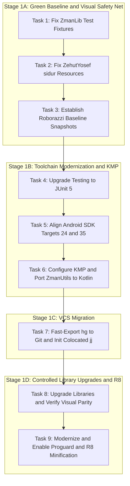

# Phase 1: Foundation Modernization, VCS Migration to Jujutsu (jj), and Visual Safety Net Implementation Plan

> **For agentic workers:** REQUIRED SUB-SKILL: Use superpowers:subagent-driven-development to implement this plan task-by-task. Steps use checkbox (`- [ ]`) syntax for tracking.

**Goal:** Establish an immediate Roborazzi screen snapshot safety net from the untouched app baseline, stabilize tests and compilation in Mercurial, upgrade the testing framework to JUnit 5, align Android SDK targets to 24/35, migrate `:ZmanUtils` to Kotlin Multiplatform (KMP) dropping custom `Pair`, migrate version control from Mercurial to Jujutsu (`jj`), comprehensively modernize Android libraries (retiring legacy local AARs and MikePenz libraries) while verifying 100% visual parity, and fully enable Proguard / R8 minification.

**Architecture:** We execute in four disciplined stages. First, fix test fixtures in `:ZmanLib` and missing resources in `:ZehutYosef:sidur`, immediately followed by establishing Roborazzi screen snapshot testing so the **original untouched visual baseline** is captured to protect all subsequent work. Second, upgrade tests to JUnit 5, align SDK baselines to 24/35, and re-structure `:ZmanUtils` as a Kotlin Multiplatform module in idiomatic Kotlin. Third, convert repository history to Git and initialize colocated Jujutsu (`jj`). Fourth, upgrade Material Components, ConstraintLayout, and AndroidX Preference, replace obsolete MikePenz libraries with standard Android components, verify visual parity against the golden baselines, and enable R8 minification.

**Architecture Diagram:**



**Tech Stack:**
- Android Gradle Plugin (AGP) 9.4.0 / Gradle 9.6.0
- Java 21 / 25 Toolchains
- Kotlin 2.1.0 / Kotlin Multiplatform (KMP)
- Jujutsu (`jj`) 0.44.0 (Git backend)
- JUnit 5 (Jupiter 5.11+)
- Roborazzi 1.40+ / Robolectric Native Graphics
- AndroidX AppCompat 1.7.0, Material Components 1.12.0, ConstraintLayout 2.2.0, Preference 1.2.1, Play Services Location 21.3.0
- `com.kosherjava:zmanim:2.5.0`

**Spec:** [`docs/superpowers/specs/2026-09-07-foundation-modernization-and-jj-migration-design.md`](file:///home/jgindin/src/gindin/zmanim/zmanim/docs/superpowers/specs/2026-09-07-foundation-modernization-and-jj-migration-design.md)

## Global Constraints
- Target SDK: 35
- Min SDK: 24 for all Android modules (`Android`, `ZehutYosef`)
- Compile SDK: 35
- Java Version: 21 for Android modules, 21/25 for JVM/KMP modules
- No custom `Pair` class: use standard `kotlin.Pair` everywhere
- All new/migrated code must be idiomatic Kotlin
- No Android emulator required: screenshot tests must run on host JVM via Roborazzi + Robolectric Native Graphics
- Zero visual regression against the user's reference screenshots (`zmanim.png`, `preferences.png`, `location.png`, `barmitzvah.png`)

---

### Task 1: Stabilize `ZmanLib` Test Suite

**Files:**
- Modify: `ZmanLib/src/test/java/com/gindin/zmanlib/UT_ShemaTimes.java`
- Modify: `ZmanLib/src/test/java/com/gindin/zmanlib/UT_Zmanim.java`
- Modify: `ZmanLib/src/test/java/com/gindin/zmanlib/UT_ZmanimWithElevation.java`
- Modify: `ZmanLib/src/test/java/com/gindin/zmanlib/UT_WakeupScheduler_ConfiguredAlerts.java`
- Modify: `ZmanLib/src/test/java/com/gindin/zmanlib/UT_WakeupScheduler_DefaultAlerts.java`
- Modify: `ZmanLib/src/test/java/com/gindin/zmanlib/UT_WakeupScheduler_NoShabbat.java`
- Modify: `ZmanLib/src/test/java/com/gindin/zmanlib/UT_YomTovCandleLighting.java`

**Interfaces:**
- Consumes: `SofZmanShema.java` (without `GR'A Kol Eliyahu` removed in commit 1350)
- Produces: 100% passing tests in `:ZmanLib:test` (191 tests)

- [ ] **Step 1: Run failing tests to verify existing failure baseline**

Run: `./gradlew :ZmanLib:test`
Expected: FAIL with 52 failures

- [ ] **Step 2: Update `UT_ShemaTimes.java` header and column fixtures**

Remove the `GR'A Kol Eliyahu` header column (`| GR'A Kol Eliyahu |`) and its corresponding data value column from:
`shemaTimesForSeattle1` through `shemaTimesForSeattle6`, `ahavatShalomLondon`, `ahavatShalomKotel`.

- [ ] **Step 3: Update remaining test classes**

Realign formatted table columns in `UT_TalitTimes.java`, `UT_Zmanim.java`, `UT_ZmanimWithElevation.java`, `UT_WakeupScheduler_*.java`, and `UT_YomTovCandleLighting.java`.

- [ ] **Step 4: Verify all tests in `:ZmanLib` pass**

Run: `./gradlew :ZmanLib:test`
Expected: BUILD SUCCESSFUL (191 tests completed, 0 failed)

- [ ] **Step 5: Commit changes in Mercurial**

```bash
hg add ZmanLib/src/test/java
hg commit -m "Fix ZmanLib test fixtures following removal of deprecated GR'A Kol Eliyahu"
```

---

### Task 2: Fix `ZehutYosef:sidur` Compilation and Resource Architecture

**Files:**
- Create: `ZehutYosef/src/main/res/values/strings.xml`
- Modify: `ZehutYosef/src/main/res/values/styles.xml`
- Create: `ZehutYosef/src/main/res/drawable/header.xml`
- Verify: `ZehutYosef/src/barMitzvah/res/values/purple_gray_style.xml`

**Interfaces:**
- Consumes: `About.java:37` (`R.string.about_description_text`), `About.java:46` (`R.style.EliPurple`), `ZehutYosefActivity.java:229` (`R.drawable.header`)
- Produces: Clean compilation for both `sidur` and `barMitzvah` product flavors

- [ ] **Step 1: Verify current compilation failure in `sidur` flavor**

Run: `./gradlew :ZehutYosef:compileSidurDebugJavaWithJavac`
Expected: FAIL with 3 unresolved symbol errors (`about_description_text`, `EliPurple`, `header`)

- [ ] **Step 2: Add default fallback string to `src/main/res/values/strings.xml`**

```xml
<?xml version="1.0" encoding="utf-8"?>
<resources>
  <string name="about_description_text">Zehut Yosef Siddur</string>
</resources>
```

- [ ] **Step 3: Add base theme and EliPurple fallback in `src/main/res/values/styles.xml`**

```xml
<?xml version="1.0" encoding="utf-8"?>
<resources>
  <style name="EliPurple" parent="Theme.AppCompat.Light.DarkActionBar">
    <!-- Default theme properties for Zehut Yosef; overridden in barMitzvah flavor -->
  </style>
</resources>
```

- [ ] **Step 4: Add default neutral header drawable in `src/main/res/drawable/header.xml`**

```xml
<?xml version="1.0" encoding="utf-8"?>
<shape xmlns:android="http://schemas.android.com/apk/res/android"
    android:shape="rectangle">
  <solid android:color="@color/material_drawer_primary" />
</shape>
```

- [ ] **Step 5: Verify both `sidur` and `barMitzvah` compile and assemble**

Run: `./gradlew :ZehutYosef:compileSidurDebugJavaWithJavac :ZehutYosef:compileBarMitzvahDebugJavaWithJavac :ZehutYosef:assembleDebug`
Expected: BUILD SUCCESSFUL

- [ ] **Step 6: Commit changes in Mercurial**

```bash
hg add ZehutYosef/src/main/res
hg commit -m "Provide default resources in main so sidur flavor compiles alongside barMitzvah"
```

---

### Task 3: Establish Roborazzi Screen Snapshot Safety Net (Untouched Baseline)

**Files:**
- Modify: `build.gradle`
- Modify: `gradle.properties`
- Modify: `Android/build.gradle`
- Modify: `ZehutYosef/build.gradle`
- Create: `Android/src/test/java/com/gindin/zmanim/android/snapshot/ZmanimSnapshotTest.java`
- Create: `ZehutYosef/src/test/java/com/gindin/zehutyosef/snapshot/SiddurSnapshotTest.java`
- Output: `screenshots/` directory containing recorded golden images

**Interfaces:**
- Consumes: Roborazzi 1.40+, Robolectric 4.14+ Native Graphics
- Produces: Deterministic JVM-rendered PNG screenshots of the untouched baseline screens matching the user's reference photos (`zmanim.png`, `preferences.png`, `location.png`, `barmitzvah.png`)

- [ ] **Step 1: Configure Roborazzi and Robolectric Native Graphics**

In `gradle.properties`:
```properties
robolectric.graphicsMode=NATIVE
```
In `build.gradle` and module build scripts, apply `io.github.takahirom.roborazzi` plugin and add test dependencies (`robolectric`, `roborazzi`, `roborazzi-junit-rule`).

- [ ] **Step 2: Write `ZmanimSnapshotTest.java` in `:Android`**

Implement tests using Robolectric `ActivityScenario`:
- `captureMainScreen()`: Launches `ZmanimActivity` with fixed test location (Yonkers, New York) and date (September 7, 2026), capturing the full daily list and header. Matches `zmanim.png`.
- `capturePreferencesScreen()`: Launches `PersonalPreferencesActivity`, capturing notification sliders and category headers. Matches `preferences.png` and `location.png`.

- [ ] **Step 3: Write `SiddurSnapshotTest.java` in `:ZehutYosef`**

Implement tests:
- `captureBarMitzvahReader()`: Launches `barMitzvah` flavor layout with `EliPurple` action bar and drawer header. Matches `barmitzvah.png`.
- `captureSiddurReader()`: Launches `sidur` flavor layout.

- [ ] **Step 4: Record golden baseline images**

Run: `./gradlew recordRoborazziDebug`
Expected: Golden PNG files generated in `screenshots/` directory, visually verified against reference images in `docs/superpowers/specs/screenshots/`.

- [ ] **Step 5: Verify that verify task passes on the baseline**

Run: `./gradlew verifyRoborazziDebug`
Expected: BUILD SUCCESSFUL (0 diffs detected)

- [ ] **Step 6: Commit golden snapshots to Mercurial**

```bash
hg add screenshots
hg commit -m "Establish Roborazzi screen snapshot safety net with golden baseline images"
```

---

### Task 4: Upgrade Testing Framework to JUnit 5 (Jupiter)

**Files:**
- Modify: `build.gradle`
- Modify: `ZmanUtils/build.gradle`
- Modify: `ZmanLib/build.gradle`
- Modify: `Android/build.gradle`
- Modify: `ZehutYosef/build.gradle`
- Modify test files across modules to use `org.junit.jupiter.api.*`

**Interfaces:**
- Consumes: JUnit 5 (Jupiter 5.11.4)
- Produces: Modern test execution via Gradle `useJUnitPlatform()`

- [ ] **Step 1: Add JUnit 5 dependencies and configure Gradle**

In all modules:
```groovy
testImplementation 'org.junit.jupiter:junit-jupiter:5.11.4'
testRuntimeOnly 'org.junit.vintage:junit-vintage-engine:5.11.4'
```
Configure test task:
```groovy
tasks.withType(Test) {
  useJUnitPlatform()
}
```

- [ ] **Step 2: Migrate test annotations in `:ZmanUtils` and `:ZmanLib`**

Replace `org.junit.Test` with `org.junit.jupiter.api.Test`, `org.junit.Assert.*` with `org.junit.jupiter.api.Assertions.*`, `@Before` with `@BeforeEach`.

- [ ] **Step 3: Verify all tests execute and pass under JUnit 5**

Run: `./gradlew test`
Expected: BUILD SUCCESSFUL across all modules under JUnit Platform runner

- [ ] **Step 4: Commit changes in Mercurial**

```bash
hg commit -m "Upgrade test suite across all modules to JUnit 5 (Jupiter 5.11+)"
```

---

### Task 5: Align SDK Baseline Targets Across Android Modules

**Files:**
- Modify: `Android/build.gradle`
- Modify: `ZehutYosef/build.gradle`

**Interfaces:**
- Consumes: AGP 9.4.0
- Produces: `minSdkVersion 24` and `compileSdk 35` across both Android apps

- [ ] **Step 1: Update `Android/build.gradle`**

Change:
```groovy
compileSdk 33
minSdkVersion 14
targetSdkVersion 35
```
to:
```groovy
compileSdk 35
minSdkVersion 24
targetSdkVersion 35
```

- [ ] **Step 2: Update `ZehutYosef/build.gradle`**

Change:
```groovy
compileSdk 33
minSdkVersion 22
targetSdkVersion 35
```
to:
```groovy
compileSdk 35
minSdkVersion 24
targetSdkVersion 35
```

- [ ] **Step 3: Verify build and visual regression tests pass**

Run: `./gradlew test assembleDebug verifyRoborazziDebug`
Expected: BUILD SUCCESSFUL with 0 visual regressions

- [ ] **Step 4: Commit changes in Mercurial**

```bash
hg commit -m "Raise minSdkVersion to 24 and compileSdk to 35 across Android and ZehutYosef"
```

---

### Task 6: Configure Kotlin Multiplatform (KMP), Drop Custom `Pair`, and Migrate `:ZmanUtils`

**Files:**
- Delete: `ZmanUtils/src/main/java/com/gindin/util/Pair.java`
- Modify call sites:
  - `ZmanLib/src/main/java/com/gindin/zmanlib/location/LatitudeLongitudeParser.java`
  - `ZmanLib/src/main/java/com/gindin/zmanlib/ZmanCallback.java`
  - `ZmanLib/src/main/java/com/gindin/zmanlib/zman/ZmanimFactory.java`
  - `Android/src/main/java/com/gindin/zmanim/android/AppUpgrader.java`
  - `Android/src/main/java/com/gindin/zmanim/android/location/resolvers/JsonQueryingResolver.java`
  - `Android/src/main/java/com/gindin/zmanim/android/service/ZmanimService.java`
  - `Android/src/main/java/com/gindin/zmanim/android/service/DisplayNotificationService.java`
  - `Android/src/main/java/com/gindin/zmanim/android/display/daily/main/ZmanimPresenterImpl.java`
- Re-configure `ZmanUtils/build.gradle` with `kotlin("multiplatform")` (JVM + Android targets, Java 21/25 toolchain)
- Create Kotlin files in `ZmanUtils/src/commonMain/kotlin/`:
  - `com/gindin/eventBus/Event.kt`
  - `com/gindin/eventBus/EventCacheControl.kt`
  - `com/gindin/eventBus/EventHandler.kt`
  - `com/gindin/eventBus/EventBus.kt`
  - `com/gindin/mvp/View.kt`
  - `com/gindin/mvp/Presenter.kt`
  - `com/gindin/mvp/AbstractPresenter.kt`
  - `com/gindin/mvp/MvpModule.kt`
  - `com/gindin/telemetry/TelemetryTracker.kt`
- Create Kotlin test in `ZmanUtils/src/commonTest/kotlin/`:
  - `com/gindin/eventBus/UT_EventBus.kt`
- Delete old Java files in `ZmanUtils/src/main/java/` and `ZmanUtils/src/test/java/`.

**Interfaces:**
- Consumes: standard library `kotlin.Pair`, Kotlin 2.1.0 Multiplatform
- Produces: Idiomatic Kotlin implementations of `EventBus`, MVP interfaces, `TelemetryTracker` API, and unit tests

- [ ] **Step 1: Replace `com.gindin.util.Pair` with `kotlin.Pair` at all call sites and remove `Pair.java`**

Update imports and constructor calls (`new Pair<>(a, b)` $\rightarrow$ `new Pair<>(a, b)` importing `kotlin.Pair`). Remove `Pair.java`.

- [ ] **Step 2: Configure `:ZmanUtils` for Kotlin Multiplatform**

In `ZmanUtils/build.gradle`:
```groovy
plugins {
  id 'org.jetbrains.kotlin.multiplatform'
}

kotlin {
  jvm {
    jvmToolchain(25)
  }
  androidTarget()
  sourceSets {
    commonMain.dependencies {
      // standard library
    }
    commonTest.dependencies {
      implementation 'org.jetbrains.kotlin:kotlin-test'
      implementation 'org.junit.jupiter:junit-jupiter:5.11.4'
    }
  }
}
```

- [ ] **Step 3: Convert `Event.kt`, `EventCacheControl.kt`, and `EventHandler.kt` to idiomatic Kotlin**

```kotlin
package com.gindin.eventBus

interface Event

enum class EventCacheControl {
    NO_CACHE,
    CACHE_LATEST
}

fun interface EventHandler<in T : Event> {
    fun onEvent(event: T)
}
```

- [ ] **Step 4: Convert `EventBus.kt` and MVP contracts to idiomatic Kotlin, and define `TelemetryTracker.kt`**

Implement thread-safe event dispatch with `ConcurrentHashMap`, Kotlin null-safety, and Java-interop annotations (`@JvmStatic`, `@JvmOverloads`).

Define `TelemetryTracker.kt` in `ZmanUtils/src/commonMain/kotlin/com/gindin/telemetry/`:
```kotlin
package com.gindin.telemetry

interface TelemetryTracker {
    fun trackScreen(screenName: String)
    fun trackEvent(name: String, parameters: Map<String, Any?> = emptyMap())
    fun setUserProperty(key: String, value: String)
    fun recordNonFatal(throwable: Throwable)
}
```

- [ ] **Step 5: Write `UT_EventBus.kt` using JUnit 5 assertions**

Rewrite the test cases in idiomatic Kotlin.

- [ ] **Step 6: Run full verification across all modules**

Run: `./gradlew test assembleDebug verifyRoborazziDebug`
Expected: BUILD SUCCESSFUL with 0 failures and 0 visual regressions

- [ ] **Step 7: Commit Stage 1B milestone in Mercurial**

```bash
hg add ZmanUtils
hg commit -m "Migrate ZmanUtils to Kotlin Multiplatform (KMP), drop custom Pair, complete Stage 1B"
```

---

### Task 7: Migrate Version Control from `hg` to `jj`

**Files:**
- Create: `.gitignore`
- Remove/Archive: `.hg/` ➔ `.hg.backup/`

**Interfaces:**
- Consumes: Full Mercurial changeset history (1356+ revisions)
- Produces: Colocated Jujutsu repository (`.jj` + `.git`) tracking active branch `zmanim-v4`

- [ ] **Step 1: Run `fast-export` to convert Mercurial history into Git**

```bash
git init
python3 /path/to/hg-fast-export.py -r /home/jgindin/src/gindin/zmanim/zmanim --force
git checkout zmanim-v4 || git checkout -b zmanim-v4
```

- [ ] **Step 2: Initialize colocated Jujutsu repository**

```bash
jj git init --colocated
```

- [ ] **Step 3: Create `.gitignore` and archive `.hg`**

Write standard `.gitignore`:
```gitignore
build/
.gradle/
*.iml
.idea/
local.properties
*.keystore
common/ProjectApiKey.txt
Android/zmanim.gradle
ZehutYosef/zehut-yosef.gradle
.hg/
.hgignore
.hgtags
*.orig
```
Archive `.hg/` to `.hg.backup/`.

- [ ] **Step 4: Verify `jj` repository state, history, and build**

Run: `jj status` and `jj log -r '::@'` and `./gradlew test assembleDebug verifyRoborazziDebug`
Expected: Clean working copy, history visible, and 0 visual regressions

- [ ] **Step 5: Commit migration milestone in Jujutsu**

```bash
jj commit -m "Migrate repository version control from Mercurial to Jujutsu (jj)"
```

---

### Task 8: Comprehensive Library Modernization & Visual Parity Verification

**Files:**
- Delete: `Android/libs/support-preference-1.3.1.*`
- Delete: `Android/libs/support-spinner-1.3.1.*`
- Modify: `Android/build.gradle`
- Modify: `Android/src/main/res/xml/personal_prefs.xml`
- Modify: `Android/src/main/res/xml/personal_prefs_oreo.xml`
- Modify: `ZehutYosef/build.gradle`
- Modify: `ZehutYosef/src/main/java/com/gindin/zehutyosef/ZehutYosefActivity.java`

**Interfaces:**
- Consumes: Roborazzi golden baseline screenshots recorded in Task 3
- Produces: Modernized dependencies with zero visual regressions confirmed by `verifyRoborazziDebug`

- [ ] **Step 1: Retire local Xpece AARs from `Android/libs/`**

Delete `Android/libs/support-preference-1.3.1.*` and `Android/libs/support-spinner-1.3.1.*`. Remove `api fileTree(include: ['*.aar'], dir: 'libs')` from `Android/build.gradle`.

- [ ] **Step 2: Migrate preference XMLs to standard `androidx.preference.*`**

In `personal_prefs.xml` and `personal_prefs_oreo.xml`:
Replace `net.xpece.android.support.preference.CheckBoxPreference` with `androidx.preference.CheckBoxPreference`.

- [ ] **Step 3: Upgrade core AndroidX and Google libraries in `Android/build.gradle`**

- `com.google.android.material:material:1.12.0`
- `androidx.constraintlayout:constraintlayout:2.2.0`
- `androidx.appcompat:appcompat:1.7.0`
- `com.google.android.gms:play-services-location:21.3.0`
- Remove `androidx.legacy:legacy-support-v4:1.0.0`

- [ ] **Step 4: Replace MikePenz libraries in `ZehutYosef` with modern standard components**

- Replace `com.mikepenz:materialdrawer:3.0.8` with standard Material `DrawerLayout` + `NavigationView`.
- Replace `com.mikepenz:iconics-core` with standard Android Vector Drawables.
- Modernize `aboutlibraries`.

- [ ] **Step 5: Run visual regression verification to detect any UI divergence**

Run: `./gradlew verifyRoborazziDebug`
Inspect side-by-side pixel comparisons in `build/reports/roborazzi/`.

- [ ] **Step 6: Reconcile styling and themes until 100% visual parity is achieved**

Adjust theme attributes in `styles.xml` / `themes.xml` to match the exact font sizes, colors, and paddings recorded in the Task 3 baseline. Re-run `./gradlew verifyRoborazziDebug` until it passes with 0 diffs.

- [ ] **Step 7: Commit in Jujutsu**

```bash
jj commit -m "Comprehensive library modernization and visual parity verified via Roborazzi"
```

---

### Task 9: Modernize & Enable Proguard / R8 Minification

**Files:**
- Modify: `Android/build.gradle`
- Modify: `ZehutYosef/build.gradle`
- Modify: `Android/proguard-rules.pro`
- Modify: `ZehutYosef/proguard-rules.pro`
- Delete: Obsolete `Android/proguard-support-*.pro` files

**Interfaces:**
- Consumes: R8 compiler (bundled with AGP 9.4.0)
- Produces: Minified, obfuscated, and optimized release builds with zero runtime crashes

- [ ] **Step 1: Clean out legacy Proguard files**

Remove `proguard-support-design.pro`, `proguard-support-v7-appcompat.pro`, `proguard-project.pro`. Remove their references in `Android/build.gradle`.

- [ ] **Step 2: Configure modern R8 rules in `proguard-rules.pro`**

Add rules protecting:
- KosherJava zmanim classes and reflection points
- EventBus event classes and handler methods
- JSON parsing and GeoJSON models
- View models and activity components

- [ ] **Step 3: Enable minification in release build types**

In `Android/build.gradle` and `ZehutYosef/build.gradle`:
```groovy
buildTypes {
  release {
    minifyEnabled true
    proguardFiles getDefaultProguardFile('proguard-android-optimize.txt'), 'proguard-rules.pro'
  }
}
```

- [ ] **Step 4: Verify release build assembly**

Run: `./gradlew assembleRelease`
Expected: BUILD SUCCESSFUL with minified release APKs generated

- [ ] **Step 5: Run comprehensive verification suite**

Run: `./gradlew test assembleDebug verifyRoborazziDebug`
Expected: 100% pass rate across all modules, tests, and visual checks

- [ ] **Step 6: Final Phase 1 Milestone Commit in Jujutsu**

```bash
jj commit -m "Phase 1 Complete: Enabled R8 minification, modernized libraries, and verified full baseline"
```
