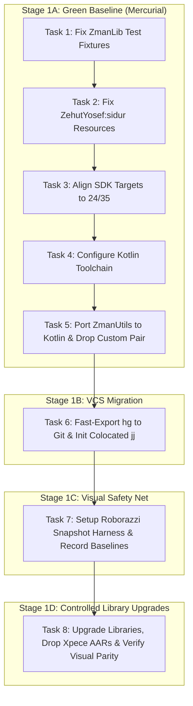

# Phase 1: Foundation Modernization, VCS Migration to Jujutsu (jj), and Visual Safety Net Implementation Plan

> **For agentic workers:** REQUIRED SUB-SKILL: Use superpowers:subagent-driven-development to implement this plan task-by-task. Steps use checkbox (`- [ ]`) syntax for tracking.

**Goal:** Establish a 100% green compilation and test baseline in Mercurial, migrate version control to Jujutsu (`jj`), implement a Roborazzi screen snapshot harness to capture golden baseline layouts, and safely modernize core Android libraries and Kotlin toolchain with verified visual parity.

**Architecture:** We tackle technical debts in strict dependency order. First, fix broken test fixtures in `:ZmanLib` (caused by deprecated zman removal in commit 1350) and missing resources in `:ZehutYosef:sidur`. Second, raise `minSdkVersion` to 24 and `compileSdk` to 35 across Android modules. Third, add the Kotlin Gradle plugin, eliminate custom `Pair` in favor of `kotlin.Pair`, and port `:ZmanUtils` to idiomatic Kotlin. Fourth, convert repository history to Git and initialize colocated Jujutsu (`jj`). Fifth, implement Roborazzi JVM screen snapshot testing referencing the user's uploaded real-device screenshots (`zmanim.png`, `preferences.png`, `location.png`, `barmitzvah.png`). Sixth, upgrade Material Components, ConstraintLayout, and AndroidX Preference while verifying zero visual regression against the golden snapshots.

**Architecture Diagram:**



**Tech Stack:**
- Android Gradle Plugin (AGP) 9.4.0 / Gradle 9.6.0
- Java 21 Toolchain
- Kotlin 2.1.0
- Jujutsu (`jj`) 0.44.0 (Git backend)
- Roborazzi 1.40+ / Robolectric Native Graphics
- AndroidX AppCompat 1.7.0, Material Components 1.12.0, ConstraintLayout 2.2.0, Preference 1.2.1, Play Services Location 21.3.0
- `com.kosherjava:zmanim:2.5.0`

**Spec:** [`docs/superpowers/specs/2026-09-07-foundation-modernization-and-jj-migration-design.md`](file:///home/jgindin/src/gindin/zmanim/zmanim/docs/superpowers/specs/2026-09-07-foundation-modernization-and-jj-migration-design.md)

## Global Constraints
- Target SDK: 35
- Min SDK: 24 for all Android modules (`Android`, `ZehutYosef`)
- Compile SDK: 35
- Java Version: 21
- No custom `Pair` class: use `kotlin.Pair` everywhere
- All new/migrated code must be idiomatic Kotlin
- No Android emulator required: screenshot tests must run on host JVM via Roborazzi + Robolectric Native Graphics

---

### Task 1: Stabilize `ZmanLib` Test Suite

**Files:**
- Modify: `ZmanLib/src/test/java/com/gindin/zmanlib/UT_ShemaTimes.java`
- Modify: `ZmanLib/src/test/java/com/gindin/zmanlib/UT_Zmanim.java`
- Modify: `ZmanLib/src/test/java/com/gindin/zmanlib/UT_ZmanimWithElevation.java`
- Modify: `ZmanLib/src/test/java/com/gindin/zmanlib/UT_WakeupScheduler_ConfiguredAlerts.java`
- Modify: `ZmanLib/src/test/java/com/gindin/zmanlib/UT_WakeupScheduler_DefaultAlerts.java`
- Modify: `ZmanLib/src/test/java/com/gindin/zmanlib/UT_WakeupScheduler_NoShabbat.java`
- Modify: `ZmanLib/src/test/java/com/gindin/zmanlib/UT_YomTovCandleLighting.java`

**Interfaces:**
- Consumes: `SofZmanShema.java` (without `GR'A Kol Eliyahu` removed in commit 1350)
- Produces: 100% passing tests in `:ZmanLib:test` (191 tests)

- [ ] **Step 1: Run failing tests to verify existing failure baseline**

Run: `./gradlew :ZmanLib:test`
Expected: FAIL with 52 failures (e.g. `UT_ShemaTimes > shemaTimesForSeattle1 FAILED`)

- [ ] **Step 2: Update `UT_ShemaTimes.java` header and column fixtures**

Remove the `GR'A Kol Eliyahu` header column (`| GR'A Kol Eliyahu |`) and its corresponding data value column from:
`shemaTimesForSeattle1` through `shemaTimesForSeattle6`, `ahavatShalomLondon`, `ahavatShalomKotel`.

- [ ] **Step 3: Update `UT_TalitTimes.java`, `UT_Zmanim.java`, `UT_ZmanimWithElevation.java`, `UT_WakeupScheduler_*.java`, and `UT_YomTovCandleLighting.java`**

Realign formatted table columns to match `kosherjava 2.5.0` output without the removed deprecated zman.

- [ ] **Step 4: Verify all tests in `:ZmanLib` pass**

Run: `./gradlew :ZmanLib:test`
Expected: BUILD SUCCESSFUL (191 tests completed, 0 failed)

- [ ] **Step 5: Commit changes in Mercurial**

```bash
hg add ZmanLib/src/test/java
hg commit -m "Fix ZmanLib test fixtures following removal of deprecated GR'A Kol Eliyahu"
```

---

### Task 2: Fix `ZehutYosef:sidur` Compilation and Resource Architecture

**Files:**
- Create: `ZehutYosef/src/main/res/values/strings.xml`
- Modify: `ZehutYosef/src/main/res/values/styles.xml`
- Create: `ZehutYosef/src/main/res/drawable/header.xml`
- Verify: `ZehutYosef/src/barMitzvah/res/values/purple_gray_style.xml`

**Interfaces:**
- Consumes: `About.java:37` (`R.string.about_description_text`), `About.java:46` (`R.style.EliPurple`), `ZehutYosefActivity.java:229` (`R.drawable.header`)
- Produces: Clean compilation for both `sidur` and `barMitzvah` product flavors

- [ ] **Step 1: Verify current compilation failure in `sidur` flavor**

Run: `./gradlew :ZehutYosef:compileSidurDebugJavaWithJavac`
Expected: FAIL with 3 unresolved symbol errors (`about_description_text`, `EliPurple`, `header`)

- [ ] **Step 2: Add default fallback string to `src/main/res/values/strings.xml`**

```xml
<?xml version="1.0" encoding="utf-8"?>
<resources>
  <string name="about_description_text">Zehut Yosef Siddur</string>
</resources>
```

- [ ] **Step 3: Add base theme and EliPurple fallback in `src/main/res/values/styles.xml`**

```xml
<?xml version="1.0" encoding="utf-8"?>
<resources>
  <style name="EliPurple" parent="Theme.AppCompat.Light.DarkActionBar">
    <!-- Default theme properties for Zehut Yosef; overridden in barMitzvah flavor -->
  </style>
</resources>
```

- [ ] **Step 4: Add default neutral header drawable in `src/main/res/drawable/header.xml`**

```xml
<?xml version="1.0" encoding="utf-8"?>
<shape xmlns:android="http://schemas.android.com/apk/res/android"
    android:shape="rectangle">
  <solid android:color="@color/material_drawer_primary" />
</shape>
```

- [ ] **Step 5: Verify both `sidur` and `barMitzvah` compile and assemble**

Run: `./gradlew :ZehutYosef:compileSidurDebugJavaWithJavac :ZehutYosef:compileBarMitzvahDebugJavaWithJavac :ZehutYosef:assembleDebug`
Expected: BUILD SUCCESSFUL

- [ ] **Step 6: Commit changes in Mercurial**

```bash
hg add ZehutYosef/src/main/res
hg commit -m "Provide default resources in main so sidur flavor compiles alongside barMitzvah"
```

---

### Task 3: Align SDK Baseline Targets Across Android Modules

**Files:**
- Modify: `Android/build.gradle`
- Modify: `ZehutYosef/build.gradle`

**Interfaces:**
- Consumes: AGP 9.4.0
- Produces: `minSdkVersion 24` and `compileSdk 35` across both Android apps

- [ ] **Step 1: Update `Android/build.gradle`**

Change:
```groovy
compileSdk 33
minSdkVersion 14
targetSdkVersion 35
```
to:
```groovy
compileSdk 35
minSdkVersion 24
targetSdkVersion 35
```

- [ ] **Step 2: Update `ZehutYosef/build.gradle`**

Change:
```groovy
compileSdk 33
minSdkVersion 22
targetSdkVersion 35
```
to:
```groovy
compileSdk 35
minSdkVersion 24
targetSdkVersion 35
```

- [ ] **Step 3: Verify build and tests pass with new SDK baselines**

Run: `./gradlew :Android:compileDebugJavaWithJavac :ZehutYosef:compileSidurDebugJavaWithJavac :ZehutYosef:compileBarMitzvahDebugJavaWithJavac`
Expected: BUILD SUCCESSFUL

- [ ] **Step 4: Commit changes in Mercurial**

```bash
hg commit -m "Raise minSdkVersion to 24 and compileSdk to 35 across Android and ZehutYosef"
```

---

### Task 4: Configure Kotlin Toolchain Across All Modules

**Files:**
- Modify: `build.gradle`
- Modify: `Android/build.gradle`
- Modify: `ZehutYosef/build.gradle`
- Modify: `ZmanLib/build.gradle`
- Modify: `ZmanUtils/build.gradle`

**Interfaces:**
- Consumes: Kotlin 2.1.0, Java 21 Toolchain
- Produces: Kotlin compilation support for JVM and Android modules

- [ ] **Step 1: Add Kotlin Gradle plugin to root `build.gradle`**

In `buildscript.dependencies`:
```groovy
classpath 'org.jetbrains.kotlin:kotlin-gradle-plugin:2.1.0'
```

- [ ] **Step 2: Apply Kotlin plugins to modules**

- In `ZmanUtils/build.gradle` and `ZmanLib/build.gradle`:
  ```groovy
  apply plugin: 'org.jetbrains.kotlin.jvm'
  ```
- In `common/gindin-android.gradle`:
  ```groovy
  apply plugin: 'org.jetbrains.kotlin.android'
  ```

- [ ] **Step 3: Configure Kotlin compiler options for Java 21 compatibility**

Ensure Kotlin targets Java 21 bytecode across all subprojects:
```groovy
kotlin {
  jvmToolchain(21)
}
```

- [ ] **Step 4: Verify Kotlin build setup**

Run: `./gradlew tasks`
Expected: BUILD SUCCESSFUL with Kotlin compile tasks visible (e.g. `compileKotlin`, `compileDebugKotlin`)

- [ ] **Step 5: Commit changes in Mercurial**

```bash
hg commit -m "Configure Kotlin 2.1.0 Gradle plugin with Java 21 toolchain across all modules"
```

---

### Task 5: Eliminate Custom `Pair` & Migrate `:ZmanUtils` to Idiomatic Kotlin

**Files:**
- Delete: `ZmanUtils/src/main/java/com/gindin/util/Pair.java`
- Modify call sites:
  - `ZmanLib/src/main/java/com/gindin/zmanlib/location/LatitudeLongitudeParser.java`
  - `ZmanLib/src/main/java/com/gindin/zmanlib/ZmanCallback.java`
  - `ZmanLib/src/main/java/com/gindin/zmanlib/zman/ZmanimFactory.java`
  - `Android/src/main/java/com/gindin/zmanim/android/AppUpgrader.java`
  - `Android/src/main/java/com/gindin/zmanim/android/location/resolvers/JsonQueryingResolver.java`
  - `Android/src/main/java/com/gindin/zmanim/android/service/ZmanimService.java`
  - `Android/src/main/java/com/gindin/zmanim/android/service/DisplayNotificationService.java`
  - `Android/src/main/java/com/gindin/zmanim/android/display/daily/main/ZmanimPresenterImpl.java`
- Create Kotlin files in `ZmanUtils/src/main/kotlin/`:
  - `com/gindin/eventBus/Event.kt`
  - `com/gindin/eventBus/EventCacheControl.kt`
  - `com/gindin/eventBus/EventHandler.kt`
  - `com/gindin/eventBus/EventBus.kt`
  - `com/gindin/mvp/View.kt`
  - `com/gindin/mvp/Presenter.kt`
  - `com/gindin/mvp/AbstractPresenter.kt`
  - `com/gindin/mvp/MvpModule.kt`
- Create Kotlin test in `ZmanUtils/src/test/kotlin/`:
  - `com/gindin/eventBus/UT_EventBus.kt`
- Delete obsolete Java files in `ZmanUtils/src/main/java/com/gindin/` and `ZmanUtils/src/test/java/`.

**Interfaces:**
- Consumes: standard library `kotlin.Pair`
- Produces: Idiomatic Kotlin implementations of `EventBus`, MVP interfaces, and unit tests

- [ ] **Step 1: Replace `com.gindin.util.Pair` with `kotlin.Pair` at all call sites and remove `Pair.java`**

Update imports and constructor calls (`new Pair<>(a, b)` $\rightarrow$ `new Pair<>(a, b)` importing `kotlin.Pair`). Remove `com/gindin/util/Pair.java`.

- [ ] **Step 2: Convert `Event.kt`, `EventCacheControl.kt`, and `EventHandler.kt` to idiomatic Kotlin**

```kotlin
package com.gindin.eventBus

interface Event

enum class EventCacheControl {
    NO_CACHE,
    CACHE_LATEST
}

fun interface EventHandler<in T : Event> {
    fun onEvent(event: T)
}
```

- [ ] **Step 3: Convert `EventBus.kt` to idiomatic Kotlin**

Implement thread-safe event dispatch with `ConcurrentHashMap`, idiomatic collection operations, proper null-safety, and `@JvmStatic` / `@JvmOverloads` where Java callers require it.

- [ ] **Step 4: Convert MVP contracts (`View.kt`, `Presenter.kt`, `AbstractPresenter.kt`, `MvpModule.kt`)**

Port the MVP interfaces and base presenter to clean Kotlin.

- [ ] **Step 5: Port `UT_EventBus.java` to `UT_EventBus.kt`**

Rewrite the test cases in idiomatic Kotlin using JUnit 4 assertions.

- [ ] **Step 6: Run full verification of Stage 1A**

Run: `./gradlew test assembleDebug`
Expected: BUILD SUCCESSFUL across all modules with 0 failures

- [ ] **Step 7: Commit Stage 1A milestone in Mercurial**

```bash
hg add ZmanUtils
hg commit -m "Migrate ZmanUtils to idiomatic Kotlin, remove custom Pair, complete Stage 1A green baseline"
```

---

### Task 6: Migrate Version Control from `hg` to `jj`

**Files:**
- Create: `.gitignore`
- Remove/Archive: `.hg/` ➔ `.hg.backup/`

**Interfaces:**
- Consumes: Full Mercurial changeset history (1356+ revisions)
- Produces: Colocated Jujutsu repository (`.jj` + `.git`) tracking active branch `zmanim-v4`

- [ ] **Step 1: Run `fast-export` to convert Mercurial history into Git**

```bash
git init
python3 /path/to/hg-fast-export.py -r /home/jgindin/src/gindin/zmanim/zmanim --force
git checkout zmanim-v4 || git checkout -b zmanim-v4
```

- [ ] **Step 2: Initialize colocated Jujutsu repository**

```bash
jj git init --colocated
```

- [ ] **Step 3: Create `.gitignore` and archive `.hg`**

Write standard `.gitignore`:
```gitignore
build/
.gradle/
*.iml
.idea/
local.properties
*.keystore
common/ProjectApiKey.txt
Android/zmanim.gradle
ZehutYosef/zehut-yosef.gradle
.hg/
.hgignore
.hgtags
*.orig
```
Archive `.hg/` to `.hg.backup/`.

- [ ] **Step 4: Verify `jj` repository state and history**

Run: `jj status` and `jj log -r '::@'`
Expected: Clean working copy, history visible with all commits up to Stage 1A

- [ ] **Step 5: Verify build under `jj`**

Run: `./gradlew test assembleDebug`
Expected: BUILD SUCCESSFUL

- [ ] **Step 6: Commit migration milestone in Jujutsu**

```bash
jj commit -m "Migrate repository version control from Mercurial to Jujutsu (jj)"
```

---

### Task 7: Setup Roborazzi Snapshot Safety Net

**Files:**
- Modify: `build.gradle`
- Modify: `gradle.properties`
- Modify: `Android/build.gradle`
- Modify: `ZehutYosef/build.gradle`
- Create: `Android/src/test/kotlin/com/gindin/zmanim/android/snapshot/ZmanimSnapshotTest.kt`
- Create: `ZehutYosef/src/test/kotlin/com/gindin/zehutyosef/snapshot/SiddurSnapshotTest.kt`
- Output: `screenshots/` directory containing recorded golden images

**Interfaces:**
- Consumes: Roborazzi 1.40+, Robolectric 4.14+ Native Graphics
- Produces: Deterministic JVM-rendered PNG screenshots of `ZmanimActivity`, `PersonalPreferences`, and `ZehutYosefActivity` (`sidur` and `barMitzvah`)

- [ ] **Step 1: Add Roborazzi dependency and configure native graphics**

In `gradle.properties`:
```properties
robolectric.graphicsMode=NATIVE
```
In `build.gradle` and module build scripts:
Apply `io.github.takahirom.roborazzi` plugin and add test dependencies (`robolectric`, `roborazzi`, `roborazzi-junit-rule`).

- [ ] **Step 2: Write `ZmanimSnapshotTest.kt` in `:Android`**

Implement tests using Robolectric's `ActivityScenario`:
- `captureMainScreen()`: Launches `ZmanimActivity` with a fixed test location (Yonkers, New York) and date (September 7, 2026), capturing the full daily list and header.
- `capturePreferencesScreen()`: Launches `PersonalPreferencesActivity`, capturing notification sliders and category headers.

- [ ] **Step 3: Write `SiddurSnapshotTest.kt` in `:ZehutYosef`**

Implement tests:
- `captureSiddurReader()`: Launches `ZehutYosefActivity` displaying Mincha prayer text with Hebrew fonts.
- `captureBarMitzvahReader()`: Launches `barMitzvah` flavor layout with `EliPurple` action bar and customized header.

- [ ] **Step 4: Record golden baseline images**

Run: `./gradlew recordRoborazziDebug`
Expected: Golden PNG files generated in `screenshots/` directory, visually verified against reference images in `docs/superpowers/specs/screenshots/`

- [ ] **Step 5: Verify that verification task passes**

Run: `./gradlew verifyRoborazziDebug`
Expected: BUILD SUCCESSFUL (0 diffs detected)

- [ ] **Step 6: Commit golden snapshots to Jujutsu**

```bash
jj commit -m "Add Roborazzi screen snapshot harness and record golden baseline images"
```

---

### Task 8: Controlled Library Modernization & Visual Parity Verification

**Files:**
- Delete: `Android/libs/support-preference-1.3.1.*`
- Delete: `Android/libs/support-spinner-1.3.1.*`
- Modify: `Android/build.gradle`
- Modify: `Android/src/main/res/xml/personal_prefs.xml`
- Modify: `Android/src/main/res/xml/personal_prefs_oreo.xml`

**Interfaces:**
- Consumes: Roborazzi golden baseline screenshots
- Produces: Modernized UI dependencies with zero visual regressions confirmed by `verifyRoborazziDebug`

- [ ] **Step 1: Retire local Xpece AARs from `Android/libs/`**

Delete `Android/libs/support-preference-1.3.1.*` and `Android/libs/support-spinner-1.3.1.*`. Remove `api fileTree(include: ['*.aar'], dir: 'libs')` from `Android/build.gradle`.

- [ ] **Step 2: Migrate preference XMLs to standard `androidx.preference.*`**

In `personal_prefs.xml` and `personal_prefs_oreo.xml`:
Replace `net.xpece.android.support.preference.CheckBoxPreference` with `androidx.preference.CheckBoxPreference`.

- [ ] **Step 3: Upgrade core AndroidX and Google libraries in `Android/build.gradle`**

- `com.google.android.material:material:1.12.0`
- `androidx.constraintlayout:constraintlayout:2.2.0`
- `androidx.appcompat:appcompat:1.7.0`
- `com.google.android.gms:play-services-location:21.3.0`
- Remove `androidx.legacy:legacy-support-v4:1.0.0`

- [ ] **Step 4: Run visual regression verification to detect any UI divergence**

Run: `./gradlew verifyRoborazziDebug`
If diffs are reported, inspect `build/reports/roborazzi/` to review side-by-side pixel differences.

- [ ] **Step 5: Reconcile styling and themes until 100% visual parity is achieved**

Adjust XML theme attributes in `styles.xml` to match the exact font sizes, colors, and paddings recorded in the baseline. Re-run `./gradlew verifyRoborazziDebug` until it passes cleanly.

- [ ] **Step 6: Run comprehensive test and build verification**

Run: `./gradlew test assembleDebug verifyRoborazziDebug`
Expected: BUILD SUCCESSFUL across all modules and tests

- [ ] **Step 7: Final Phase 1 Commit in Jujutsu**

```bash
jj commit -m "Phase 1 Complete: Modernized libraries, retired legacy AARs, verified visual parity"
```
