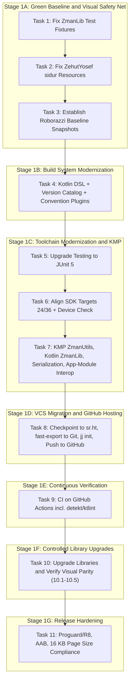

# Phase 1: Foundation Modernization, VCS Migration to Jujutsu (jj) + GitHub, and Visual Safety Net Implementation Plan

> **For agentic workers:** REQUIRED SUB-SKILL: Use superpowers:subagent-driven-development to implement this plan task-by-task. Steps use checkbox (`- [ ]`) syntax for tracking. **Do not skip ahead**: each task's final verification step is a hard gate — if it fails, stop and fix before starting the next task. Where a step's exact command-line syntax depends on the installed version of a tool (`jj`, `hg-fast-export`), a `--help` confirmation sub-step is included before the step that uses it; run that confirmation and adjust the literal command if this machine's version differs from what's shown.

**Revision history:**
- **2026-09-14 (first pass):** real tool paths substituted for placeholders (Task 7→8), a hosting move to GitHub added with a new CI task immediately after it, library modernization split into five sub-tasks, a real-device check added to the SDK-alignment task, the `EventBus` port explicitly framed as a stepping stone, `UT_TalitTimes.java` added to Task 1's file manifest, Task 3's stated goal corrected.
- **2026-09-14 (second pass):** SDK target corrected to **API 36** (Google Play's compliance requirement effective August 31, 2026 — the previous API 35 target was already out of date). New Task 4 inserted: convert all build scripts to Kotlin DSL and adopt a Gradle version catalog, before any further build-file edits. KMP task expanded: `:ZmanLib` converts to Kotlin alongside `:ZmanUtils` (staying JVM/Android-only — see the master roadmap's Phase 6.1 for the multiplatform follow-up), `explicitApiMode` applied to both, `kotlinx.serialization`/`kotlinx-datetime` replace remaining `org.json`/JVM-date usage. CI task gains `detekt`/`ktlint`. R8/AAB task gains a 16 KB page size compliance check. GitHub destination confirmed as `github.com/jgindin/zmanim`. Phase 1 is now 11 tasks (was 9, then 10).

**Goal:** Establish an immediate Roborazzi screen snapshot safety net from the untouched app baseline, stabilize tests and compilation in Mercurial, convert all build scripts to Kotlin DSL with a version catalog, upgrade the testing framework to JUnit 5, align Android SDK targets to 24/36 (with real-device verification and current Play compliance), migrate `:ZmanUtils` and `:ZmanLib` to idiomatic Kotlin (dropping custom `Pair`, adopting `kotlinx.serialization`/`kotlinx-datetime`), enable Kotlin interop in the app modules, migrate version control from Mercurial to Jujutsu (`jj`) and hosting to GitHub, stand up CI with static analysis, comprehensively modernize Android libraries as independently-verified sub-tasks, and fully enable Proguard / R8 minification with a 16 KB page size compliance check.

**Architecture:** Seven disciplined stages. First, fix test fixtures in `:ZmanLib` and missing resources in `:ZehutYosef:sidur`, immediately followed by establishing Roborazzi screen snapshot testing so the **original untouched visual baseline** is captured to protect all subsequent work. Second, convert every build script to Kotlin DSL with a version catalog — done once, early, so every later build-file edit in this phase is already in the target format. Third, upgrade tests to JUnit 5, align SDK baselines to 24/36 (verified on both Roborazzi and a real device/emulator), and convert `:ZmanUtils` and `:ZmanLib` to idiomatic Kotlin while enabling Kotlin interop in the app modules. Fourth, convert repository history to Git, initialize colocated Jujutsu (`jj`), and move canonical hosting to GitHub. Fifth, stand up CI on GitHub Actions — tests, static analysis, and visual/behavioral verification — so every subsequent change is automatically checked. Sixth, upgrade Material Components, ConstraintLayout, and AndroidX Preference, and replace obsolete MikePenz libraries with standard Android components, as five separately-committed, separately-verified sub-tasks. Seventh, enable R8 minification and verify release-readiness including 16 KB page size compliance.

**Architecture Diagram:**



**Tech Stack:**
- Android Gradle Plugin (AGP) 9.4.0 / Gradle 9.6.0
- Java 21 / 25 Toolchains
- Kotlin 2.1.0 / Kotlin Multiplatform (KMP), all build scripts as Kotlin DSL with a `gradle/libs.versions.toml` version catalog and a `build-logic` convention-plugin build
- Jujutsu (`jj`) — installed at `~/.local/bin/jj`; confirm exact version with `jj --version` before Task 8
- Mercurial (`hg`) — installed at `/usr/bin/hg`
- `hg-fast-export` — checked out at `~/src/fast-export`; confirm invocation with `~/src/fast-export/hg-fast-export.sh --help` before Task 8
- GitHub — canonical hosting at **github.com/jgindin/zmanim**, effective Task 8
- JUnit 5 (Jupiter 5.11+), `kotlin-test` in KMP `commonTest`
- `detekt` + `ktlint` for static analysis (Task 9, CI-enforced)
- Roborazzi 1.40+ / Robolectric Native Graphics (host-JVM layer), plus a targeted real-device/emulator smoke layer (Task 6, Task 9's CI matrix)
- AndroidX AppCompat 1.7.0, Material Components 1.12.0, ConstraintLayout 2.2.0, Preference 1.2.1, Play Services Location 21.3.0
- `com.kosherjava:zmanim:2.5.0` (JVM-only; see Task 7's scope note and the master roadmap's Phase 6.1 for the multiplatform follow-up)
- `kotlinx.serialization`, `kotlinx-datetime` for shared KMP code

**Spec:** [`docs/superpowers/specs/2026-09-07-foundation-modernization-and-jj-migration-design.md`](file:///home/jgindin/src/gindin/zmanim/zmanim/docs/superpowers/specs/2026-09-07-foundation-modernization-and-jj-migration-design.md)

## Global Constraints
- Target SDK / Compile SDK: **36** (Android 16) — corrected from an earlier API 35 target to match Google Play's compliance requirement effective August 31, 2026
- Min SDK: 24 for all Android modules (`Android`, `ZehutYosef`) — confirm against current Play Console install-base distribution before changing (Task 6, Step 1)
- Java Version: 21 for Android modules, 21/25 for JVM/KMP modules
- All build scripts are Kotlin DSL (`.gradle.kts`); all dependency versions live in `gradle/libs.versions.toml`
- No custom `Pair` class: use standard `kotlin.Pair` everywhere
- All new/migrated code must be idiomatic Kotlin; `:ZmanUtils` and `:ZmanLib` apply `explicitApiMode`
- `:Android` and `:ZehutYosef` remain Java modules through the end of Phase 1 except for the interop plugin added in Task 7 — do not mass-convert their existing `.java` files in this phase; that happens screen-by-screen in Phase 4a/4b alongside each Compose rewrite
- `:ZmanLib` converts to Kotlin in this phase but stays JVM/Android-only — do not attempt to add an iOS target to it in Phase 1; that depends on the KosherKotlin spike scoped for the start of Phase 6
- The Kotlin port of `EventBus`/MVP in Task 7 is a deliberately mechanical stepping stone — Phase 4a deletes this pattern outright when DI lands. Do not invest effort improving its design.
- No Android emulator required for Tasks 1–5 and 7–11: screenshot tests run on host JVM via Roborazzi + Robolectric Native Graphics. Task 6 is the one exception — it requires one manual real-device/emulator check in addition to Roborazzi. Task 9 automates this going forward via CI.
- Zero visual regression against the recorded Roborazzi baseline; zero `detekt`/`ktlint` violations once CI (Task 9) establishes the baseline
- sr.ht is the pre-migration source of truth; Bitbucket is stale/non-functional and is not used as a migration target; GitHub (`github.com/jgindin/zmanim`) is the canonical host going forward

---

### Task 1: Stabilize `ZmanLib` Test Suite

**Files:**
- Modify: `ZmanLib/src/test/java/com/gindin/zmanlib/UT_ShemaTimes.java`
- Modify: `ZmanLib/src/test/java/com/gindin/zmanlib/UT_TalitTimes.java`
- Modify: `ZmanLib/src/test/java/com/gindin/zmanlib/UT_Zmanim.java`
- Modify: `ZmanLib/src/test/java/com/gindin/zmanlib/UT_ZmanimWithElevation.java`
- Modify: `ZmanLib/src/test/java/com/gindin/zmanlib/UT_WakeupScheduler_ConfiguredAlerts.java`
- Modify: `ZmanLib/src/test/java/com/gindin/zmanlib/UT_WakeupScheduler_DefaultAlerts.java`
- Modify: `ZmanLib/src/test/java/com/gindin/zmanlib/UT_WakeupScheduler_NoShabbat.java`
- Modify: `ZmanLib/src/test/java/com/gindin/zmanlib/calendar/holiday/UT_YomTovCandleLighting.java`

**Interfaces:**
- Consumes: `SofZmanShema.java` (with `GR'A Kol Eliyahu` removed in commit 1350)
- Produces: 100% passing tests in `:ZmanLib:test` (191 tests)

- [ ] **Step 1: Run failing tests to verify existing failure baseline**

Run: `./gradlew :ZmanLib:test`
Expected: FAIL with 52 failures

- [ ] **Step 2: Update `UT_ShemaTimes.java` header and column fixtures**

Remove the `GR'A Kol Eliyahu` header column (`| GR'A Kol Eliyahu |`) and its corresponding data value column from:
`shemaTimesForSeattle1` through `shemaTimesForSeattle6`, `ahavatShalomLondon`, `ahavatShalomKotel`.

- [ ] **Step 3: Update remaining test classes**

Realign formatted table columns in `UT_TalitTimes.java`, `UT_Zmanim.java`, `UT_ZmanimWithElevation.java`, `UT_WakeupScheduler_*.java`, and `UT_YomTovCandleLighting.java`. Every literal occurrence of the string `GR'A Kol Eliyahu` and its adjacent time value must be removed from expected-output fixtures — search each file for that exact string to find every occurrence rather than relying on the line numbers above, since expected-output blocks repeat per test case.

- [ ] **Step 4: Verify all tests in `:ZmanLib` pass**

Run: `./gradlew :ZmanLib:test`
Expected: BUILD SUCCESSFUL (191 tests completed, 0 failed)

- [ ] **Step 5: Commit changes in Mercurial**

```bash
hg add ZmanLib/src/test/java
hg commit -m "Fix ZmanLib test fixtures following removal of deprecated GR'A Kol Eliyahu"
```

---

### Task 2: Fix `ZehutYosef:sidur` Compilation and Resource Architecture

**Files:**
- Create: `ZehutYosef/src/main/res/values/strings.xml`
- Modify: `ZehutYosef/src/main/res/values/styles.xml`
- Create: `ZehutYosef/src/main/res/drawable/header.xml`
- Verify: `ZehutYosef/src/barMitzvah/res/values/purple_gray_style.xml`

**Interfaces:**
- Consumes: `About.java:37` (`R.string.about_description_text`), `About.java:46` (`R.style.EliPurple`), `ZehutYosefActivity.java:229` (`R.drawable.header`)
- Produces: Clean compilation for both `sidur` and `barMitzvah` product flavors

- [ ] **Step 1: Verify current compilation failure in `sidur` flavor**

Run: `./gradlew :ZehutYosef:compileSidurDebugJavaWithJavac`
Expected: FAIL with 3 unresolved symbol errors (`about_description_text`, `EliPurple`, `header`)

- [ ] **Step 2: Add default fallback string to `src/main/res/values/strings.xml`**

```xml
<?xml version="1.0" encoding="utf-8"?>
<resources>
  <string name="about_description_text">Zehut Yosef Siddur</string>
</resources>
```

- [ ] **Step 3: Add base theme and EliPurple fallback in `src/main/res/values/styles.xml`**

```xml
<?xml version="1.0" encoding="utf-8"?>
<resources>
  <style name="EliPurple" parent="Theme.AppCompat.Light.DarkActionBar">
    <!-- Default theme properties for Zehut Yosef; overridden in barMitzvah flavor -->
  </style>
</resources>
```

- [ ] **Step 4: Add default neutral header drawable in `src/main/res/drawable/header.xml`**

```xml
<?xml version="1.0" encoding="utf-8"?>
<shape xmlns:android="http://schemas.android.com/apk/res/android"
    android:shape="rectangle">
  <solid android:color="@color/material_drawer_primary" />
</shape>
```

- [ ] **Step 5: Verify both `sidur` and `barMitzvah` compile and assemble**

Run: `./gradlew :ZehutYosef:compileSidurDebugJavaWithJavac :ZehutYosef:compileBarMitzvahDebugJavaWithJavac :ZehutYosef:assembleDebug`
Expected: BUILD SUCCESSFUL

- [ ] **Step 6: Commit changes in Mercurial**

```bash
hg add ZehutYosef/src/main/res
hg commit -m "Provide default resources in main so sidur flavor compiles alongside barMitzvah"
```

---

### Task 3: Establish Roborazzi Screen Snapshot Safety Net (Untouched Baseline)

**Files:**
- Modify: `build.gradle`
- Modify: `gradle.properties`
- Modify: `Android/build.gradle`
- Modify: `ZehutYosef/build.gradle`
- Create: `Android/src/test/java/com/gindin/zmanim/android/snapshot/ZmanimSnapshotTest.java`
- Create: `ZehutYosef/src/test/java/com/gindin/zehutyosef/snapshot/SiddurSnapshotTest.java`
- Output: `screenshots/` directory containing recorded golden images

**Interfaces:**
- Consumes: Roborazzi 1.40+, Robolectric 4.14+ Native Graphics
- Produces: Deterministic JVM-rendered PNG screenshots serving as the self-referential golden baseline for every later Roborazzi comparison in this phase

**Important framing:** the goal of this task is a baseline that later runs are diffed *against*, not a literal pixel match to the reference photos in `docs/superpowers/specs/screenshots/`. Robolectric Native Graphics' font rendering, anti-aliasing, and DPI handling do not reproduce a real device photo pixel-for-pixel — don't iterate trying to close that gap. Use the reference photos once, as a human sanity check that the recorded baseline is roughly right, then treat the recorded PNGs in `screenshots/` as the only thing `verifyRoborazziDebug` ever compares against from here on.

**Note:** this task is written against `build.gradle` (Groovy) since it runs before Task 4's Kotlin DSL conversion. If Task 4 is reordered ahead of this task for any reason, translate the snippets below to Kotlin DSL syntax accordingly.

- [ ] **Step 1: Configure Roborazzi and Robolectric Native Graphics**

In `gradle.properties`:
```properties
robolectric.graphicsMode=NATIVE
```
In `build.gradle` and module build scripts, apply `io.github.takahirom.roborazzi` plugin and add test dependencies (`robolectric`, `roborazzi`, `roborazzi-junit-rule`).

- [ ] **Step 2: Write `ZmanimSnapshotTest.java` in `:Android`**

Implement tests using Robolectric `ActivityScenario`:
- `captureMainScreen()`: Launches `ZmanimActivity` with fixed test location (Yonkers, New York) and date (September 7, 2026), capturing the full daily list and header.
- `capturePreferencesScreen()`: Launches `PersonalPreferencesActivity`, capturing notification sliders and category headers.

- [ ] **Step 3: Write `SiddurSnapshotTest.java` in `:ZehutYosef`**

Implement tests:
- `captureBarMitzvahReader()`: Launches `barMitzvah` flavor layout with `EliPurple` action bar and drawer header.
- `captureSiddurReader()`: Launches `sidur` flavor layout.

- [ ] **Step 4: Record golden baseline images**

Run: `./gradlew recordRoborazziDebug`
Expected: Golden PNG files generated in `screenshots/` directory. Open each one and eyeball it against the corresponding reference photo purely to confirm the right screen/content was captured — do not expect or chase pixel identity.

- [ ] **Step 5: Verify that verify task passes on the baseline**

Run: `./gradlew verifyRoborazziDebug`
Expected: BUILD SUCCESSFUL (0 diffs detected against the just-recorded baseline)

- [ ] **Step 6: Commit golden snapshots to Mercurial**

```bash
hg add screenshots
hg commit -m "Establish Roborazzi screen snapshot safety net with golden baseline images"
```

---

### Task 4: Convert Build Scripts to Kotlin DSL, Adopt a Version Catalog and Convention Plugins

**Files:**
- Convert: `build.gradle` → `build.gradle.kts`, `settings.gradle` → `settings.gradle.kts`
- Convert: `ZmanUtils/build.gradle` → `ZmanUtils/build.gradle.kts`
- Convert: `ZmanLib/build.gradle` → `ZmanLib/build.gradle.kts`
- Convert: `Android/build.gradle` → `Android/build.gradle.kts`
- Convert: `ZehutYosef/build.gradle` → `ZehutYosef/build.gradle.kts`
- Create: `gradle/libs.versions.toml`
- Create: `build-logic/settings.gradle.kts`, `build-logic/build.gradle.kts`, and at least one convention plugin (e.g. `build-logic/src/main/kotlin/zmanim.java-library-conventions.gradle.kts`)

**Interfaces:**
- Consumes: the current Groovy build scripts (verified working as of Task 3's checkpoint)
- Produces: Kotlin DSL build scripts, a populated version catalog, and a `build-logic` included build, with **zero behavior change** — this task is a mechanical translation

**Scope note:** this task deliberately does nothing but change *how* the build is expressed, not what it does. Resist the temptation to also fix or upgrade anything while in these files — Tasks 5, 6, 7, and 10 do that, each with their own verification gate. Mixing a translation with a behavior change here makes it much harder to tell which caused a regression.

- [ ] **Step 1: Create the version catalog**

Create `gradle/libs.versions.toml` and populate it with every dependency coordinate and plugin version currently hardcoded across `build.gradle`, `Android/build.gradle`, `ZehutYosef/build.gradle`, `ZmanLib/build.gradle`, and `ZmanUtils/build.gradle` — AGP, `org.moallemi.gradle.advanced-build-version`, `foojay-resolver-convention`, `com.kosherjava:zmanim`, `org.jetbrains:annotations`, `org.json:json`, `junit:junit`, `androidx.appcompat:appcompat`, the MikePenz libraries, etc. Group under `[versions]`, `[libraries]`, and `[plugins]` per standard TOML version catalog format.

- [ ] **Step 2: Convert the root `build.gradle` and `settings.gradle`**

Translate to `build.gradle.kts` and `settings.gradle.kts`, referencing the version catalog via `libs.plugins.*` where applicable. Verify the catalog is visible to `settings.gradle.kts` (`dependencyResolutionManagement { versionCatalogs { ... } }` if not using the default `gradle/libs.versions.toml` auto-detection).

- [ ] **Step 3: Convert each module's `build.gradle` to `build.gradle.kts`**

For `ZmanUtils`, `ZmanLib`, `Android`, and `ZehutYosef`: translate Groovy syntax to Kotlin DSL (`apply plugin: 'x'` → `plugins { id("x") }`, `dependencies { implementation 'g:a:v' }` → `dependencies { implementation(libs.g.a) }`, etc.), replacing every inline coordinate with its version-catalog reference from Step 1.

- [ ] **Step 4: Scaffold `build-logic` with one convention plugin**

Create a `build-logic` included build (referenced from the root `settings.gradle.kts` via `pluginManagement { includeBuild("build-logic") }`) with a single convention plugin capturing the Java 21 toolchain configuration currently duplicated in `ZmanUtils/build.gradle.kts` and `ZmanLib/build.gradle.kts`. Apply it to both modules, replacing their duplicated `java { toolchain { ... } }` blocks. Do not attempt a convention plugin for the Android modules yet — Task 7's KMP work and Task 10's library changes will touch those build scripts again shortly, and consolidating Android-specific conventions makes more sense once that settles.

- [ ] **Step 5: Verify zero behavior change**

Run: `./gradlew test assembleDebug verifyRoborazziDebug`
Expected: BUILD SUCCESSFUL, identical results to the Task 3 checkpoint — 0 test failures, 0 visual regressions, same artifacts produced. Any difference here means the conversion introduced a behavior change and needs to be found before proceeding, not carried forward into Task 5.

- [ ] **Step 6: Commit changes in Mercurial**

```bash
hg add build.gradle.kts settings.gradle.kts gradle/libs.versions.toml build-logic ZmanUtils/build.gradle.kts ZmanLib/build.gradle.kts Android/build.gradle.kts ZehutYosef/build.gradle.kts
hg rm build.gradle settings.gradle ZmanUtils/build.gradle ZmanLib/build.gradle Android/build.gradle ZehutYosef/build.gradle
hg commit -m "Convert build scripts to Kotlin DSL, adopt a version catalog and build-logic convention plugins"
```

---

### Task 5: Upgrade Testing Framework to JUnit 5 (Jupiter)

**Files:**
- Modify: `build.gradle.kts`
- Modify: `ZmanUtils/build.gradle.kts`
- Modify: `ZmanLib/build.gradle.kts`
- Modify: `Android/build.gradle.kts`
- Modify: `ZehutYosef/build.gradle.kts`
- Modify test files across modules to use `org.junit.jupiter.api.*`

**Interfaces:**
- Consumes: JUnit 5 (Jupiter 5.11.4), the version catalog from Task 4
- Produces: Modern test execution via Gradle `useJUnitPlatform()`

- [ ] **Step 1: Add JUnit 5 catalog entries and configure Gradle**

Add `junit-jupiter` and `junit-vintage-engine` (version 5.11.4) to `gradle/libs.versions.toml`. In each module's `build.gradle.kts`:
```kotlin
dependencies {
  testImplementation(libs.junit.jupiter)
  testRuntimeOnly(libs.junit.vintage.engine)
}

tasks.withType<Test> {
  useJUnitPlatform()
}
```

- [ ] **Step 2: Migrate test annotations in `:ZmanUtils` and `:ZmanLib`**

Replace `org.junit.Test` with `org.junit.jupiter.api.Test`, `org.junit.Assert.*` with `org.junit.jupiter.api.Assertions.*`, `@Before` with `@BeforeEach`.

- [ ] **Step 3: Verify all tests execute and pass under JUnit 5**

Run: `./gradlew test`
Expected: BUILD SUCCESSFUL across all modules under JUnit Platform runner

- [ ] **Step 4: Commit changes in Mercurial**

```bash
hg commit -m "Upgrade test suite across all modules to JUnit 5 (Jupiter 5.11+)"
```

---

### Task 6: Align SDK Baseline Targets Across Android Modules

**Files:**
- Modify: `Android/build.gradle.kts`
- Modify: `ZehutYosef/build.gradle.kts`

**Interfaces:**
- Consumes: AGP 9.4.0
- Produces: `minSdkVersion 24` and `compileSdk`/`targetSdk` **36** across both Android apps, verified on both Roborazzi and one real device/emulator at each SDK boundary

- [ ] **Step 1: Pull current Android-version install-base distribution**

Before changing any value, check Play Console's Android version/API level distribution for both `com.gindin.zmanim.android` and the `ZehutYosef` flavors. Confirm that raising `minSdkVersion` to 24 does not silently drop a meaningful share of the existing install base. Record the observed distribution in the commit message for this task.

- [ ] **Step 2: Update `Android/build.gradle.kts`**

Change:
```kotlin
compileSdk = 33
minSdk = 14
targetSdk = 35
```
to:
```kotlin
compileSdk = 36
minSdk = 24
targetSdk = 36
```
**36, not 35** — Google Play requires apps to target API 36 (Android 16) for updates effective August 31, 2026, with a grace extension available to November 1, 2026 if genuinely needed. Check Play Console independently of this task for whether either app needs that extension right now, since that deadline does not wait for the rest of this phase to finish.

- [ ] **Step 3: Update `ZehutYosef/build.gradle.kts`**

Same change: `compileSdk = 36`, `minSdk = 24`, `targetSdk = 36`.

- [ ] **Step 4: Verify build and visual regression tests pass**

Run: `./gradlew test assembleDebug verifyRoborazziDebug`
Expected: BUILD SUCCESSFUL with 0 visual regressions

- [ ] **Step 5: Real-device/emulator smoke check (does not run on host JVM — this is the one manual exception in this phase)**

Targeting API 36 turns on edge-to-edge-by-default enforcement (introduced at API 35, still in force) and other targetSdk-gated behavior changes. Robolectric's simulated window insets are not reliable for this category of regression. Install a debug build on one real device or emulator image at API 24 and one at API 36, and manually confirm: no content is drawn under the status bar or navigation bar, no interactive control (buttons, sliders in `PersonalPreferencesActivity`) is obscured by system bars, and the app launches and navigates normally on both. Note the device/emulator images used in the commit message. (Task 9 automates an equivalent check in CI going forward.)

- [ ] **Step 6: Commit changes in Mercurial**

```bash
hg commit -m "Raise minSdkVersion to 24 and compileSdk/targetSdk to 36 across Android and ZehutYosef; verified against Play Console install base, current Play target-API requirement, and real-device edge-to-edge behavior"
```

---

### Task 7: Configure Kotlin Multiplatform (KMP), Convert `:ZmanUtils` and `:ZmanLib` to Kotlin, Drop Custom `Pair`, Adopt `kotlinx.serialization`/`kotlinx-datetime`, and Enable Kotlin Interop in App Modules

**Files:**
- Delete: `ZmanUtils/src/main/java/com/gindin/util/Pair.java`
- Modify call sites:
  - `ZmanLib/src/main/java/com/gindin/zmanlib/location/LatitudeLongitudeParser.java` (converts to `.kt` in Step 3 below)
  - `ZmanLib/src/main/java/com/gindin/zmanlib/ZmanCallback.java` (converts to `.kt`)
  - `ZmanLib/src/main/java/com/gindin/zmanlib/zman/ZmanimFactory.java` (converts to `.kt`)
  - `Android/src/main/java/com/gindin/zmanim/android/AppUpgrader.java`
  - `Android/src/main/java/com/gindin/zmanim/android/location/resolvers/JsonQueryingResolver.java`
  - `Android/src/main/java/com/gindin/zmanim/android/service/ZmanimService.java`
  - `Android/src/main/java/com/gindin/zmanim/android/service/DisplayNotificationService.java`
  - `Android/src/main/java/com/gindin/zmanim/android/display/daily/main/ZmanimPresenterImpl.java`
- Re-configure `ZmanUtils/build.gradle.kts` with `kotlin("multiplatform")` (JVM + Android targets, Java 21/25 toolchain), `explicitApiMode`
- Re-configure `ZmanLib/build.gradle.kts` as a Kotlin JVM/Android library (not multiplatform yet — see scope note), `explicitApiMode`
- Create Kotlin files in `ZmanUtils/src/commonMain/kotlin/`:
  - `com/gindin/eventBus/Event.kt`, `EventCacheControl.kt`, `EventHandler.kt`, `EventBus.kt`
  - `com/gindin/mvp/View.kt`, `Presenter.kt`, `AbstractPresenter.kt`, `MvpModule.kt`
  - `com/gindin/telemetry/TelemetryTracker.kt`
- Create Kotlin test in `ZmanUtils/src/commonTest/kotlin/com/gindin/eventBus/UT_EventBus.kt`
- Convert all of `ZmanLib/src/main/java/**/*.java` to `ZmanLib/src/main/kotlin/**/*.kt` (entire module — see Step 5)
- Delete old Java files in `ZmanUtils/src/main/java/`, `ZmanUtils/src/test/java/`, and all of `ZmanLib/src/main/java/` once converted
- Modify: `Android/build.gradle.kts` (apply `kotlin-android` plugin, interop only)
- Modify: `ZehutYosef/build.gradle.kts` (apply `kotlin-android` plugin, interop only)
- Modify: the 3 current `org.json` call sites (locate via `grep -rl "org.json" --include=*.java ZmanLib Android ZehutYosef`) to use `kotlinx.serialization` instead

**Interfaces:**
- Consumes: standard library `kotlin.Pair`, Kotlin 2.1.0 (Multiplatform for `:ZmanUtils`; JVM/Android-only for `:ZmanLib`), `kotlinx.serialization`, `kotlinx-datetime`
- Produces: Idiomatic Kotlin `:ZmanUtils` (KMP) and `:ZmanLib` (JVM/Android), `EventBus`, MVP interfaces, `TelemetryTracker` API, unit tests, and Kotlin-interop-ready `:Android`/`:ZehutYosef` modules

**Scope note:** the `EventBus`/MVP port below is a deliberately mechanical stepping stone — Phase 4a's DI work deletes this entire pattern in favor of `StateFlow`/UDF. Don't spend time improving its design beyond what's needed to compile cleanly and pass its tests. `:ZmanLib`'s conversion to Kotlin is a **separate, lower-risk decision** from making it multiplatform: this task converts its *language* (Java → Kotlin, safety-netted by 191 existing tests) but explicitly does **not** attempt to add an iOS/Native target, because `:ZmanLib` depends on `com.kosherjava:zmanim`, a JVM-only Java library with no first-party multiplatform build. True multiplatform support for `:ZmanLib` is scoped as a dedicated spike at the start of Phase 6 (see the master roadmap's Phase 6.1), evaluating the community **KosherKotlin** port (`github.com/Sternbach-Software/KosherKotlin`) against this module's own golden-fixture tests before committing to a migration. Do not pull `KosherKotlin` into this task.

- [ ] **Step 1: Replace `com.gindin.util.Pair` with `kotlin.Pair` at all call sites and remove `Pair.java`**

Update imports and constructor calls. Remove `Pair.java`. Do this before the language conversion in Step 5 so the Java call sites are already updated when they convert.

- [ ] **Step 2: Configure `:ZmanUtils` for Kotlin Multiplatform**

In `ZmanUtils/build.gradle.kts`:
```kotlin
plugins {
  alias(libs.plugins.kotlin.multiplatform)
}

kotlin {
  explicitApi()

  jvm {
    jvmToolchain(25)
  }
  androidTarget()
  sourceSets {
    commonMain.dependencies {
      // standard library
    }
    commonTest.dependencies {
      // kotlin-test only — NOT a direct JUnit 5 Jupiter dependency here.
      // Jupiter does not run on non-JVM Kotlin/Native targets, and Phase 6
      // adds an iOS target to this module. kotlin-test maps to JUnit 5
      // automatically on the JVM/Android targets without pulling in a
      // JVM-only dependency that would break commonTest once iOS is added.
      implementation(libs.kotlin.test)
    }
  }
}
```
If any JUnit5-Jupiter-specific API (not covered by `kotlin-test`) turns out to be needed, add `org.junit.jupiter:junit-jupiter` only to the `jvmTest` or `androidUnitTest` source set dependencies — never to `commonTest`.

- [ ] **Step 3: Convert `Event.kt`, `EventCacheControl.kt`, and `EventHandler.kt` to idiomatic Kotlin**

```kotlin
package com.gindin.eventBus

public interface Event

public enum class EventCacheControl {
    NO_CACHE,
    CACHE_LATEST
}

public fun interface EventHandler<in T : Event> {
    public fun onEvent(event: T)
}
```
(Explicit `public` modifiers shown because `explicitApiMode` is enabled — Kotlin normally infers `public`, but explicit API mode requires it to be written.)

- [ ] **Step 4: Convert `EventBus.kt` and MVP contracts to idiomatic Kotlin, and define `TelemetryTracker.kt`**

Implement thread-safe event dispatch with `ConcurrentHashMap`, Kotlin null-safety, and Java-interop annotations (`@JvmStatic`, `@JvmOverloads`).

Define `TelemetryTracker.kt` in `ZmanUtils/src/commonMain/kotlin/com/gindin/telemetry/`:
```kotlin
package com.gindin.telemetry

public interface TelemetryTracker {
    public fun trackScreen(screenName: String)
    public fun trackEvent(name: String, parameters: Map<String, Any?> = emptyMap())
    public fun setUserProperty(key: String, value: String)
    public fun recordNonFatal(throwable: Throwable)
}
```
Note for callers: the default value on `parameters` is visible to Kotlin call sites but not to Java call sites — existing Java code in `:Android`/`:ZehutYosef` calling `trackEvent` must pass `emptyMap()` explicitly rather than omitting the argument. This is expected, not a bug to fix.

- [ ] **Step 5: Convert `:ZmanLib` from Java to Kotlin**

Re-configure `ZmanLib/build.gradle.kts` to apply the Kotlin JVM plugin (`org.jetbrains.kotlin.jvm`) alongside its existing `java-library` setup, with `explicitApi()` enabled. Convert every file under `ZmanLib/src/main/java/` to an equivalent `.kt` file under `ZmanLib/src/main/kotlin/`, preserving package structure and public API shape (the test suite from Task 1 depends on exact output strings, not on internal implementation details, so this should be a safe mechanical conversion — but run the full `:ZmanLib:test` suite after converting each logical group of files, not only at the end, so a mistranslation is caught close to its source). This module stays JVM/Android-only — do not add `androidTarget()`/multiplatform configuration here (see the scope note above).

- [ ] **Step 6: Replace `org.json` usage with `kotlinx.serialization`**

Locate the 3 current `org.json` call sites and replace them with `kotlinx.serialization` equivalents (`@Serializable` data classes plus `Json.encodeToString`/`decodeFromString`), removing the `org.json:json` dependency once nothing references it. Replace any shared `java.util.Date`/`Calendar`-based code encountered during the `:ZmanLib` conversion in Step 5 with `kotlinx-datetime` types (`Instant`, `LocalDate`, etc.) where that code is meant to be shared logic rather than pure JVM-facing formatting.

- [ ] **Step 7: Write `UT_EventBus.kt` using `kotlin-test` assertions**

Rewrite the test cases in idiomatic Kotlin using `kotlin.test.Test`, `kotlin.test.assertEquals`, etc.

- [ ] **Step 8: Enable Kotlin interop in `:Android` and `:ZehutYosef` (no file conversion)**

Apply the `kotlin-android` plugin in `Android/build.gradle.kts` and `ZehutYosef/build.gradle.kts`. Do **not** convert any existing `.java` file to Kotlin in this step. Full conversion of these modules' Java sources to Kotlin is deferred to Phase 4a/4b, screen-by-screen alongside each Compose rewrite.

- [ ] **Step 9: Run full verification across all modules**

Run: `./gradlew test assembleDebug verifyRoborazziDebug`
Expected: BUILD SUCCESSFUL with 0 failures and 0 visual regressions

- [ ] **Step 10: Commit Stage 1C milestone in Mercurial**

```bash
hg add ZmanUtils ZmanLib Android/build.gradle.kts ZehutYosef/build.gradle.kts
hg commit -m "Migrate ZmanUtils to Kotlin Multiplatform and ZmanLib to idiomatic Kotlin (JVM/Android only); drop custom Pair; adopt kotlinx.serialization/kotlinx-datetime; enable Kotlin interop in app modules; complete Stage 1C"
```

---

### Task 8: Migrate Version Control from `hg` to `jj`, and Move Hosting to GitHub

**Files:**
- Create: `.gitignore`
- Remove/Archive: `.hg/` ➔ `.hg.backup/`
- Create (new remote, not a repo file): `github.com/jgindin/zmanim`

**Interfaces:**
- Consumes: Full Mercurial changeset history (1356+ revisions), tooling at `/usr/bin/hg`, `~/.local/bin/jj`, `~/src/fast-export`
- Produces: Colocated Jujutsu repository (`.jj` + `.git`) tracking the active branch, pushed to `github.com/jgindin/zmanim` as canonical `origin`

**Before starting:** confirm `~/.local/bin` is on `PATH` in the shell that will run this task. Run `jj --version` and `~/src/fast-export/hg-fast-export.sh --help` and compare against the syntax below — both tools' CLI surfaces can drift between versions.

- [ ] **Step 1: Push current Mercurial history to sr.ht as a pre-conversion checkpoint**

```bash
hg push ssh://hg@hg.sr.ht/~jgindin/zmanim
```
Expected: push succeeds with no new heads / no errors. The Bitbucket remote is stale and no longer functional — not used as a target here.

- [ ] **Step 2: Run `hg-fast-export` to convert Mercurial history into Git**

```bash
cd /home/jgindin/src/gindin/zmanim/zmanim
git init
~/src/fast-export/hg-fast-export.sh -r . --force
git checkout zmanim-v4 || git checkout -b zmanim-v4
```
Adjust flags to match whatever `hg-fast-export.sh --help` reports for the checked-out version.

- [ ] **Step 3: Verify revision-count parity between Mercurial and Git**

```bash
hg log --template '{rev}\n' | wc -l
git log --all --oneline | wc -l
```
Expected: the two counts should reconcile. Investigate and resolve any unexplained gap before proceeding.

- [ ] **Step 4: Initialize colocated Jujutsu repository**

```bash
jj git init --colocated
jj log -r '::@' | head -20
```
Expected: `jj log` shows the imported history ending at the current commit.

- [ ] **Step 5: Create `.gitignore` and archive `.hg`**

```gitignore
build/
.gradle/
*.iml
.idea/
local.properties
*.keystore
common/ProjectApiKey.txt
Android/zmanim.gradle
ZehutYosef/zehut-yosef.gradle
.hg/
.hgignore
.hgtags
*.orig
```
Archive `.hg/` to `.hg.backup/` (kept locally in addition to the sr.ht push in Step 1).

- [ ] **Step 6: Point at the confirmed GitHub destination and push**

The destination repository is confirmed: **https://github.com/jgindin/zmanim**. Check whether it already exists before trying to create it:

```bash
gh repo view jgindin/zmanim
```
If that succeeds, just add the remote and push:
```bash
git remote add github git@github.com:jgindin/zmanim.git
git push github zmanim-v4 --all
git push github --tags
```
If it reports not found, create it first, then push:
```bash
gh repo create jgindin/zmanim --private --source=. --remote=github
git push github zmanim-v4 --all
git push github --tags
```
If `gh` isn't available or authenticated, do the equivalent manually on github.com (confirm or create `jgindin/zmanim`), then run the `git remote add` / `git push` commands above.

- [ ] **Step 7: Verify repository state, history, and build against the GitHub-hosted repo**

```bash
jj status
jj log -r '::@'
./gradlew test assembleDebug verifyRoborazziDebug
```
Expected: Clean working copy, full history visible, and 0 visual regressions.

- [ ] **Step 8: Commit migration milestone in Jujutsu**

```bash
jj commit -m "Migrate repository version control from Mercurial to Jujutsu (jj); move canonical hosting to github.com/jgindin/zmanim (sr.ht kept as secondary mirror, Bitbucket retired)"
```

---

### Task 9: Establish CI on GitHub Actions

**Files:**
- Create: `.github/workflows/ci.yml`

**Interfaces:**
- Consumes: the GitHub-hosted repository from Task 8
- Produces: automated test + static analysis + Roborazzi + emulator-smoke verification on every push and pull request

- [ ] **Step 1: Add the primary verification workflow**

Create `.github/workflows/ci.yml`:
```yaml
name: CI

on:
  push:
    branches: [zmanim-v4]
  pull_request:

jobs:
  verify:
    runs-on: ubuntu-latest
    steps:
      - uses: actions/checkout@v4
      - uses: actions/setup-java@v4
        with:
          distribution: 'temurin'
          java-version: '21'
      - name: Run static analysis
        run: ./gradlew detekt ktlintCheck
      - name: Run unit tests and Roborazzi verification
        run: ./gradlew test verifyRoborazziDebug
      - name: Upload Roborazzi diff report on failure
        if: failure()
        uses: actions/upload-artifact@v4
        with:
          name: roborazzi-diffs
          path: '**/build/outputs/roborazzi/**'
```

- [ ] **Step 2: Add `detekt` and `ktlint` Gradle configuration**

Add the `detekt` and `ktlint` (e.g. `org.jlleitschuh.gradle.ktlint`) Gradle plugins via the version catalog and `build-logic` convention plugin from Task 4, applied to every Kotlin-bearing module (`:ZmanUtils`, `:ZmanLib` as of Task 7, and `:Android`/`:ZehutYosef` once they gain Kotlin files in Phase 4a/4b). Establish the baseline: run `./gradlew detekt ktlintCheck` locally, fix or explicitly and narrowly suppress any findings so the baseline starts clean, and commit a `detekt.yml` config capturing the agreed rule set.

- [ ] **Step 3: Add an instrumented emulator smoke matrix**

```yaml
  emulator-smoke:
    runs-on: ubuntu-latest
    strategy:
      matrix:
        api-level: [24, 36]
    steps:
      - uses: actions/checkout@v4
      - uses: actions/setup-java@v4
        with:
          distribution: 'temurin'
          java-version: '21'
      - name: Run instrumented smoke test on emulator
        uses: reactivecircus/android-emulator-runner@v2
        with:
          api-level: ${{ matrix.api-level }}
          script: ./gradlew connectedDebugAndroidTest
```
This runs fully unattended on GitHub-hosted runners, triggered automatically by the same push/PR events as the `verify` job — no one launches an emulator or clicks anything once this workflow exists. It's the automated, ongoing equivalent of the manual real-device check Task 6 performed once — assert (at minimum) that the main content of `ZmanimActivity` and `PersonalPreferencesActivity` isn't obscured by system bars on both the API-24 floor and the API-36 ceiling. Write the underlying instrumented test(s) this job runs (e.g. Espresso assertions on view bounds vs. window insets) before wiring the matrix job, if they don't already exist.

- [ ] **Step 4: Verify the workflow runs green on the current `zmanim-v4` branch**

Push a trivial commit (or open a draft PR) and confirm all jobs complete successfully on GitHub Actions.
Expected: green checks on `verify` and `emulator-smoke`.

- [ ] **Step 5: Commit in Jujutsu**

```bash
jj commit -m "Establish CI on GitHub Actions: detekt/ktlint, unit tests, Roborazzi verification, and API 24/36 emulator smoke matrix on every push and PR"
```

---

### Task 10: Comprehensive Library Modernization & Visual Parity Verification

**Interfaces:**
- Consumes: Roborazzi golden baseline screenshots recorded in Task 3, CI from Task 9
- Produces: Modernized dependencies with zero visual regressions confirmed by `verifyRoborazziDebug`, landed as five independently committed and verified sub-tasks

Each sub-task follows the same pattern: make the change, run `./gradlew verifyRoborazziDebug` locally, push and let CI confirm, then commit. Do not start the next sub-task until the current one's `verifyRoborazziDebug` is clean.

#### Task 10.1: Retire local Xpece AARs and migrate preference XMLs

**Files:**
- Delete: `Android/libs/support-preference-1.3.1.*`
- Delete: `Android/libs/support-spinner-1.3.1.*`
- Modify: `Android/build.gradle.kts`
- Modify: `Android/src/main/res/xml/personal_prefs.xml`
- Modify: `Android/src/main/res/xml/personal_prefs_oreo.xml`

- [ ] **Step 1:** Delete the local AAR files. Remove `api(fileTree(mapOf("dir" to "libs", "include" to listOf("*.aar"))))`-equivalent from `Android/build.gradle.kts`.
- [ ] **Step 2:** In `personal_prefs.xml` and `personal_prefs_oreo.xml`, replace `net.xpece.android.support.preference.CheckBoxPreference` with `androidx.preference.CheckBoxPreference` (and any other Xpece preference types referenced).
- [ ] **Step 3:** Run `./gradlew verifyRoborazziDebug`. Expected: 0 diffs (or reconcile any theme/spacing diff before proceeding).
- [ ] **Step 4:** Commit: `jj commit -m "10.1: Retire local Xpece preference AARs in favor of androidx.preference"`

#### Task 10.2: Upgrade core AndroidX and Google libraries

**Files:**
- Modify: `Android/build.gradle.kts`, `gradle/libs.versions.toml`

- [ ] **Step 1:** Upgrade `com.google.android.material:material` (1.0 ➔ 1.12.0), `androidx.constraintlayout:constraintlayout` (1.1.3 ➔ 2.2.0), `androidx.appcompat:appcompat` (1.6.1 ➔ 1.7.0), `com.google.android.gms:play-services-location` (21.0.1 ➔ 21.3.0) in the version catalog. Remove `androidx.legacy:legacy-support-v4:1.0.0`.
- [ ] **Step 2:** Run `./gradlew verifyRoborazziDebug`. Expected: 0 diffs, or reconcile Material 1.12's updated default component styling against the Task 3 baseline before proceeding.
- [ ] **Step 3:** Commit: `jj commit -m "10.2: Upgrade Material, ConstraintLayout, AppCompat, and Play Services Location"`

#### Task 10.3: Replace MaterialDrawer with standard DrawerLayout + NavigationView

**Files:**
- Modify: `ZehutYosef/build.gradle.kts`
- Modify: `ZehutYosef/src/main/java/com/gindin/zehutyosef/ZehutYosefActivity.java`
- Modify: `ZehutYosef/src/main/java/com/gindin/zehutyosef/About.java`
- Create/Modify relevant drawer layout and menu resource XML

This is a real UI rewrite, not a dependency bump. Expect this sub-task to take longer and produce more Roborazzi diffs to reconcile than 10.1, 10.2, 10.4, or 10.5.

- [ ] **Step 1:** Replace `com.mikepenz:materialdrawer:3.0.8` usage in `ZehutYosefActivity.java` with standard `androidx.drawerlayout.widget.DrawerLayout` + `com.google.android.material.navigation.NavigationView`. Rebuild the drawer header as a `NavigationView` header layout resource.
- [ ] **Step 2:** Update `About.java`'s `.withActivityTheme(R.style.EliPurple)` usage to the equivalent theming mechanism for the new navigation components.
- [ ] **Step 3:** Remove the `com.mikepenz:materialdrawer:3.0.8` dependency (and its version catalog entry).
- [ ] **Step 4:** Run `./gradlew verifyRoborazziDebug`. Expected: reconcile drawer header, item styling, and spacing diffs against the Task 3 baselines until 0 diffs remain.
- [ ] **Step 5:** Commit: `jj commit -m "10.3: Replace MaterialDrawer with standard DrawerLayout + NavigationView"`

#### Task 10.4: Replace Iconics with standard Vector Drawables

**Files:**
- Modify: `ZehutYosef/build.gradle.kts`
- Modify: any Java source referencing `com.mikepenz.iconics.*`

- [ ] **Step 1:** Replace each icon referenced via `com.mikepenz:iconics-core`/`google-material-typeface`/`fontawesome-typeface` with an equivalent `VectorDrawable` resource.
- [ ] **Step 2:** Remove those three dependencies and their version catalog entries.
- [ ] **Step 3:** Run `./gradlew verifyRoborazziDebug`. Expected: 0 diffs.
- [ ] **Step 4:** Commit: `jj commit -m "10.4: Replace Iconics with standard Vector Drawables"`

#### Task 10.5: Modernize the About screen's library-attribution dependency

**Files:**
- Modify: `ZehutYosef/build.gradle.kts`
- Modify: `ZehutYosef/src/main/java/com/gindin/zehutyosef/About.java`

- [ ] **Step 1:** Modernize or replace `com.mikepenz:aboutlibraries:5.6.2` with a current release, updating `About.java` to the current API.
- [ ] **Step 2:** Run `./gradlew verifyRoborazziDebug`. Expected: 0 diffs.
- [ ] **Step 3:** Commit: `jj commit -m "10.5: Modernize aboutlibraries dependency"`

#### Task 10 Final Verification

- [ ] **Step 1:** Run `./gradlew verifyRoborazziDebug` once more with all five sub-tasks combined.
Expected: BUILD SUCCESSFUL, 100% visual parity with Task 3 baselines.
- [ ] **Step 2:** Confirm CI (Task 9) is green on the branch/PR containing all five sub-tasks.
- [ ] **Step 3:** Commit Stage 1F milestone: `jj commit -m "Phase 1, Stage 1F complete: comprehensive library modernization with verified visual parity"`

---

### Task 11: Modernize & Enable Proguard / R8 Minification, AAB Bundling, and Release-Readiness Checks

**Files:**
- Modify: `Android/build.gradle.kts`
- Modify: `ZehutYosef/build.gradle.kts`
- Modify: `Android/proguard-rules.pro`
- Modify: `ZehutYosef/proguard-rules.pro`
- Delete: Obsolete `Android/proguard-support-*.pro` files

**Interfaces:**
- Consumes: R8 compiler (bundled with AGP 9.4.0)
- Produces: Minified, obfuscated, and optimized release builds with zero runtime crashes, confirmed 16 KB page size compliant

- [ ] **Step 1: Clean out legacy Proguard files**

Remove `proguard-support-design.pro`, `proguard-support-v7-appcompat.pro`, `proguard-project.pro`. Remove their references in `Android/build.gradle.kts`.

- [ ] **Step 2: Configure modern R8 rules in `proguard-rules.pro`**

Add rules protecting:
- KosherJava zmanim classes and reflection points
- `:ZmanLib`'s and `:ZmanUtils`'s Kotlin classes (from Task 7), including the `EventBus` event classes and handler methods
- `kotlinx.serialization` models (from Task 7's `org.json` replacement)
- View models and activity components

- [ ] **Step 3: Enable minification in release build types**

In `Android/build.gradle.kts` and `ZehutYosef/build.gradle.kts`:
```kotlin
buildTypes {
  release {
    isMinifyEnabled = true
    proguardFiles(getDefaultProguardFile("proguard-android-optimize.txt"), "proguard-rules.pro")
  }
}
```

- [ ] **Step 4: Verify release build assembly**

Run: `./gradlew assembleRelease`
Expected: BUILD SUCCESSFUL with minified release APKs generated

- [ ] **Step 5: Verify 16 KB memory page size compliance**

Google Play requires apps targeting API 35+ (which Task 6 now does) to support 16 KB memory page sizes, effective February 1, 2027. Java/Kotlin-only apps are already compatible and this app currently has no native (`.so`) dependencies, but confirm none were introduced by Task 10's library upgrades:
```bash
unzip -l Android/build/outputs/apk/release/*.apk | grep "\.so$"
unzip -l ZehutYosef/build/outputs/apk/*/release/*.apk | grep "\.so$"
```
Expected: no `.so` files present. If any are found (e.g. pulled in transitively by an upgraded dependency), verify their ELF alignment with `zipalign -c -v -P 16 4 <apk>` rather than assuming AGP 9.4.0 handled it automatically.

- [ ] **Step 6: Run comprehensive verification suite**

Run: `./gradlew test assembleDebug verifyRoborazziDebug`
Expected: 100% pass rate across all modules, tests, and visual checks. Confirm CI (Task 9) is also green on this change.

- [ ] **Step 7: Manually install and smoke-test the minified release build**

R8 minification is the one change in this phase that can produce a build that compiles and passes automated checks but crashes at runtime (missing `-keep` rule surfacing only at runtime via reflection). Install `Android/build/outputs/apk/release/*.apk` and `ZehutYosef`'s release APKs for both flavors on a real device or emulator and exercise the main screens before considering this task done.

- [ ] **Step 8: Final Phase 1 Milestone Commit in Jujutsu**

```bash
jj commit -m "Phase 1 complete: enabled R8 minification, verified 16 KB page size compliance, modernized libraries, migrated to jj/GitHub with CI, and verified full baseline"
```
