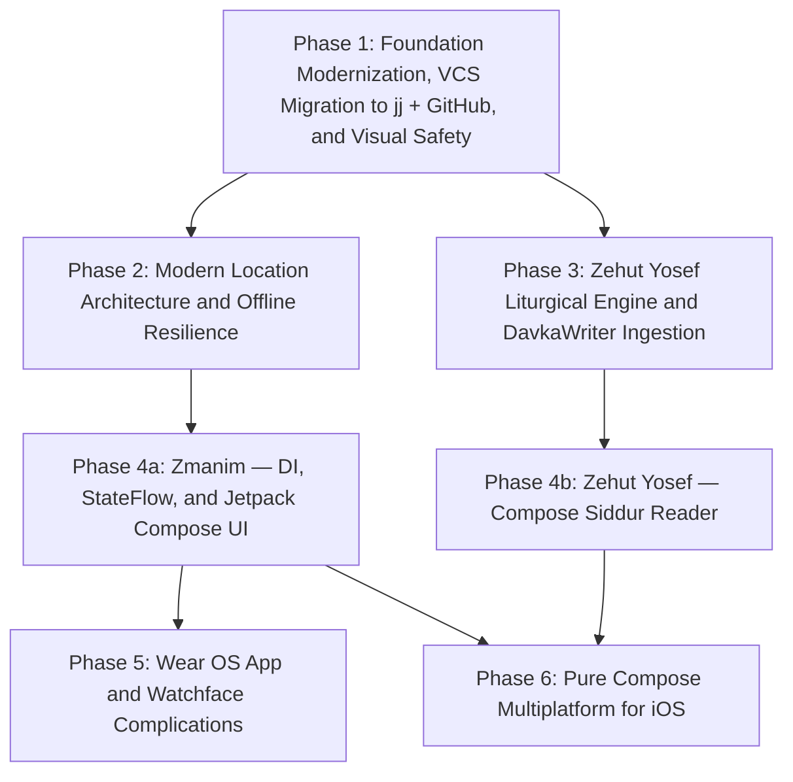
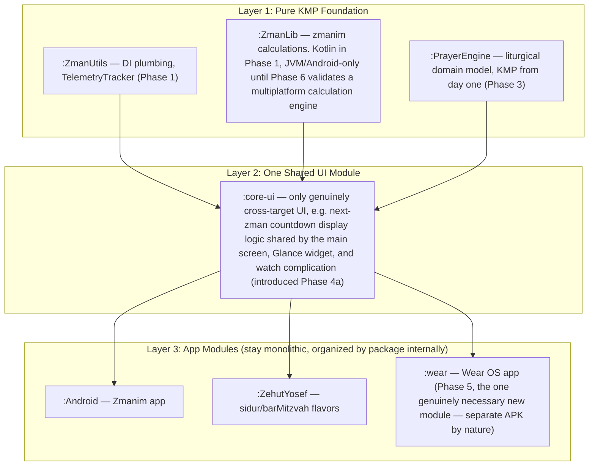
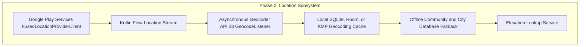
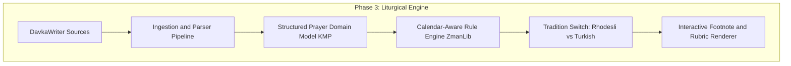
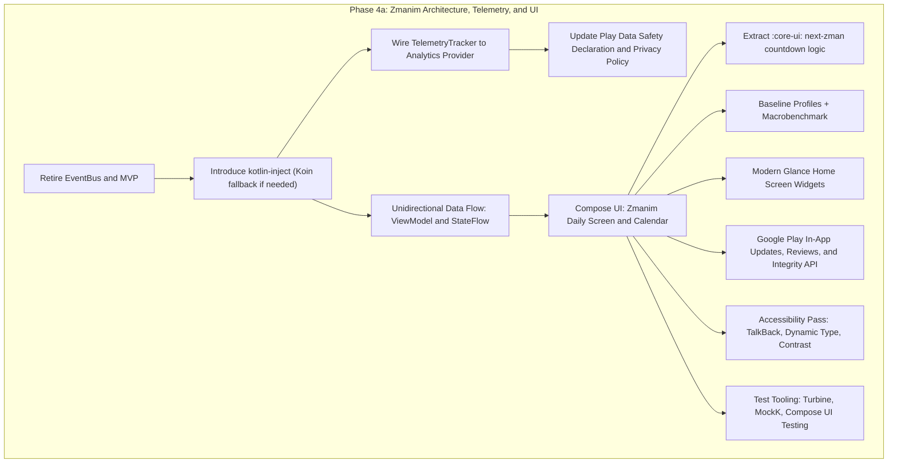
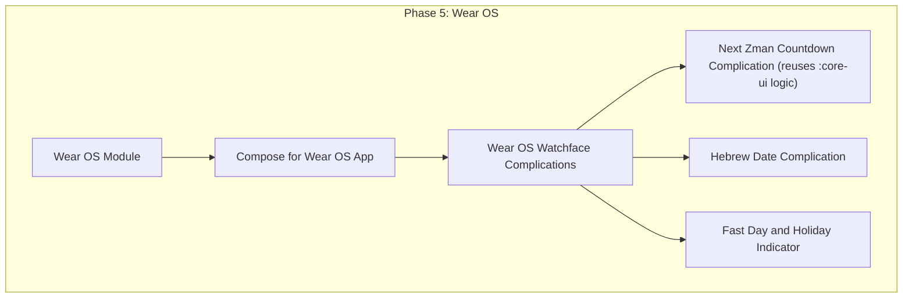
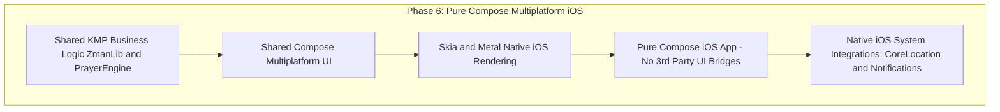

# Master Architectural Roadmap: Zmanim & Zehut Yosef

**Author:** Jay R. Gindin & Antigravity
**Date:** 2026-09-13 (Revised 2026-09-14 twice and 2026-09-16 — see Revision Notes)
**Status:** Approved Architectural Blueprint
**Platforms:** Android (Mobile & Tablet), Wear OS, iOS (Compose Multiplatform), Desktop

---

## 0. Revision Notes

**2026-09-14 (first pass)** — feasibility/sequencing review of Phase 1:
- Split Phase 4 into independent 4a (Zmanim) / 4b (Zehut Yosef) tracks so Zmanim's modernization isn't gated on the much larger, less-scoped Phase 3.
- `:Android`/`:ZehutYosef` stay Java through Phase 1–3, with Kotlin interop enabled early (Phase 1 Task 7) and full conversion deferred to Phase 4a/4b, screen-by-screen alongside each Compose rewrite.
- Added VCS hosting move to GitHub, with a CI task immediately after it.
- Added privacy/compliance and accessibility as explicit line items rather than implicit assumptions.
- Added rough effort sizing per phase.

**2026-09-14 (second pass)** — Kotlin/Android/KMP/Play Store best-practices review, plus tooling confirmation:
- **Compliance-critical fix:** Google Play requires targeting API 36 (Android 16) as of August 31, 2026, not API 35 — Phase 1's SDK-alignment task now targets 24/36. (There is a grace extension to November 1, 2026 if needed; check Play Console independently of this roadmap's timeline.)
- Build scripts convert to Kotlin DSL (`.gradle.kts`) and adopt a Gradle version catalog (`gradle/libs.versions.toml`) early in Phase 1 — done once, before the JUnit5/SDK/KMP tasks touch those files further, rather than editing Groovy repeatedly and converting later.
- Added `detekt` + `ktlint` to CI, explicit API mode on the pure library modules, `kotlinx.serialization`/`kotlinx-datetime` replacing the last `org.json`/JVM-date usage in shared code (JVM-only APIs don't compile for the iOS target Phase 6 adds).
- Finalized the DI choice: **kotlin-inject primary, Koin as the documented fallback** if kotlin-inject's KSP setup proves painful once Phase 4a starts — see rationale under Principle 2.
- Adopted a target module graph (Section 2a): a three-layer structure (KMP foundation / one shared `:core-ui` module / monolithic app modules), explicitly not a feature-module-per-screen split — sized for a solo maintainer and each app's modest screen count.
- Surfaced a real, previously-unbudgeted Phase 6 risk: `:ZmanLib`'s calculation engine (`kosherjava`) is JVM-only. A community Kotlin Multiplatform port exists (**KosherKotlin**) but is not a drop-in replacement. See Phase 6.1 and the risk table in Section 4.
- Added Baseline Profiles + Macrobenchmark and modern test tooling (Turbine, MockK, Compose UI testing) to Phase 4a/4b's scope.
- Added the 16 KB page size Play compliance deadline (February 1, 2027) as a release-readiness checkpoint, and a note to avoid `firebase-crashlytics-ndk` unless there's a specific reason to need it, since this app currently has zero native (`.so`) dependencies and should stay that way by default.
- Added Play Integrity API and staged-rollout/pre-launch-report usage to the Play Store delivery principle.

**2026-09-16** — sync with the Phase 1 design spec and implementation plan, which had drifted several revisions ahead of this document without it being updated. Phase 1 is now **12 tasks**, not 11: Task 8 gained a secrets audit/scrub gate, a repo-visibility decision (public), and a `LICENSE` addition (pending confirmation given the repo's existing `LICENSE.md`); Task 9 gained Gradle Wrapper Validation, Dependabot, and branch protection; Task 11 gained a migration to Google Play App Signing; a new **Task 12** authors a repo-root `AGENTS.md`. Also corrected here: Task 1's "191/191" test claim and its file list were never independently verified against the live repository — an adversarial pass found 4 of the original 8 listed files contain none of the fixture string the task is built around removing; see the implementation plan's Task 1 for the corrected, grep-verified file list. This document should be treated as the durable cross-phase reference; when the Phase 1 plan/spec change materially, update this section too rather than letting it drift, since Phase 1's own Task 12 (`AGENTS.md`) points future agents here for orientation.

---

## 1. Vision & Architectural Principles

The goal of this initiative is to modernize the **Zmanim** and **Zehut Yosef** codebases into a premier, unified, multiplatform Jewish calendar and Sephardic liturgical suite.

The application architecture is governed by eight core principles:

1. **100% Idiomatic Kotlin & Kotlin Multiplatform (KMP):** Pure business logic, calendar calculations, and liturgical text processing will reside in platform-agnostic KMP modules shared across Android, Wear OS, and iOS — see Section 2a for the target module graph. App-module UI code (`:Android`, `:ZehutYosef`) converts to Kotlin incrementally, screen-by-screen, as it is rewritten in Compose in Phase 4a/4b. `:ZmanLib` converts to idiomatic Kotlin in Phase 1 (low-risk, test-netted) but stays JVM/Android-only until Phase 6 validates a path to true multiplatform — see Phase 6.1. All Gradle build scripts are Kotlin DSL (`.gradle.kts`) with dependency versions centralized in a version catalog (`gradle/libs.versions.toml`), established in Phase 1 Task 4.
2. **Elimination of Legacy Event Bus & Adoption of Modern DI:** The bespoke `EventBus` and legacy MVP patterns are retired in favor of Unidirectional Data Flow (UDF) with Kotlin `StateFlow` and compile-time, KMP-compatible Dependency Injection. **`kotlin-inject` is the primary choice** — pure compile-time KSP codegen, zero reflection, and it's the better fit given real Wear OS and iOS targets where compile-time safety and no runtime resolution overhead matter more than on an Android-only app. **Koin is the documented fallback** if kotlin-inject's KSP setup proves painful once Phase 4a starts — a pre-agreed pivot, not a mid-phase debate. Phase 1's Kotlin port of `EventBus`/MVP (Task 7) is an explicit, intentionally minimal stepping stone needed to make `:ZmanUtils` a real KMP module — it is not final architecture, and Phase 4a deletes it.
3. **Safety-First, Evidence-Driven Evolution:** UI and architectural changes are guarded by Roborazzi screen snapshot testing running on the host JVM, backstopped by targeted real-device/emulator instrumented checks for changes gated by actual OS behavior, and by `detekt`/`ktlint` static analysis enforced in CI. Zero visual regressions are permitted against recorded golden baselines; zero behavioral regressions are permitted against the targeted instrumented checks; zero new static-analysis violations are permitted once the baseline is established.
4. **Faithful Sephardic Liturgical Preservation (Zehut Yosef):** The prayer engine faithfully preserves the **Zehut Yosef** text (ingested from DavkaWriter sources), including vocalization (nikud), cantillation (teamim), footnotes, and dynamic halachic custom switching between the **Rhodesli** and **Turkish** traditions.
5. **Declarative UI via Compose Everywhere:** The user experience is built entirely with Jetpack Compose on Android, Compose for Wear OS, and Compose Multiplatform for iOS, minimizing platform-specific UI code. Accessibility (screen reader support, dynamic type / system font scaling, color-contrast-safe themes) is a first-class requirement of every Compose screen. Startup performance is guarded with Baseline Profiles and Macrobenchmark from the first Compose screen onward (Phase 4a), not bolted on later.
6. **Modern Google Play Store Delivery:** Full adoption of Android App Bundles (`.aab`), the Play In-App Updates API, the In-App Review API, the Play Integrity API for basic tamper/abuse detection, and automated track deployment via Gradle Play Publisher, released through staged rollouts with Play Console's pre-launch reports rather than 100%-immediate publishing.
7. **Privacy-Respecting Telemetry & Insights:** Comprehensive visibility into real-world user configurations (zmanim selections, prayer engagement, session durations, tradition choices) through a decoupled KMP telemetry abstraction with user opt-out control. Before any concrete telemetry implementation ships (Phase 4a.2), update the Play Store Data Safety declaration and the published privacy policy to accurately describe what is collected.
8. **Continuous Verification:** From the point the repository moves to GitHub (Phase 1, Task 8) onward, every push and pull request automatically runs the full unit test suite, static analysis, and Roborazzi visual verification via CI (Task 9). A safety net that only runs when a human remembers to invoke it is not a safety net past the phase that built it.

---

## 2. High-Level Multi-Phase Architecture



Phase 4a and Phase 4b are independent tracks that can proceed in parallel, or in either order — neither is gated on the other. Phase 5 (Wear OS) depends only on Phase 4a. Phase 6 (iOS) depends on both, since it ports the full shared UI, and additionally depends on resolving the `:ZmanLib` multiplatform question flagged in Phase 6.1.

---

## 2a. Target Module Graph

Sized deliberately for a solo maintainer and each app's modest screen count (Zmanim: ~3–4 screens; Zehut Yosef: ~3–5 per flavor) — **not** a feature-module-per-screen split. Google's full modularization pattern earns its cost through parallel build/CI time on large teams; that benefit doesn't materialize here while the Gradle-wiring tax would. Revisit this decision only if either app's screen count roughly doubles, or build time becomes a measured (not hypothetical) pain point.



`:ZmanLib` currently depends on `com.kosherjava:zmanim` (JVM-only Java). Converting `:ZmanLib`'s own source to Kotlin (Phase 1) is independent of and lower-risk than making it truly multiplatform, which additionally requires replacing or wrapping that calculation engine — see Phase 6.1.

Gradle convention plugins (a `build-logic` module) are introduced alongside the Kotlin DSL conversion in Phase 1 Task 4, even at the current module count, since the work is already touching every build script and avoids repeating Java toolchain/lint/test boilerplate across what will be six-plus modules by Phase 5.

---

## 3. Detailed Phase Roadmap

### Phase 1: Foundation Modernization, VCS Migration to Jujutsu (`jj`) + GitHub, and Visual Safety Net

**Estimated effort:** 4–6 weeks solo (revised up slightly from the first pass to account for the Kotlin DSL/version-catalog conversion and expanded tooling). This is the largest source of near-term schedule risk in the entire roadmap despite being "just" cleanup.

**Objective:** Stabilize existing code and tests, capture untouched golden visual baselines, convert build scripts to Kotlin DSL with a version catalog, align SDKs to the current Play compliance target, introduce Kotlin Multiplatform, migrate version control to `jj` and hosting to GitHub, stand up CI with static analysis, modernize core libraries, prepare `.aab` bundles, and enable R8 minification.

```mermaid
flowchart LR
    T1["Task 1: ZmanLib Test Fixes"] --> T2["Task 2: ZehutYosef sidur Build Fix"]
    T2 --> T3["Task 3: Roborazzi Baseline Snapshots"]
    T3 --> T4["Task 4: Kotlin DSL + Version Catalog"]
    T4 --> T5["Task 5: JUnit 5 Upgrade"]
    T5 --> T6["Task 6: SDK 24/36 Alignment"]
    T6 --> T7["Task 7: KMP ZmanUtils, Kotlin ZmanLib, Telemetry, Serialization"]
    T7 --> T8["Task 8: Secrets Audit, Migrate hg to jj, Move Hosting to Public GitHub"]
    T8 --> T9["Task 9: CI on GitHub Actions incl. detekt/ktlint, Dependabot, Branch Protection"]
    T9 --> T10["Task 10: Library Modernization and Visual Parity (10.1-10.5)"]
    T10 --> T11["Task 11: Proguard, R8, Play App Signing, AAB Bundling, 16KB Page Size Check"]
    T11 --> T12["Task 12: Author AGENTS.md"]
```



- **Task 1: Stabilize `ZmanLib` Test Suite:** Realign table fixtures to match `kosherjava 2.5.0` output without the deprecated `GR'A Kol Eliyahu`. Confirmed by grep against the live repository: only `UT_ShemaTimes`, `UT_Zmanim`, `UT_ZmanimWithElevation`, and `UT_YomTovCandleLighting` actually contain the string — `UT_TalitTimes` and the `UT_WakeupScheduler_*` files, listed in earlier drafts, don't, and shouldn't be assumed to need the same fix without checking their actual failures first. See the implementation plan's Task 1 for the verified file list and diagnostic approach.
- **Task 2: Fix `ZehutYosef:sidur` Compilation:** Provide default fallback resources (`about_description_text`, base `EliPurple` style, neutral `header.xml`) in `ZehutYosef/src/main/res/` so both `sidur` and `barMitzvah` assemble cleanly.
- **Task 3: Establish Roborazzi Snapshot Safety Net (Untouched Baseline):** Integrate Roborazzi + Robolectric Native Graphics. Record untouched golden baseline PNGs of `ZmanimActivity`, `PersonalPreferences`, and `ZehutYosefActivity`. The reference photos are a human sanity check, not the automated comparison target — that's the recorded baseline itself.
- **Task 4: Convert Build Scripts to Kotlin DSL and Adopt a Version Catalog:** Convert every `build.gradle`/`settings.gradle` to `.gradle.kts`, extract all dependency coordinates into `gradle/libs.versions.toml`, and scaffold a `build-logic` module with convention plugins for shared Java/Kotlin toolchain and lint configuration. Done once, early, so every later Phase 1 task (JUnit5, SDK alignment, KMP setup, library modernization) edits Kotlin DSL directly instead of Groovy that gets converted later.
- **Task 5: Upgrade Test Suite to JUnit 5 (Jupiter):** Configure `useJUnitPlatform()` across all modules and migrate test annotations and assertions to JUnit 5.11+.
- **Task 6: Align Android SDK Baselines:** Set `minSdkVersion 24` and **`compileSdk`/`targetSdk` 36** (Android 16 — corrected from the original 35 target to match Google Play's compliance requirement effective August 31, 2026) across `:Android` and `:ZehutYosef`. Pull each app's current Android-version distribution from Play Console before changing `minSdkVersion`. Verify with Roborazzi, **and** separately smoke-test on one real device or emulator per SDK floor/ceiling (API 24, API 36) for edge-to-edge/system-bar behavior that Robolectric's simulated insets don't reliably catch.
- **Task 7: Configure Kotlin Multiplatform (KMP), Convert `:ZmanLib` to Kotlin, Drop Custom `Pair`, Adopt `kotlinx.serialization`/`kotlinx-datetime`, Enable Kotlin Interop in App Modules, and Add Telemetry Abstraction:**
  - Delete `com.gindin.util.Pair` in favor of standard `kotlin.Pair`.
  - Re-configure `:ZmanUtils` with `kotlin("multiplatform")` targeting JVM + Android; apply `explicitApiMode` to its public surface.
  - Convert `:ZmanLib`'s Java sources to idiomatic Kotlin (test-netted by the 191 tests from Task 1). It remains JVM/Android-only in this phase — becoming truly multiplatform depends on resolving the calculation-engine question in Phase 6.1, and is out of scope here. Apply `explicitApiMode` here too.
  - Replace the remaining `org.json` usage (3 files currently) with `kotlinx.serialization`, and any `java.util.Date`/`Calendar`-based shared code with `kotlinx-datetime` — both are JVM-only otherwise and won't compile for the iOS target Phase 6 adds.
  - Port `EventBus`, `Event`, `EventHandler`, `EventCacheControl`, and MVP contracts to idiomatic Kotlin — mechanically, since Phase 4a replaces this pattern outright.
  - Define the vendor-neutral `TelemetryTracker` interface in `commonMain`.
  - Apply the `kotlin-android` plugin to `:Android` and `:ZehutYosef` (interop enablement only — no Java file conversion yet).
- **Task 8: Migrate Version Control from Mercurial (`hg`) to Jujutsu (`jj`), and Move Hosting to Public GitHub:**
  - Push the current Mercurial tip to sr.ht (pre-migration source of truth; Bitbucket is stale and not used) as a checkpoint.
  - Audit the full Mercurial history for secrets before anything goes public — already run once (2026-09-16): the repo's actual signing keystore and a stray API-key file were confirmed *never* committed, but an older, already-lower-risk API key (a self-hosted ACRA reporting key, and a Flurry Analytics key for a service shut down in 2024) was found in history and gets scrubbed with `git-filter-repo`.
  - `fast-export` full history into Git, verify which branch it actually produced corresponds to the `zmanim-v4` bookmark's real commit (the Mercurial named branch is `default`, not `zmanim-v4` — this needs explicit verification, not an assumed match), initialize colocated `jj`, verify commit-count parity.
  - Confirm with Jay whether the repo's existing `LICENSE.md` (LGPL-2.1) is being deliberately replaced by a new Apache-2.0 `LICENSE`, since that's a real relicensing decision, not a mechanical file-add.
  - Push to **https://github.com/jgindin/zmanim** as the canonical host, **public** (check whether it exists before creating it).
- **Task 9: Establish CI on GitHub Actions:** Run `./gradlew test verifyRoborazziDebug` plus `detekt`/`ktlint` on every push/PR, plus Gradle Wrapper Validation (supply-chain protection now that the repo is public) and an instrumented-emulator smoke job (API 24 and API 36) — fully automated on GitHub-hosted runners, no manual step once this task lands. Adds `dependabot.yml` for the Gradle version catalog and GitHub Actions, and branch protection requiring the CI check to pass before merge.
- **Task 10: Comprehensive Library Modernization & Visual Parity (sub-tasks 10.1–10.5, each independently committed and verified):** retire legacy Xpece AARs and migrate to `androidx.preference`; upgrade Material/ConstraintLayout/AppCompat/Play Services Location; replace MikePenz MaterialDrawer with standard `DrawerLayout`/`NavigationView` (a real UI rewrite); replace Iconics with Vector Drawables; modernize `aboutlibraries`.
- **Task 11: Modernize Proguard / R8 Minification, Migrate to Play App Signing, and App Bundle Packaging:** Clean out obsolete pre-AndroidX Proguard rules, migrate release signing to Google Play App Signing so the keystore no longer needs to live in the repository, enable `minifyEnabled true`, verify `assembleRelease`/`bundleRelease`, and verify 16 KB memory page size compliance (Play deadline February 1, 2027 — this app has no native `.so` dependencies today; keep it that way by default, and specifically avoid `firebase-crashlytics-ndk` in Phase 4a.2 unless there's a concrete reason to need native crash symbolication).
- **Task 12: Author `AGENTS.md` for Agent-Directed Development:** written last, once Tasks 1–11 have actually produced the structure it describes — module map and per-module build/test commands, where static-analysis config lives, version-control conventions now that the repo is `jj`/public-GitHub, and how this roadmap, the Phase 1 design spec, and the implementation plan relate to each other for an agent picking up Phase 2.

---

### Phase 2: Modern Location Architecture & Offline Resilience

**Estimated effort:** 2–3 weeks.

**Objective:** Overhaul location acquisition and geocoding following the removal of MapQuest and Nominatim in commit 1356, providing fast, battery-efficient, asynchronous, and offline-capable location resolution.



- **2.1: Modern Coroutine-based Location Provider:**
  - Replace legacy location acquirers (`DynamicLocationAcquirer`, `StaticLocationAcquirer`) with a reactive repository backed by `FusedLocationProviderClient`.
  - Expose location updates as a cold Kotlin `Flow<ZmanimLocation>`.
  - Graceful modern Android 14/15/16 runtime permission handling (`ACCESS_FINE_LOCATION`, `ACCESS_COARSE_LOCATION`).
- **2.2: Asynchronous Geocoding Engine:**
  - Migrate from blocking `Geocoder.getFromLocation()` to Android 13+ asynchronous `GeocodeListener`.
  - Support non-blocking forward geocoding (e.g. typing "Seattle" or "98118") and reverse geocoding from GPS coordinates.
  - Implement a free, resilient HTTP fallback reverse-geocoder (e.g. OpenStreetMap Nominatim with compliant User-Agent and rate limiting, or GeoNames) when system `Geocoder.isPresent()` is false.
- **2.3: Persistent Geocoding Cache:**
  - Introduce a lightweight local database (Room / SQLDelight) caching geocoded coordinates $\leftrightarrow$ location names and timezones to avoid repeated network hits.
- **2.4: Offline City Database Fallback:**
  - Bundle a compact offline dataset of Jewish communities and major global cities with latitude, longitude, and elevation. If sourced from a third party (e.g. GeoNames), confirm its license permits bundling and satisfy any attribution requirement.
  - If device is completely offline and system geocoder fails, match coordinates to the nearest known community using haversine distance.
- **2.5: Elevation Service Overhaul:**
  - Ensure astronomical zmanim (especially sunrise/sunset with elevation adjustment) have reliable elevation data from GPS altitude, offline dataset, or elevation API with local caching.

---

### Phase 3: Zehut Yosef Liturgical Engine & DavkaWriter Ingestion

**Estimated effort:** 2–4+ months. This is the largest, least-scoped phase in the roadmap — treat early milestones (ingestion format understood, one full weekday Shacharit round-tripped end to end) as the real checkpoints, not the phase-level objective.

**Objective:** Transform the Siddur from static text files into a dynamic, halachically intelligent liturgical engine that faithfully represents the **Zehut Yosef** prayer book, handles footnotes, and supports both the **Rhodesli** and **Turkish** customs.



- **3.1: DavkaWriter Ingestion & Normalization Pipeline:**
  - Ingest raw texts for daily prayers, fast days, and holidays from DavkaWriter (`.dwd` / exported formatted texts).
  - Parse and extract Hebrew body text with full vocalization (nikud) and cantillation (teamim); rubrics and instructions; footnotes and annotations (preserve footnote numbers, original scholarly notes, and source citations).
  - Output normalized, versioned `kotlinx.serialization` data structures into `zehut-yosef-text`.
- **3.2: Structured Liturgical Domain Model (`:PrayerEngine` in KMP, `explicitApiMode` on from the start):**
  - Define structured domain entities:
    ```kotlin
    data class Prayer(val id: String, val title: String, val sections: List<PrayerSection>)
    data class PrayerSection(val id: String, val title: String, val blocks: List<PrayerBlock>)
    sealed interface PrayerBlock {
        data class Text(val hebrew: String, val footnotes: List<Footnote> = emptyList()) : PrayerBlock
        data class Rubric(val instruction: String) : PrayerBlock
        data class CongregationalResponse(val text: String) : PrayerBlock
        data class ConditionalBlock(val condition: PrayerCondition, val content: List<PrayerBlock>) : PrayerBlock
    }
    data class Footnote(val id: Int, val marker: String, val content: String)
    ```
- **3.3: Tradition Variant Switch (Rhodesli vs. Turkish):**
  - Add user preference in settings: **Rhodesli Tradition** (Customs of Rhodes and diaspora communities like Seattle's Ezra Bessaroth) and **Turkish Tradition** (Customs of Istanbul, Izmir, etc.).
  - Tag prayer blocks with liturgical variants where wording, order of piyyutim, or psalms diverge.
- **3.4: Calendar-Aware Dynamic Insertion Engine:**
  - Query `:ZmanLib` for the active Hebrew date, time of day, and holiday status.
  - Dynamically resolve seasonal Amidah/Birkat Hamazon blessings, holiday additions (Ya'aleh V'Yavo, Al HaNissim, Atah Chonantanu), Tachanun/Vidui logic, and fast-day/special-day insertions (Aneinu, Selichot, Avinu Malkeinu, Hallel full vs. half).
- **3.5: Full Liturgical Coverage:**
  - Shacharit, Mincha, Arvit, Musaf across weekday/Shabbat/Rosh Chodesh/festivals/fast days/Chol HaMoed; Birkat Hamazon, Meen Shalosh, Tefillat HaDerech, Bedtime Shema, Sefirat HaOmer with nightly counting formula and Harachaman.

---

### Phase 4a: Zmanim — Modern Architecture, Dependency Injection, Telemetry, and Jetpack Compose UI

**Depends on:** Phase 2 only. **Estimated effort:** 6–8 weeks (revised up slightly to include Baseline Profiles/Macrobenchmark and the `:core-ui` module).

**Objective:** Retire the legacy `EventBus` and MVP architecture, introduce `kotlin-inject`-based DI, implement telemetry and Play Store APIs, and build a modern, reactive Jetpack Compose interface for the Zmanim app. Convert `:Android`'s remaining Java sources to Kotlin as each screen is touched for its Compose rewrite. Introduce `:core-ui` (see Section 2a) for the specific pieces of UI logic genuinely shared across the phone screen, Glance widget, and (later) watch complication.



- **4a.1: Eliminate EventBus & Introduce `kotlin-inject`:**
  - Completely remove `com.gindin.eventBus.EventBus` (including the mechanical Kotlin port from Phase 1) from the codebase.
  - Implement DI with `kotlin-inject` (KSP, zero reflection, KMP-native). If setup friction becomes a real blocker, fall back to Koin — this is a pre-agreed pivot, not a mid-phase decision to relitigate.
  - Inject repositories, location providers, zmanim calculators, telemetry trackers, and preference stores. Adopt UDF with `ViewModel` and `StateFlow`/`SharedFlow`.
- **4a.2: Telemetry Implementation, User Insights, and Privacy Compliance:**
  - Implement `TelemetryTracker` using Firebase Analytics & Crashlytics (or TelemetryDeck). Use the JVM-only `firebase-crashlytics` artifact, not `firebase-crashlytics-ndk`, unless there's a specific reason to need native crash symbolication — this app has zero native dependencies today and the 16 KB page-size Play requirement (Task 11) only bites apps with native libraries.
  - **Metric Tracking:** session duration, zmanim configuration snapshot, notification lead times, liturgical engagement, tradition distribution.
  - **Privacy:** explicit opt-out toggle. Update the Play Store Data Safety section and published privacy policy before this ships — a compliance requirement, not a follow-up.
- **4a.3: Google Play Store In-App Experience:**
  - In-App Updates API, In-App Review API, and the **Play Integrity API** for basic tamper/abuse detection.
  - Release through staged rollouts using Play Console's pre-launch reports rather than 100%-immediate publishing.
- **4a.4: Jetpack Compose UI for Zmanim:**
  - Main Zmanim Screen, Hebrew & Secular Date Picker, Preferences Screen (Material 3). Convert each screen's backing Java Activity/Presenter to Kotlin as part of its own Compose rewrite.
  - Add Baseline Profiles + Macrobenchmark from the first Compose screen onward, and Compose UI testing (`createComposeRule`), `Turbine` (for `StateFlow`/`Flow` assertions), and `MockK` to the test suite.
- **4a.5: Accessibility Pass:** TalkBack/screen-reader labels on every Compose surface, respect for system font scaling, and a high-contrast theme option verified against WCAG contrast guidance.
- **4a.6: Modern Home Screen Widgets (Jetpack Glance):**
  - Glanceable next-zman countdowns and candle lighting times via WorkManager, reusing the `:core-ui` countdown logic rather than reimplementing it.

---

### Phase 4b: Zehut Yosef — Compose Siddur Reader

**Depends on:** Phase 3 only. **Estimated effort:** 4–6 weeks once Phase 3's domain model is stable.

**Objective:** Build a modern, reactive Jetpack Compose reader for the Zehut Yosef siddur atop the Phase 3 liturgical domain model. Convert `:ZehutYosef`'s remaining Java sources to Kotlin screen-by-screen, same rationale as Phase 4a. DI and test tooling follow the same choices as Phase 4a (`kotlin-inject`/Koin fallback; Turbine, MockK, Compose UI testing) for consistency across the two apps.

- **4b.1: Hebrew Layout Engine:** Exceptional right-to-left (RTL) typography with pixel-perfect vowel (nikud) alignment using bundled authentic Sephardic typefaces (`Shlomo.ttf`, `TaameyCLM`).
- **4b.2: Interactive Footnotes:** Subtle, non-intrusive superscript footnote indicators that open a bottom sheet or expand in-place upon tapping.
- **4b.3: Reading Customizations:** Font size slider, line-spacing controls, contrast themes (AMOLED Pure Black, Soft Sepia, Bright White), "Keep Screen On" mode during prayer.
- **4b.4: Navigation Drawer / Bottom Sheet:** Instant jump list to prayer milestones.
- **4b.5: Tradition Switch in Toolbar:** Instant visual indicator and toggle between Rhodesli and Turkish customs.
- **4b.6: Accessibility Pass:** screen-reader navigation through prayer structure (not just raw text), dynamic type support, and contrast-safe themes.

---

### Phase 5: Wear OS App & Watchface Complications

**Depends on:** Phase 4a. **Estimated effort:** 3–4 weeks.

**Objective:** Deliver a first-class smartwatch experience for Wear OS, putting essential zmanim and prayer reminders directly on the user's wrist. `:wear` is the one genuinely necessary new module in the target graph (Section 2a) — a separate APK by nature.



- **5.1: Standalone Wear OS Module (`:wear`):**
  - Built using **Compose for Wear OS** with Material Design for round and square watch displays.
  - Displays the immediate daily zmanim list optimized for quick rotary and swipe navigation.
  - Standalone location caching so watch functions even when disconnected from phone.
- **5.2: Watchface Complications (AndroidX Wear Watchface API):**
  - **Next Zman Complication:** the next impending zman with a progress ring showing elapsed time in the current halachic hour (Sha'ah Zmanit) — shares its core logic with the `:core-ui` module rather than a third independent implementation.
  - **Countdown Timer Complication:** minutes remaining until the next zman.
  - **Hebrew Date Complication:** today's Hebrew day and month.
  - **Holiday / Fast Day Indicator.**
  - **Low-Power Ambient Support.**

---

### Phase 6: Pure Compose Multiplatform for iOS

**Depends on:** Phase 4a and Phase 4b. **Estimated effort:** 3–4+ months (revised up from the first pass — see the `:ZmanLib` risk below, which is real, previously-unbudgeted scope).

**Objective:** Deliver an authentic, high-performance iOS application built purely in Compose Multiplatform (CMP), maximizing code reuse.



- **6.1: Full Kotlin Multiplatform Core — resolve the `:ZmanLib` calculation engine question first:**
  - `:ZmanUtils` and `:PrayerEngine` are already KMP by this point (Phase 1 and Phase 3 respectively). `:ZmanLib` is Kotlin but still JVM/Android-only, because its calculation engine, `com.kosherjava:zmanim`, is a JVM-only Java library with no first-party multiplatform build.
  - A community Kotlin Multiplatform port exists: **[KosherKotlin](https://github.com/Sternbach-Software/KosherKotlin)** (LGPL-2.1, same license family as kosherjava; targets Android/iOS/desktop/JS; actively maintained). It is **not** a drop-in replacement — its API is redesigned around Kotlin idioms (computed properties instead of Java getters), it isn't yet published to Maven Central, and its own test suite is still being ported from upstream.
  - **Before committing to Phase 6's timeline:** run a dedicated spike validating KosherKotlin's calculation output against `:ZmanLib`'s existing golden-fixture tests (the same discipline established in Phase 1 Task 1) for every zman this app actually surfaces. If parity holds, plan the `:ZmanLib` → KosherKotlin migration (including vendoring it, since it isn't on Maven Central yet) as the first task of Phase 6, not a background assumption. If parity doesn't hold for some calculations, the fallback is an `expect`/`actual` split — kosherjava on JVM/Android, a from-scratch or partial Swift/Kotlin-Native implementation for iOS — which is meaningfully more work and should reset the phase's effort estimate if it comes to that.
- **6.2: Pure Compose Multiplatform iOS UI:**
  - Build the iOS UI using Jetpack Compose Multiplatform rendered natively via Skia / Metal, reusing `:core-ui` where its logic applies.
  - Explicit VoiceOver validation pass before release — do not assume parity with the Android accessibility work from Phase 4a/4b carries over automatically.
- **6.3: Clean Native Platform Expectations (`expect`/`actual`):**
  - Location: Apple `CoreLocation`. Notifications: Apple `UserNotifications`. Telemetry: shared `TelemetryTracker` routing to Firebase iOS SDK or TelemetryDeck. Haptics & screen wake lock.

---

## 4. Phase Sequencing, Effort Sizing & Next Steps

| Phase | Depends on | Rough effort | Primary risk |
|---|---|---|---|
| 1 — Foundation, VCS, Tooling | — | 4–6 weeks | Tooling/process risk (VCS + build-system migration), not code risk |
| 2 — Location | 1 | 2–3 weeks | Low; well-trodden Android APIs |
| 3 — Liturgical Engine | 1 | 2–4+ months | High; DavkaWriter format and halachic rule coverage are open-ended |
| 4a — Zmanim Compose/DI | 2 | 6–8 weeks | Moderate; standard but broad UI rewrite |
| 4b — Zehut Yosef Compose | 3 | 4–6 weeks after 3 stabilizes | Moderate; depends on Phase 3's domain model being settled |
| 5 — Wear OS | 4a | 3–4 weeks | Low-moderate |
| 6 — iOS (CMP) | 4a, 4b | 3–4+ months | High; `:ZmanLib` multiplatform migration (KosherKotlin spike) plus CMP iOS accessibility/native-integration maturity |

This is a multi-quarter-to-multi-year program for a solo-maintained pair of apps, not a single connected sprint. It's worth periodically revisiting whether Phases 5 and 6 are committed goals or stretch items, rather than treating the full six-phase scope as fixed from the outset — particularly Phase 6, now that its real dependency on a non-drop-in third-party library port is explicit rather than assumed away.

With the complete roadmap established, execution begins with **Phase 1: Foundation Modernization, VCS Migration to `jj` + GitHub, and Visual Safety Net**.

The 12 tasks of Phase 1 are detailed in the accompanying [**implementation plan**](../plans/2026-09-07-foundation-modernization-and-jj-migration.md) and will be executed task-by-task using **subagent-driven-development**.
