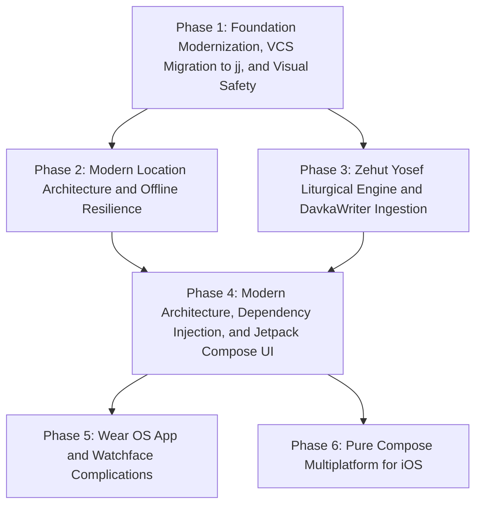
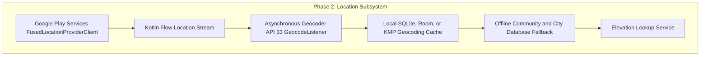
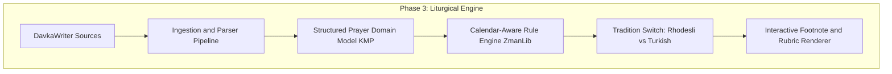
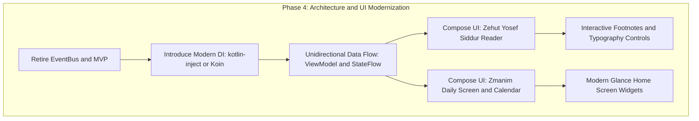
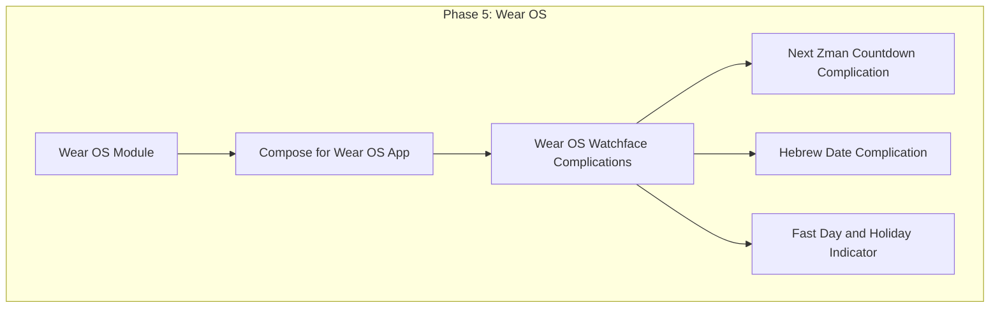
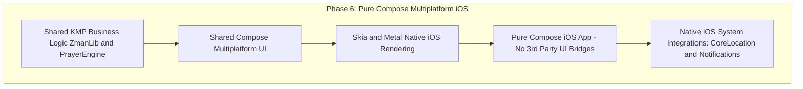

# Master Architectural Roadmap: Zmanim & Zehut Yosef

**Author:** Jay R. Gindin & Antigravity  
**Date:** 2026-09-13  
**Status:** Approved Architectural Blueprint  
**Platforms:** Android (Mobile & Tablet), Wear OS, iOS (Compose Multiplatform), Desktop  

---

## 1. Vision & Architectural Principles

The goal of this initiative is to modernize the **Zmanim** and **Zehut Yosef** codebases into a premier, unified, multiplatform Jewish calendar and Sephardic liturgical suite. 

The application architecture is governed by five non-negotiable principles:

1. **100% Idiomatic Kotlin & Kotlin Multiplatform (KMP):** Pure business logic, calendar calculations, and liturgical text processing will reside in platform-agnostic KMP modules shared across Android, Wear OS, and iOS.
2. **Elimination of Legacy Event Bus & Adoption of Modern DI:** The bespoke `EventBus` and legacy MVP patterns are retired in favor of Unidirectional Data Flow (UDF) with Kotlin `StateFlow` and compile-time, KMP-compatible Dependency Injection (`kotlin-inject` / `Koin`).
3. **Safety-First, Evidence-Driven Evolution:** UI and architectural changes are guarded by Roborazzi screen snapshot testing running on the host JVM. Zero visual regressions are permitted against recorded golden baselines.
4. **Faithful Sephardic Liturgical Preservation (Zehut Yosef):** The prayer engine faithfully preserves the **Zehut Yosef** text (ingested from DavkaWriter sources), including vocalization (nikud), cantillation (teamim), footnotes, and dynamic halachic custom switching between the **Rhodesli** and **Turkish** traditions.
5. **Declarative UI via Compose Everywhere:** The user experience is built entirely with Jetpack Compose on Android, Compose for Wear OS, and Compose Multiplatform for iOS, minimizing platform-specific UI code.

---

## 2. High-Level Multi-Phase Architecture



---

## 3. Detailed Phase Roadmap

### Phase 1: Foundation Modernization, VCS Migration to Jujutsu (`jj`), and Visual Safety Net

**Objective:** Stabilize existing code and tests, capture untouched golden visual baselines, align SDKs, introduce Kotlin Multiplatform, migrate version control to `jj`, modernize core libraries, and enable R8 minification.

```mermaid
flowchart LR
    T1["Task 1: ZmanLib Test Fixes"] --> T2["Task 2: ZehutYosef sidur Build Fix"]
    T2 --> T3["Task 3: Roborazzi Baseline Snapshots"]
    T3 --> T4["Task 4: JUnit 5 Upgrade"]
    T4 --> T5["Task 5: SDK 24 and 35 Alignment"]
    T5 --> T6["Task 6: KMP ZmanUtils and Drop Pair"]
    T6 --> T7["Task 7: Migration from hg to jj"]
    T7 --> T8["Task 8: Library Modernization and Visual Parity"]
    T8 --> T9["Task 9: Proguard and R8 Minification"]
```



- **Task 1: Stabilize `ZmanLib` Test Suite:** Realign table fixtures in `UT_ShemaTimes`, `UT_Zmanim`, `UT_WakeupScheduler_*`, and `UT_YomTovCandleLighting` to match `kosherjava 2.5.0` output without deprecated `GR'A Kol Eliyahu` (commit 1350). Achieve 191/191 green tests.
- **Task 2: Fix `ZehutYosef:sidur` Compilation:** Provide default fallback resources (`about_description_text`, base `EliPurple` style, neutral `header.xml`) in `ZehutYosef/src/main/res/` so both `sidur` and `barMitzvah` assemble cleanly.
- **Task 3: Establish Roborazzi Snapshot Safety Net (Untouched Baseline):** Integrate Roborazzi + Robolectric Native Graphics in `./gradlew testDebugUnitTest`. Record untouched golden baseline PNGs of `ZmanimActivity`, `PersonalPreferences`, and `ZehutYosefActivity` matching the reference screenshots (`zmanim.png`, `preferences.png`, `location.png`, `barmitzvah.png`).
- **Task 4: Upgrade Test Suite to JUnit 5 (Jupiter):** Configure `useJUnitPlatform()` across all modules and migrate test annotations and assertions to JUnit 5.11+.
- **Task 5: Align Android SDK Baselines:** Set `minSdkVersion 24` and `compileSdk 35` across `:Android` and `:ZehutYosef`. Verify with Roborazzi that zero visual regressions occur.
- **Task 6: Configure Kotlin Multiplatform (KMP), Drop Custom `Pair`, and Migrate `:ZmanUtils`:**
  - Delete `com.gindin.util.Pair` in favor of standard `kotlin.Pair`.
  - Re-configure `:ZmanUtils` with `kotlin("multiplatform")` targeting JVM + Android.
  - Port `EventBus`, `Event`, `EventHandler`, `EventCacheControl`, and MVP contracts to idiomatic Kotlin.
  - Rewrite `UT_EventBus` as an idiomatic Kotlin test suite on JUnit 5.
- **Task 7: Migrate Version Control from Mercurial (`hg`) to Jujutsu (`jj`):**
  - Stream full 1356+ changeset history into Git via `fast-export`.
  - Initialize colocated Jujutsu repository (`jj git init --colocated`).
  - Convert `.hgignore` to `.gitignore` and archive `.hg/`.
- **Task 8: Comprehensive Library Modernization & Visual Parity:**
  - Delete legacy AARs (`support-preference-1.3.1.*`, `support-spinner-1.3.1.*`).
  - Migrate preference XMLs to standard `androidx.preference.*`.
  - Upgrade Material (1.0 ➔ 1.12), ConstraintLayout (1.1 ➔ 2.2), AppCompat (1.6 ➔ 1.7), Location (21.0 ➔ 21.3).
  - Replace `com.mikepenz:materialdrawer` with standard AndroidX `DrawerLayout` + `NavigationView`.
  - Replace `com.mikepenz:iconics-core` with standard Vector Drawables.
  - Verify 100% visual parity against Task 3 golden baselines via `./gradlew verifyRoborazziDebug`.
- **Task 9: Modernize & Enable Proguard / R8 Minification:** Clean out obsolete pre-AndroidX Proguard rules, configure modern rules in `proguard-rules.pro`, enable `minifyEnabled true`, and verify release APK assembly (`./gradlew assembleRelease`).

---

### Phase 2: Modern Location Architecture & Offline Resilience

**Objective:** Overhaul location acquisition and geocoding following the removal of MapQuest and Nominatim in commit 1356, providing fast, battery-efficient, asynchronous, and offline-capable location resolution.



- **2.1: Modern Coroutine-based Location Provider:**
  - Replace legacy location acquirers (`DynamicLocationAcquirer`, `StaticLocationAcquirer`) with a reactive repository backed by `FusedLocationProviderClient`.
  - Expose location updates as a cold Kotlin `Flow<ZmanimLocation>`.
  - Graceful modern Android 14/15 runtime permission handling (`ACCESS_FINE_LOCATION`, `ACCESS_COARSE_LOCATION`).
- **2.2: Asynchronous Geocoding Engine:**
  - Migrate from blocking `Geocoder.getFromLocation()` to Android 13+ asynchronous `GeocodeListener`.
  - Support non-blocking forward geocoding (e.g. typing "Seattle" or "98118") and reverse geocoding from GPS coordinates.
  - Implement a free, resilient HTTP fallback reverse-geocoder (e.g. OpenStreetMap Nominatim with compliant User-Agent and rate limiting, or GeoNames) when system `Geocoder.isPresent()` is false.
- **2.3: Persistent Geocoding Cache:**
  - Introduce a lightweight local database (Room / SQLDelight) caching geocoded coordinates $\leftrightarrow$ location names and timezones to avoid repeated network hits.
- **2.4: Offline City Database Fallback:**
  - Bundle a compact offline dataset of Jewish communities and major global cities with latitude, longitude, and elevation.
  - If device is completely offline and system geocoder fails, match coordinates to the nearest known community using haversine distance.
- **2.5: Elevation Service Overhaul:**
  - Ensure astronomical zmanim (especially sunrise/sunset with elevation adjustment) have reliable elevation data from GPS altitude, offline dataset, or elevation API with local caching.

---

### Phase 3: Zehut Yosef Liturgical Engine & DavkaWriter Ingestion

**Objective:** Transform the Siddur from static text files into a dynamic, halachically intelligent liturgical engine that faithfully represents the **Zehut Yosef** prayer book, handles footnotes, and supports both the **Rhodesli** and **Turkish** customs.



- **3.1: DavkaWriter Ingestion & Normalization Pipeline:**
  - Ingest raw texts for daily prayers, fast days, and holidays from DavkaWriter (`.dwd` / exported formatted texts).
  - Parse and extract:
    - Hebrew body text with full vocalization (nikud) and cantillation (teamim).
    - Rubrics and instructions (halachic directions, e.g. "say quietly", "stand for Amidah").
    - Footnotes and annotations: preserve footnote numbers, original scholarly notes, and source citations.
  - Output normalized, versioned JSON or Kotlin serialization data structures into `zehut-yosef-text`.
- **3.2: Structured Liturgical Domain Model (`:PrayerEngine` in KMP):**
  - Define structured domain entities:
    ```kotlin
    data class Prayer(val id: String, val title: String, val sections: List<PrayerSection>)
    data class PrayerSection(val id: String, val title: String, val blocks: List<PrayerBlock>)
    sealed interface PrayerBlock {
        data class Text(val hebrew: String, val footnotes: List<Footnote> = emptyList()) : PrayerBlock
        data class Rubric(val instruction: String) : PrayerBlock
        data class CongregationalResponse(val text: String) : PrayerBlock
        data class ConditionalBlock(val condition: PrayerCondition, val content: List<PrayerBlock>) : PrayerBlock
    }
    data class Footnote(val id: Int, val marker: String, val content: String)
    ```
- **3.3: Tradition Variant Switch (Rhodesli vs. Turkish):**
  - Add user preference in settings:
    - **Rhodesli Tradition** (Customs of Rhodes and diaspora communities like Seattle's Ezra Bessaroth).
    - **Turkish Tradition** (Customs of Istanbul, Izmir, etc.).
  - Tag prayer blocks with liturgical variants where wording, order of piyyutim, or psalms diverge.
- **3.4: Calendar-Aware Dynamic Insertion Engine:**
  - Query `:ZmanLib` for the active Hebrew date, time of day, and holiday status.
  - Dynamically resolve:
    - **Seasonal Amidah & Birkat Hamazon Blessings:** Automatically switch between *Barech Aleinu* (winter/rain) and *Barchenu* (summer), *Mashiv HaRuach* vs. *Morid HaTal*.
    - **Holiday Additions:** Automatically insert and visually highlight *Ya'aleh V'Yavo* (with specific holiday name), *Al HaNissim* (Chanukah / Purim), *Atah Chonantanu* on Motza'ei Shabbat.
    - **Tachanun Logic:** Accurately determine whether Tachanun / Vidui is recited or omitted (omitted on Rosh Chodesh, the entire month of Nisan, Lag BaOmer, fast day afternoons in certain customs, etc.).
    - **Fast Days & Special Days:** Insert *Aneinu*, *Selichot*, *Avinu Malkeinu*, and *Hallel* (full vs half).
- **3.5: Full Liturgical Coverage:**
  - Shacharit (Weekday, Shabbat, Rosh Chodesh, Fast Days, Chol HaMoed).
  - Mincha & Arvit (Weekday, Erev Shabbat, Motza'ei Shabbat).
  - Musaf (Shabbat, Rosh Chodesh, Festivals).
  - Full blessings: Birkat Hamazon, Meen Shalosh, Tefillat HaDerech, Bedtime Shema, Sefirat HaOmer with nightly counting formula and Harachaman.

---

### Phase 4: Modern Architecture, Dependency Injection & Jetpack Compose UI

**Objective:** Retire the legacy `EventBus` and MVP architecture, introduce modern Kotlin Dependency Injection, and build a modern, reactive Jetpack Compose interface for both Zmanim and Zehut Yosef.



- **4.1: Eliminate EventBus & Introduce Modern Kotlin Dependency Injection:**
  - Completely remove `com.gindin.eventBus.EventBus` from the codebase.
  - Implement a modern, Kotlin Multiplatform compatible DI framework:
    - **`kotlin-inject`** (preferred: pure compile-time KSP, zero reflection, 100% KMP compatible for Android and iOS) or **Koin**.
    - Inject repositories, location providers, zmanim calculators, and preference stores cleanly.
  - Adopt Unidirectional Data Flow (UDF) with Android `ViewModel` and `StateFlow` / `SharedFlow`.
- **4.2: Jetpack Compose UI for Zmanim:**
  - Build modern declarative Compose screens:
    - **Main Zmanim Screen:** Clean, high-contrast list of times, countdown timer to the next upcoming zman, circular or linear solar day progress indicator, and Shabbat/Yom Tov candle lighting badges.
    - **Hebrew & Secular Date Picker:** Seamless Compose date selection with Jewish calendar navigation.
    - **Preferences Screen:** Modern Compose settings with Material 3 components, replacing legacy preference XMLs.
- **4.3: Jetpack Compose Reader for Zehut Yosef Siddur:**
  - **Hebrew Layout Engine:** Exceptional right-to-left (RTL) typography with pixel-perfect vowel (nikud) alignment using bundled authentic Sephardic typefaces (`Shlomo.ttf`, `TaameyCLM`).
  - **Interactive Footnotes:** Subtle, non-intrusive superscript footnote indicators that open a bottom sheet or expand in-place upon tapping, preserving prayer concentration.
  - **Reading Customizations:** Font size slider, line-spacing controls, contrast themes (AMOLED Pure Black, Soft Sepia, Bright White), and "Keep Screen On" mode during prayer.
  - **Navigation Drawer / Bottom Sheet:** Instant jump list to prayer milestones (e.g. *Pesukei D'Zimra*, *Shema*, *Amidah*, *Tachanun*, *Torah Reading*, *Alenu*).
  - **Tradition Switch in Toolbar:** Instant visual indicator and toggle between Rhodesli and Turkish customs.
- **4.4: Modern Home Screen Widgets (Jetpack Glance):**
  - Implement modern Android widgets using Jetpack Glance (Compose for widgets).
  - Provide glanceable next-zman countdowns and candle lighting times with efficient background updates via WorkManager.

---

### Phase 5: Wear OS App & Watchface Complications

**Objective:** Deliver a first-class smartwatch experience for Wear OS, putting essential zmanim and prayer reminders directly on the user's wrist.



- **5.1: Standalone Wear OS Module (`:wear`):**
  - Built using **Compose for Wear OS** with Material Design for round and square watch displays.
  - Displays the immediate daily zmanim list optimized for quick rotary and swipe navigation.
  - Standalone location caching so watch functions even when disconnected from phone.
- **5.2: Watchface Complications (AndroidX Wear Watchface API):**
  - **Next Zman Complication (Short Text & Ranged Value):** Displays the next impending zman (e.g. "Shkia 7:18" or "Chatzot") with a progress ring showing elapsed time in the current halachic hour (Sha'ah Zmanit).
  - **Countdown Timer Complication:** Real-time minutes remaining until the next zman (e.g., "Tefila: 14m").
  - **Hebrew Date Complication:** Displays today's Hebrew day and month (e.g. "25 Elul").
  - **Holiday / Fast Day Indicator:** Highlights if today is Rosh Chodesh, a fast day, or a festival.
  - **Low-Power Ambient Support:** Efficient rendering that respects watch battery life.

---

### Phase 6: Pure Compose Multiplatform for iOS

**Objective:** Deliver an authentic, high-performance iOS application built purely in Compose Multiplatform (CMP), maximizing code reuse with zero unnecessary third-party bridge libraries.



- **6.1: Full Kotlin Multiplatform Core:**
  - `:ZmanUtils`, `:ZmanLib`, and `:PrayerEngine` are 100% KMP modules targeting Android, iOS (arm64, simulator), and Desktop.
  - All calendar calculations, astronomical algorithms, and liturgical assembly run identically on Android and iOS.
- **6.2: Pure Compose Multiplatform iOS UI:**
  - Build the iOS UI using Jetpack Compose Multiplatform rendered natively via Skia / Metal.
  - Zero requirement for third-party UI wrapping libraries or dual-coding in SwiftUI.
  - Native iOS feel: iOS navigation gestures, smooth scrolling physics, and system font scaling.
- **6.3: Clean Native Platform Expectations (`expect`/`actual`):**
  - Minimal native integration points for platform services:
    - Location: Apple `CoreLocation` provider feeding the shared KMP location flow.
    - Notifications: Apple `UserNotifications` framework for zmanim alerts.
    - Haptics & Screen wake lock.

---

## 4. Phase Sequencing & Next Steps

With the complete roadmap established, execution begins with **Phase 1: Foundation Modernization, VCS Migration to `jj`, and Visual Safety Net**.

The 9 tasks of Phase 1 are detailed in the accompanying [**implementation_plan.md**](file:///home/jgindin/.gemini/antigravity/brain/3029f58f-8ec9-47ff-b744-4943db9d9a61/implementation_plan.md) and will be executed task-by-task using **subagent-driven-development**.
